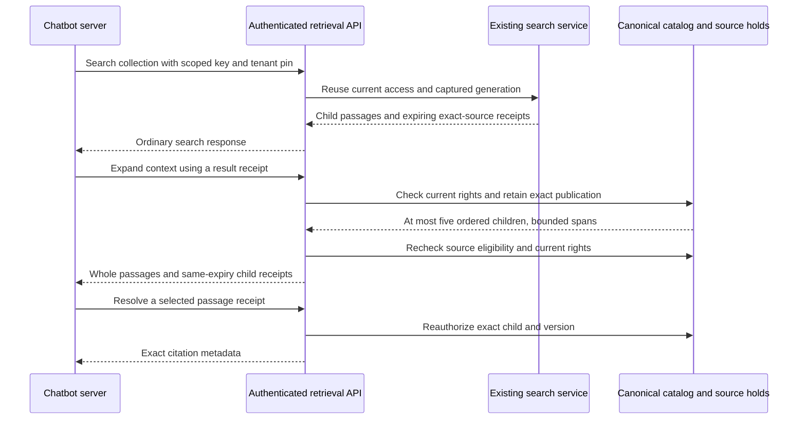

# Retrieval API for chatbot clients

Status: **implementation and acceptance in progress for compatible API revision
`1.24.0`**. This guide describes the contract being delivered; it is not a record
of completed native or dashboard validation. The [build log](build-task-log.md)
records the checks actually run.

The authenticated `retrieval` API supplies passages, exact citations and bounded
neighboring context to an external application. The calling application owns
answer generation and its language-model configuration. Existing dashboard search,
collection settings and document administration remain available.

## Authentication and preparation

Publish a readable collection using the normal indexing workflow. Create an
organization API key through the dashboard with these permissions:

```json
{
    "ragCollection": ["read"],
    "ragLibrary": ["read"]
}
```

Give it a collection scope with `read: true` and `manageDocuments: false` for each
collection it may search. Its issuer must still hold the corresponding current
organization permissions and member/group collection-read grant. The API checks
the current issuer, membership, organization activity, permissions and collection
scope; a stored key or receipt cannot preserve revoked access. Catalog management
alone does not grant content reading. See [API-key authorization](api-key-authorization.md).

Keep this key on the chatbot application's server. Send `x-api-key` and the
recommended `Vectorix-Expected-Organization-Id` header. The latter checks the
organization already bound to the authenticated key; it does not select or switch
organizations. A mismatch is refused. `x-organization-id` is not this header.

The curl examples below use client-shell variables, not new deployment settings:

```sh
export VECTORIX_API_ORIGIN='https://YOUR_API_HOST'
export VECTORIX_ORGANIZATION_ID='YOUR_ORGANIZATION_ID'
export VECTORIX_COLLECTION_ID='YOUR_COLLECTION_ID'
# Supply VECTORIX_API_KEY through your secret manager or private process environment.
```

Use HTTPS outside an explicitly local test instance. Disable shell tracing and
keep request/response files private, outside Git. Headers containing the key are
passed to curl on standard input rather than command arguments. These examples
send no cookies; the cookie-session CSRF marker is unnecessary for this API-key
flow. Do not attach a browser session to it.

## Search one collection

REST: `POST /api/v1/retrieval/collections/{collectionId}/search`.
Typed client: `client.retrieval.search(...)`.

Save the following JSON as a private `search.json` file:

```json
{
    "query": "Which insects make honey?",
    "strategy": "HYBRID",
    "topK": 5,
    "filters": {}
}
```

```sh
curl -q --fail-with-body --silent --show-error --max-time 65 \
  --url "${VECTORIX_API_ORIGIN}/api/v1/retrieval/collections/${VECTORIX_COLLECTION_ID}/search" \
  --request POST --header 'Content-Type: application/json' \
  --data-binary @search.json --config - <<EOF
header = "x-api-key: ${VECTORIX_API_KEY}"
header = "Vectorix-Expected-Organization-Id: ${VECTORIX_ORGANIZATION_ID}"
EOF
```

This reuses the existing ordinary-search input and output. Strategies are
`HYBRID`, `LEXICAL` and `VECTOR`; the default is Hybrid. `topK` is 1–50, default 10. Queries are trimmed, nonempty and limited to 4,000 UTF-16 code units; saved
embedding profiles also enforce their native input limits. Supported filters
include document IDs, languages, MIME types, tags, creation dates and declared
typed metadata. Filters apply to the captured publication before candidate limits.
The collection ID is supplied by the REST path; typed clients also pass it in the
input object.

Vector and Hybrid search use the collection's saved query-embedding provider and
can incur its normal work or charges. Lexical search does not embed the query.

The response contains `generationId`, `model`, `strategy`, `results`, underfill
indicators and `durationMs`. A result retains its child `id`, canonical text,
document/version/publication metadata, original scores, source spans and
`source: { receipt, expiresAt }`. Parent-enabled collections may additionally
return `parentContext`; the source receipt still identifies the matched child.
Scores express ranking, not answer confidence. Empty results are a valid outcome;
check them before selecting a receipt. A bounded-window underfill flag does not
establish that the entire collection has been exhausted.

`retrieval.search` follows ordinary ranking. An optional reranking profile does
not enable reranking for this operation; [explicit reranking](rag-reranking.md)
continues to use its separate operations and permission.

## Resolve an exact citation

REST: `POST /api/v1/retrieval/collections/{collectionId}/citations/resolve`.
Typed client: `client.retrieval.citation(...)`.

Take `source.receipt` from a returned search result or context passage. Save it
unchanged in a private `citation.json`, using a JSON serializer for actual values:

```json
{
    "receipt": "EXACT_RECEIPT_FROM_THE_RESPONSE"
}
```

```sh
curl -q --fail-with-body --silent --show-error --max-time 20 \
  --url "${VECTORIX_API_ORIGIN}/api/v1/retrieval/collections/${VECTORIX_COLLECTION_ID}/citations/resolve" \
  --request POST --header 'Content-Type: application/json' \
  --data-binary @citation.json --config - <<EOF
header = "x-api-key: ${VECTORIX_API_KEY}"
header = "Vectorix-Expected-Organization-Id: ${VECTORIX_ORGANIZATION_ID}"
EOF
```

The strict response contains `chunkId`, `generationId`, `publicationId`,
`documentId`, `documentName`, `version`, `ordinal`, nullable `startOffset` and
`endOffset`, up to 64 `sourceSpans`, `sourceSpansTruncated`, and `source` with the
same receipt/expiry. It resolves immutable indexed metadata rather than the
library's latest version. Offsets use canonical UTF-16 indices; page/paragraph
metadata comes from extraction, and is not invented when absent.

Treat receipts as opaque signed references. They expire 15 minutes after issue,
are not public permanent links, and never grant access on their own. Do not build
a citation from a raw chunk ID or decode the receipt into an application contract.
Resolving it does not refresh its expiry. A retained previous-generation receipt
can resolve its original version after a rebuild only while that exact source is
still eligible and the caller retains access. It never silently switches to the
latest version. Expired, malformed or unavailable references require a fresh
authorized retrieval; a new search may return different versions.

## Expand nearby child passages

REST: `POST /api/v1/retrieval/collections/{collectionId}/context`.
Typed client: `client.retrieval.context(...)`.

Save a private `context.json` with the anchor receipt:

```json
{
    "receipt": "EXACT_RECEIPT_FROM_THE_RESPONSE",
    "before": 1,
    "after": 1
}
```

```sh
curl -q --fail-with-body --silent --show-error --max-time 20 \
  --url "${VECTORIX_API_ORIGIN}/api/v1/retrieval/collections/${VECTORIX_COLLECTION_ID}/context" \
  --request POST --header 'Content-Type: application/json' \
  --data-binary @context.json --config - <<EOF
header = "x-api-key: ${VECTORIX_API_KEY}"
header = "Vectorix-Expected-Organization-Id: ${VECTORIX_ORGANIZATION_ID}"
EOF
```

`before` and `after` are whole numbers from 0 to 2, each defaulting to 1. The
response contains `anchorChunkId`, generation/document/version metadata, the
original anchor `source`, and 1–5 ordered `passages`. Each passage carries citation
metadata, its complete `text`, its own `source`, and `relation` equal to `BEFORE`,
`MATCH` or `AFTER`. All passages are searchable children from the same exact
publication and document version; parent rows are excluded. Document boundaries
can produce fewer neighbors.

The `MATCH` passage keeps the input receipt byte-for-byte. Neighbor receipts bind
their own chunk identity, with the original issue time and expiry; deriving them
does not renew the lifetime. Resolve a passage's own receipt when citing that
passage. The top-level receipt continues to identify the anchor.

Context returns whole passages, with no silent text truncation: at most 49,152
UTF-16 code units per passage and 245,760 across five. Source-span projection stays
bounded inside PostgreSQL to 64 entries per row, with an explicit truncation flag.
This flag describes provenance projection, not text trimming. Citation and context
use canonical application storage and do not call S3, the vector store or an
embedding provider.

Neighboring chunks can overlap. Preserve their source identities if you merge or
deduplicate text in your application. Search token counts remain estimates where
marked; neither passage count nor this character bound is an exact language-model
token budget. Choose a smaller expansion when needed and apply the receiving
model's tokenizer to the final prompt.



## Source viewing, errors and chatbot integration

Existing authenticated source operations accept these same receipts:

- `POST /api/v1/admin/rag/collections/{collectionId}/sources/preview`
- `POST /api/v1/admin/rag/collections/{collectionId}/sources/original`

Use `{"receipt":"...","offset":0}` for preview and `{"receipt":"..."}` for an
original. They preserve exact-version storage bindings and current authorization;
do not replace them with the library's latest-version download route. These file
operations can require S3 access even though citation/context do not. See
[exact-source retrieval](rag-first-search.md#retrieval-and-exact-sources).

Handle authentication/permission failures separately from unavailable sources.
`SOURCE_UNAVAILABLE` is a finite domain reason under `data.errorCode`; malformed,
expired or unavailable receipts share that refusal. Input validation rejects
out-of-range context windows. A wrong tenant pin, denied collection, revoked
issuer or missing read scope must not trigger an unscoped retry. Search keeps its
existing explicit provider/vector failure behavior; partial Hybrid results are
not presented as a complete success.
Respect HTTP 429 and its `Retry-After` delay; citation/context consume the shared
personal request budget, while search also uses provider admission where
applicable. See [API request limits](api-rate-limiting.md).

Retrieved document text is untrusted evidence. Keep it separate from system
instructions and tool authorization, escape it when rendering, and never execute
instructions embedded in a source. The calling chatbot is responsible for prompt
construction, model token budgeting, answer policy and displaying citations to
the exact passages used. This API supplies no language-model generation or chat
conversation storage.

## Implementation and acceptance

- Contract: [retrieval.ts](../packages/api-contracts/src/v1/retrieval.ts), reusing
  [ordinary search DTOs](../packages/api-contracts/src/v1/rag/search-contract.ts).
- [Router](../packages/routers/rag/src/retrieval/index.ts) composes the separate
  [search](../packages/routers/rag/src/services/retrieval/search.ts),
  [citation](../packages/routers/rag/src/services/retrieval/citation.ts) and
  [context](../packages/routers/rag/src/services/retrieval/context.ts) services.
- [Source leasing](../packages/routers/rag/src/services/indexing/source-lease.ts)
  and [projection](../packages/routers/rag/src/services/indexing/source-projection.ts)
  preserve cleanup fencing and bounded JSON hydration.
- [Receipt protocol](../packages/routers/rag/src/services/indexing/receipts.ts)
  preserves original lifetimes for derived neighbor references.
- [Organization pinning](../packages/routers/utils/src/expected-organization.ts)
  and [organization authorization](../packages/routers/utils/src/authorized.ts)
  remain shared with the existing API.

Expected acceptance: configure a least-privilege key from the dashboard, inspect
one published collection, search it through native HTTP, resolve a citation,
expand context and resolve each neighbor's receipt. Verify canonical order,
same publication/version/expiry, exact original bytes, denied foreign collection
and revoked scope/issuer, and retained old-generation behavior. Exercise the
delivered dashboard retrieval controls and their loading, error, empty and locale
states. Record automated, controlled-provider and real native/browser results
separately. Validation is pending while this slice is in progress.
