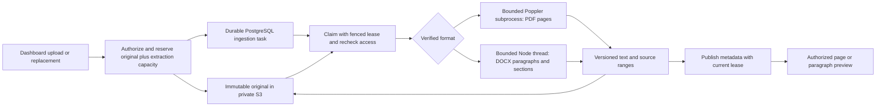

# PDF and DOCX library — M2b

M2b extends the existing document upload, replacement, extraction and authorized preview journey to text-based PDF and DOCX. The journey is implemented, independently reviewed and browser-verified against production builds and disposable infrastructure. This extraction milestone alone does not make a collection searchable. [M3](rag-first-search.md) subsequently delivered Ollama indexing and filtered search; [M4](rag-index-rebuild.md) adds profile changes and rebuilds with a separate acceptance record.

## Runtime and storage

API, web, workers, catalog PostgreSQL, Redis and private S3 storage are required. The existing organization-first credential resolution and saved per-version storage bindings still apply. No database migration is required beyond the existing ingestion/lifecycle migrations. The compatible API revision is `1.6.0`; the closed V1 task error enum is preserved and an optional `diagnostic` field adds precise parser failures.

Native PDF tools belong only to workers. Production workers install `poppler-utils` and `util-linux-misc` (for `prlimit`); a development Linux host needs `pdfinfo`, `pdftotext` and `prlimit` at `/usr/bin`. Debian/Ubuntu packages are `poppler-utils` and `util-linux`. DOCX uses pinned `yauzl` and `saxes` inside a separately bundled Node worker thread. API and frontend images contain neither these parser dependencies nor Poppler. The runtime parser smoke test uses the production bundle without a TypeScript loader.

Originals remain immutable private objects. TXT/Markdown retain `text.txt` and `utf8-text-v1`. PDF/DOCX write a deterministic `extraction.json` containing a versioned text/source artifact. Extraction metadata records `pdf-structured-v1` or `docx-structured-v1`. Full-text preview remains available for existing V1 consumers; the new authenticated source-preview endpoint returns one page or paragraph with at most 20,000 characters per request.

## Limits and failure behavior

The original upload limit remains 25 MiB by default. Each PDF/DOCX reserves an additional 10 MiB extraction budget before S3 I/O, since a compressed original may expand. Actual extracted text is limited to 8 MiB UTF-8 and the complete JSON artifact to 10 MiB. Publication charges actual artifact bytes. Failed attempts retain their reservation until retry or confirmed cleanup, and rich late writes restore the same bounded reservation. Cleanup deletes both possible legacy and structured extraction keys before releasing storage.

PDF has a 500-page limit and a 30-second total parser deadline. Each native child has a 512 MiB address-space limit, 20 CPU seconds, 64 file descriptors, bounded stdout and 32 KiB diagnostics. Files use a private temporary directory and mode `0600`; cleanup runs on success and failure. Child processes receive no inherited credentials. Encrypted, malformed or partially corrupt PDFs fail explicitly. A PDF with no usable text reports `PDF_OCR_UNAVAILABLE`; a mixed text/scanned document retains physical page positions and warns on each page without usable text. No OCR is performed.

The [narrow xref-reconstruction follow-up](rag-pdf-recovery.md) records the exact diagnostic exception, unchanged source geometry and additional acceptance status separately from the historical M2b results below. It does not establish arbitrary recoverable-warning support.

DOCX has a 30-second thread deadline, bounded V8 heap and explicit byte counters, at most 2,000 ZIP entries, 100 MiB declared decompressed package size, 8 MiB main XML, 16 MiB total read XML and 5,000 source paragraphs. ZIP names, duplicates, encryption, CRCs, XML namespaces, DTDs and relationship targets are validated. No relationship is fetched. Text extraction includes table paragraphs, headings, current section boundaries and referenced headers, footers, footnotes and endnotes. Extra document parts follow the body in deterministic order; `partIndex` identifies that extracted part, not a printed note number. Paragraph numbers are local to each part. Comments, note separators, deleted revisions and field instructions are excluded. External HTTP(S)/mailto hyperlinks retain inert display text; targets are neither fetched nor returned. DOCX never invents layout-dependent page numbers. Only current section/header/footer references and referenced normal note IDs contribute text. Orphan, historical and deleted references do not make their content visible, but unused ZIP parts still receive CRC validation. Missing, ambiguous or mismatched references fail explicitly. Unsupported package constructs fail explicitly instead of producing a misleading partial success.

Safe diagnostics distinguish invalid/encrypted content, resource limits, deadline and unavailable parser runtime. Raw native output, XML, storage URLs, paths and secrets are never exposed. An unavailable parser runtime remains retryable with bounded backoff; invalid input requires a corrected replacement. A failed replacement leaves the previous READY version published with its original preview and authorized download.

## Implementation entry points

- `packages/documents/src/index.ts`: shared artifact validation, bounds, reservations and compatible task mapping.
- `apps/workers/src/extraction/{main,pdf,subprocess,docx,docx-thread}.ts`: parser isolation and extraction; `apps/workers/vite.config.ts` bundles both thread and main parser entries beside shared chunks.
- `packages/routers/rag/src/services/documents/{upload,replace,retry,process,ingestion-state,retention,cleanup}.ts`: private transfer, accounting, fenced publication and cleanup.
- `packages/api-contracts/src/v1/rag/documents.ts`, `packages/routers/rag/src/documents/sourcePreview.ts` and `services/documents/read.ts`: compatible source DTOs and current content authorization before and after S3 reads.
- `apps/web/components/rag/documents/document-sources.tsx`: bounded source jump/navigation and text pagination, with localized errors and warnings. Existing dialogs support all four formats in English, French and Belgian Dutch.
- `tests/documents/`: reproducible real/adversarial parser fixtures and unit checks; `apps/api/src/rag-tests/document-rich.ts`: real HTTP, PostgreSQL and S3 journeys; `scripts/test-docker.sh`: bundled runtime parser checks.

## Dashboard acceptance recipe

Prerequisites: production builds, disposable PostgreSQL/Redis/private RustFS, a library manager, a collection reader and a second organization. Native PDF tools must be installed on the worker host; no application data is used.

1. Upload `tests/documents/fixtures/text-fr-en.pdf`, wait for READY, inspect both page labels and FR/EN text, navigate back and jump to a source. Download the unchanged original.
2. Upload `structure-fr-en.docx`, inspect section/paragraph/heading labels, table text and text pagination. Confirm that no PDF-style page number is invented.
3. Upload `mixed.pdf`, inspect the second physical page and its empty-text warning. Upload scanned, encrypted, malformed and oversized-package fixtures; verify localized safe failures and no false successful extraction.
4. Attach a rich document to a collection. Verify reader visibility without manager controls, direct-URL denial from another organization and immediate denial after grant removal.
5. Replace a published rich document with invalid input and verify that the previous source preview remains published. Then submit a valid replacement, verify version-aware preview state, delete it and observe durable cleanup and storage release.
6. Switch all three locales and reload. Inspect keyboard labels, bounded scrolling, loading/error states and the browser console.

## Validation status

Prisma validation, all 20 workspace type-check and 20 lint tasks, 22 backend regressions and all four application builds passed. Lint retains non-blocking complexity warnings. The parser suite passes 43 real-fixture/limit tests; an independent verifier regenerates and checks 37 binary fixture hashes. All 64 isolated core/RAG HTTP integration tests pass, including fresh/upgrade/repeat migrations and schema parity. Rich journeys cover exact source offsets, RPC/REST authorization, current grants and scoped keys, expansion quotas, safe diagnostics with legacy error compatibility, failed replacement/retry, JSON cleanup and delayed writes after deletion. No application database was used and no new migration was generated.

Independent review found and corrected inherited filename-property acceptance and extraction of orphaned DOCX stories/notes. The final reviewer separately passed seven active-reference regressions and found no remaining blocker. The earlier M2a.2 retirement race was corrected and reviewed before PR #5 was squash-merged.

Browser acceptance used standalone production web, API and workers with disposable PostgreSQL, Redis and private RustFS. The manager uploaded the real FR/EN PDF, navigated both pages and jumped between sources. Its downloaded original had the same SHA-256 as the fixture. A structured DOCX exposed seven paragraphs, heading labels and the actual second section; the corrected live-reference DOCX exposed nine current sources, including localized header and footnote labels. A synthetic 28,818-character single-paragraph DOCX exercised the 20,000-character boundary, next/previous segments and the exact final marker.

A scanned PDF replacement displayed the French OCR-unavailable diagnosis while the original version remained published. A subsequent mixed PDF published version 3 and retained the second physical page with an explicit no-text warning. The rich document was attached to a collection; a reader saw sources and original download without management controls. Revoking the grant denied the known document URL, as did the owner of a second organization. English, French and Belgian Dutch were exercised, including Belgian Dutch persistence after reload. The long DOCX was deleted through the dashboard. Its manager tombstone reached completed cleanup; Prisma confirmed a discarded original, removed extraction and zero reservation, and a real S3 listing confirmed no objects remained for that version. API tests cover the remaining hostile-file, quota and cleanup races; these are not claimed as browser actions in every locale.

A final fresh manager tab had no console warnings or errors. Temporary browser tabs, production test servers and disposable PostgreSQL/Redis/RustFS were stopped after verification.

The six-image production-runtime suite includes the actual built PDF/DOCX parser, scans/ZIP limits, API parser-dependency exclusion, standalone assets, durable worker scans, migrations, HNSW/DiskANN, vector roles and private S3 persistence. The final suite passed after the reviewed DOCX correction. No live embedding, vector indexing or retrieval is claimed by M2b.
