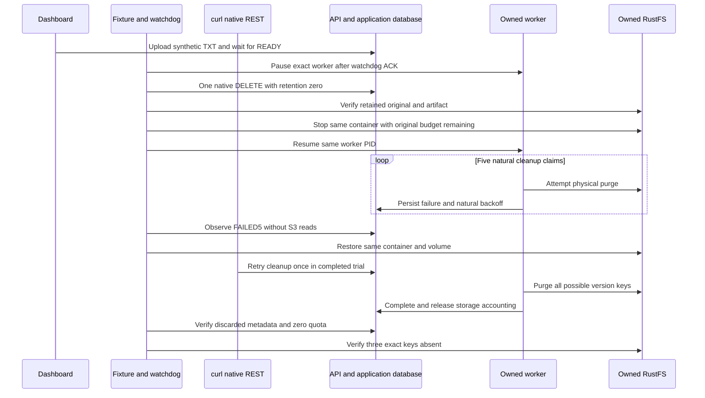

# S3 physical cleanup outage and dashboard retry

**Status: native cleanup recovery PASS; English dashboard failure/completion states verified.** Run `8070c4f9162b` exercised the native retry operation through curl, not a dashboard button click. All nine gates are restored to disabled bytes and owned resources are cleaned. This bounded M7c acceptance slice exercises existing native deletion, durable cleanup and the dashboard recovery interface. It adds no schema, migration, public DTO, API revision or product permission. The earlier [ingestion-outage result](rag-s3-outage-acceptance.md) remains historical protocol-1 evidence.

The reusable [harness and exact commands](../tests/acceptance/s3-outage/README.md) now use protocol 2 and require an explicit `INGESTION_V1` or `CLEANUP_V1` scenario on every command. Cleanup runs in a separate fresh namespace, with four new owned stores/volumes and exact `_test` databases. No state or receipt from the other scenario or the prior protocol is adopted. All nine execution gates are disabled again after the reviewed trial; a new run still requires separate review and deliberate activation. Checking out or importing these sources starts nothing.

## User journey and evidence

The original protocol starts with an ordinary owner uploading the tiny synthetic TXT through the production dashboard and waiting for READY. The completed trial performed that upload and its exact download before the user prohibited further browser transfers. **Future uploads/downloads must use a controlled, least-privilege organization API key and curl.** The current frozen cleanup fixture does not implement that new key/transfer setup; it must not be presented as delivered automation. Browser inspection of failure/completion states remains distinct from transfer and retry evidence. The read-only baseline requires no lease, reservation, source hold or index work. After the original watchdog acknowledges, only the exact worker is paused. A one-shot native HTTP fixture signs in independently, verifies the current owner/organization, deletes exactly that disposable document/version with retention zero, and signs out. **The browser never deletes a document.** No SQL business writes, task retiming, key, role, grant or credential action is part of the fixture.

The independent watchdog owns one original 900-second monotonic deadline, beginning before enrollment checks. At least 625 seconds must remain immediately before the native DELETE and again immediately before S3 stop, after durable receipt work and identity checks. That planning budget comprises five bounded I/O attempts, four natural 20/40/80/160-second backoffs totaling at least 300 seconds, and worker scans; it is not an SLA or native request count. No deadline is refreshed and no clock is advanced. A late refusal restores the enrolled resources and remains INCOMPLETE. Any watchdog intervention permanently prevents PASS even if later recovery succeeds.

The outage phase is DB-only: it proves the DELETED tombstones, content DELETING, unchanged saved storage binding, retained original/extraction charge, zero reservation and terminal FAILED/STORAGE_UNAVAILABLE after five durable destructive claims. It does **not** assert S3 readability or physical absence while the store is stopped. Cleanup's nonterminal retry lease deadline is null; ingestion's old FAILED/ACCESS_REVOKED row is historical cancellation, not runnable extraction. Missing a required backoff observation is INCOMPLETE.

Restoration must use the same container ID and volume. Before retry, both original and artifact must still match the frozen source. The dashboard exposes Deleted documents, the lifecycle manager and Retry cleanup. In the completed trial the browser inspected the failed and completed views, while curl invoked that same native retry operation once and the existing worker performed the purge. A browser Retry cleanup button click is not claimed. Completion requires cleanup COMPLETE, both discarded timestamps, version content PURGED, zero original/extraction/reservation charge, no source holds/index work, and exact HEAD 404 for `original`, `text.txt` and possible `extraction.json`. Document/version tombstones remain; this is physical-purge evidence, not database row deletion. Natural retry legitimately resets the attempt counter, so the pre-retry FAILED5 proof is preserved separately.

## Boundaries and validation

The controlled fixture permits five normal HTTP operations with bounded private intent/status receipts, redirects refused and finite body/deadline caps. It never replays a partial DELETE. Observers use bounded READ ONLY Repeatable Read transactions, select predicate counts instead of lease tokens and perform S3 I/O outside the transaction followed by an exact metadata reread. These are rechecked observations, not an atomic cross-store snapshot. Operational telemetry is supplemental; accounting comes from source/discard/reservation rows.

Private platform S3 points only to the new owned RustFS bucket. Original/artifact reads retain the existing 64 KiB/object, 256 KiB total, nine-command, 30-second total and five-second GET-body bounds. Final absence is limited to three generated keys for the exact saved version. The enumerated Prisma/tsx/AWS closure, build, helper and migration pins are checked before admission; this does not attest every OS library or bundled backend external dependency. No hosted provider, model, GPU, quality or capacity trial is involved.

Owned cleanup resumes a stopped identity-matching worker before graceful termination, stops the watchdog, and removes only exact recorded containers and volumes. It uses no SIGKILL and retains safe private evidence. Browser logout, tabs/downloads and bounded native SMTP capture are separately accounted for; zero mail is not assumed.

The first cohesive offline pass succeeds: 31 mocked Python tests, 25 pure/injected Node tests and eight Node syntax checks. Four Python AST checks also pass; documentation formatting, one Mermaid diagram, 53 local Markdown links and `git diff --check` pass. These were the initial preparation results, before independent review and native execution. The source inventory and historical provenance retain that checkpoint unchanged; offline tests alone do not establish an outage or resource teardown. The later reviewed trial is recorded separately below.

## Actual isolated trial — October 24, 2026

Fresh protocol-2 `CLEANUP_V1` run `8070c4f9162b`, at commit `d68d93714e4b22e66105e806307b545aad0aaa7d`, passes the single-document native cleanup-recovery slice. Its reviewed disabled source inventory is `61fcbc288bad2521e67b596dd9a8e4cafa32c171fb7d31cf2fc2055489052a8d`; activation changes only the nine gates. The completed private summary has SHA-256 `41d7fe5c68b0e6d1bb6837370d52cfba4e08058c63fa8ce902782ef181de1d35`, with six separately hashed read-only phase proofs. These results do not rewrite the older protocol-1 or protocol-2 preparation records.

The initial READY source is 522 bytes with a 522-byte plain-text extraction, charged together as 1,044 bytes and no reservation. The unique watchdog is enrolled at 15:16:45 UTC with its original 900-second deadline. After the controlled native DELETE and exact RustFS stop, 80 DB-only snapshots capture all five cleanup claim states, including the four natural 20/40/80/160-second backoff schedules and terminal `FAILED`/`STORAGE_UNAVAILABLE`. Those are destructive task claims, not a count of S3 wire requests. Storage remains charged at 1,044 bytes throughout the outage; no offline readability or physical-absence claim is made.

The exact same RustFS container/volume and worker identity are restored. The watchdog exits successfully without intervention. Before retry, independent S3 reads still match the original and extraction. A one-shot curl session recipe then receives four HTTP 200 responses: owner sign-in, active-organization selection, the native REST cleanup retry and sign-out. It creates no API key, uses no browser security mutation and removes its private request/response/cookie files afterward. This historical retry used the existing frozen owner-session fixture; it is not evidence of the future API-key transfer setup.

The complete proof requires cleanup `COMPLETE` after its reset attempt counter reaches one, retained document/version tombstones, discarded original/extraction metadata, no holds or index work, and charge/reservation both zero. Three exact HEAD checks confirm `original`, `text.txt` and the possible `extraction.json` key absent. Only two objects existed before purge; three absent keys must not be described as three deleted objects. The final signed-out proof preserves those results and records zero sessions.

English dashboard captures show “File cleanup stopped” with the retry control before recovery and “File cleanup complete” with released usage afterward. Console observation reports zero warnings/errors. The initial browser upload/download predates the transfer prohibition; none occurs afterward. No additional language, browser retry-click, provider, collection/hold or capacity result is claimed.

Teardown confirms four owned processes, four stores and volumes, the watchdog and owned tab gone. Lifecycle is disabled first during restoration; all 19 source files and the provenance bytes match their reviewed disabled archives, all nine gates are true, and the tracked tree is clean before these result notes. Safe evidence remains private. No new resource check or scenario is executed by the independent filesystem-only result review.

The earlier run `7e3c4660c0eb` remains **INCOMPLETE**: a browser download took approximately fourteen minutes after its one-shot READY proof, so watchdog enrollment refused stale evidence before any watchdog, pause or DELETE intent. Its resources were cleaned and its receipt is retained separately (SHA-256 `76c4c43c9a8270635a2fd752bd318463b3a2e0c863c68512f4deb8e70883ad89`). The successful trial uses a fresh run; it does not refresh or replay that stale proof. Publication and new exact-head CI remain pending.

## Current observer finalization guard

A follow-up helper patch, based on `2ccfd0f5db10722aa6e9afb4f695a6ede925ec2e`, closes the object reader and awaits Prisma disconnect before the final resource/watchdog/ACK recheck. Only then may the cleanup observer write its consumable `OBSERVED` proof and completed stdout receipt. A reader-close failure or final-guard refusal follows the incomplete path without publishing that success proof. The actual CLI and the injected tests use the same finalization function.

The focused offline runner passes 31 mocked Python tests, 28 pure/injected Node tests and eight Node syntax checks. Three new injected cases cover pending disconnect ordering, both reader-close failures and post-close guard refusal; independent source review is CLEAR. All nine gates remain disabled. No native scenario, build, provider or resource operation is rerun for this patch.

The [provenance](../tests/acceptance/s3-outage/provenance.json) records these two changed sources under the separate `cleanupFinalizationPatch` inventory. Its preceding protocol-1 history and protocol-2 preparation inventory remain unchanged. Run `8070c4f9162b` retains its original source hashes, successful CLI exit and independently verified close; it is historical native evidence, not a native retest of this guard patch.
