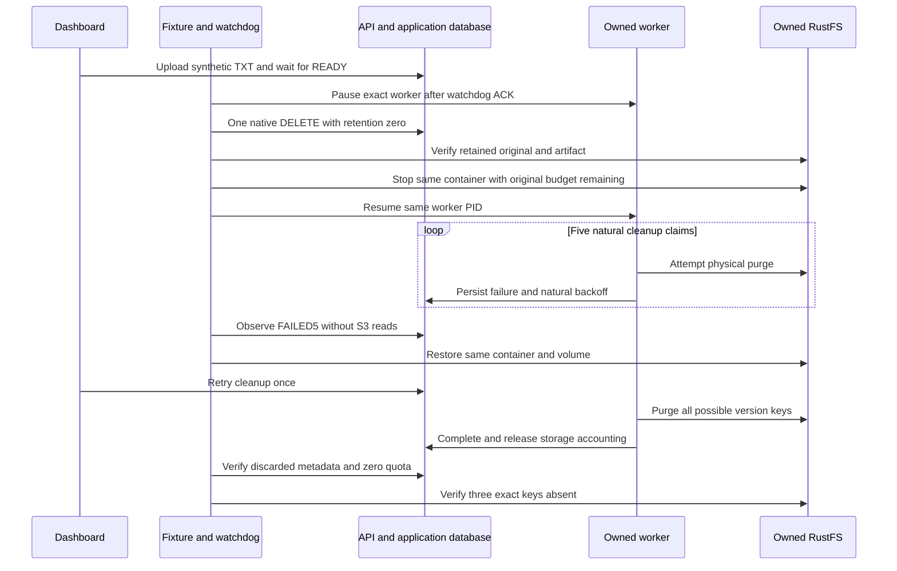

# S3 physical cleanup outage and dashboard retry

**Status: disabled acceptance tooling prepared; native outage, browser retry, final purge and cleanup NOT_RUN.** This is the next bounded M7c acceptance slice, exercising existing native deletion, durable cleanup and dashboard Retry cleanup. It adds no schema, migration, public DTO, API revision or product permission. The earlier [ingestion-outage result](rag-s3-outage-acceptance.md) remains historical protocol-1 evidence.

The reusable [harness and exact commands](../tests/acceptance/s3-outage/README.md) now use protocol 2 and require an explicit `INGESTION_V1` or `CLEANUP_V1` scenario on every command. Cleanup runs in a separate fresh namespace, with four new owned stores/volumes and exact `_test` databases. No state or receipt from the other scenario or the prior protocol is adopted. All nine execution gates are disabled until review and deliberate activation; checking out or importing these sources starts nothing.

## User journey and evidence

An ordinary owner uploads the tiny synthetic TXT through the production dashboard and waits for READY. The read-only baseline requires no lease, reservation, source hold or index work. After the original watchdog acknowledges, only the exact worker is paused. A one-shot native HTTP fixture signs in independently, verifies the current owner/organization, deletes exactly that disposable document/version with retention zero, and signs out. **The browser never deletes a document.** No SQL business writes, task retiming, key, role, grant or credential action is part of the fixture.

The independent watchdog owns one original 900-second monotonic deadline, beginning before enrollment checks. At least 625 seconds must remain immediately before the native DELETE and again immediately before S3 stop, after durable receipt work and identity checks. That planning budget comprises five bounded I/O attempts, four natural 20/40/80/160-second backoffs totaling at least 300 seconds, and worker scans; it is not an SLA or native request count. No deadline is refreshed and no clock is advanced. A late refusal restores the enrolled resources and remains INCOMPLETE. Any watchdog intervention permanently prevents PASS even if later recovery succeeds.

The outage phase is DB-only: it proves the DELETED tombstones, content DELETING, unchanged saved storage binding, retained original/extraction charge, zero reservation and terminal FAILED/STORAGE_UNAVAILABLE after five durable destructive claims. It does **not** assert S3 readability or physical absence while the store is stopped. Cleanup's nonterminal retry lease deadline is null; ingestion's old FAILED/ACCESS_REVOKED row is historical cancellation, not runnable extraction. Missing a required backoff observation is INCOMPLETE.

Restoration must use the same container ID and volume. Before the dashboard retry, both original and artifact must still match the frozen source. The browser then opens Deleted documents and the lifecycle manager, clicks Retry cleanup once, and waits for the actual worker. Completion requires cleanup COMPLETE, both discarded timestamps, version content PURGED, zero original/extraction/reservation charge, no source holds/index work, and exact HEAD 404 for `original`, `text.txt` and possible `extraction.json`. Document/version tombstones remain; this is physical-purge evidence, not database row deletion. Natural retry legitimately resets the attempt counter, so the pre-retry FAILED5 proof is preserved separately.

## Boundaries and validation

The controlled fixture permits five normal HTTP operations with bounded private intent/status receipts, redirects refused and finite body/deadline caps. It never replays a partial DELETE. Observers use bounded READ ONLY Repeatable Read transactions, select predicate counts instead of lease tokens and perform S3 I/O outside the transaction followed by an exact metadata reread. These are rechecked observations, not an atomic cross-store snapshot. Operational telemetry is supplemental; accounting comes from source/discard/reservation rows.

Private platform S3 points only to the new owned RustFS bucket. Original/artifact reads retain the existing 64 KiB/object, 256 KiB total, nine-command, 30-second total and five-second GET-body bounds. Final absence is limited to three generated keys for the exact saved version. The enumerated Prisma/tsx/AWS closure, build, helper and migration pins are checked before admission; this does not attest every OS library or bundled backend external dependency. No hosted provider, model, GPU, quality or capacity trial is involved.

Owned cleanup resumes a stopped identity-matching worker before graceful termination, stops the watchdog, and removes only exact recorded containers and volumes. It uses no SIGKILL and retains safe private evidence. Browser logout, tabs/downloads and bounded native SMTP capture are separately accounted for; zero mail is not assumed.

The first cohesive offline pass succeeds: 31 mocked Python tests, 25 pure/injected Node tests and eight Node syntax checks. Four Python AST checks also pass; documentation formatting, one Mermaid diagram, 53 local Markdown links and `git diff --check` pass. Independent source review is pending. The current source inventory records these results separately from historical native evidence. They cannot establish a successful native outage, browser retry, storage release or resource teardown. Those results remain **NOT_RUN** until a fresh approved trial is completed and reviewed.
