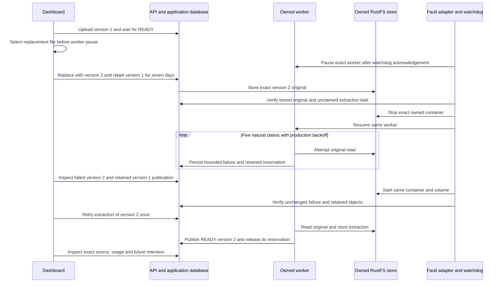

# S3 ingestion outage and dashboard recovery

**Status: one isolated production-dashboard ingestion outage/recovery trial verified; PR delivery pending.** This M7c slice exercises the implemented document replacement and extraction-retry journey. It does not add a provider, schema, API revision or application feature. The [implementation plan](rag-implementation-plan.md#10-validation-throughout-delivery-and-final-v1-acceptance) retains the remaining outage matrix separately.

## Selected user journey

An ordinary library manager uploads version 1 through the dashboard, waits for READY, then replaces it with version 2 using seven-day retention. The replacement original is fully stored before private S3 becomes unavailable. The unchanged worker exhausts its five natural extraction claims. Version 2 fails with the finite `STORAGE_UNAVAILABLE` code while version 1 remains the catalog publication. After the same object store returns, the manager retries extraction from version history. The same version 2 becomes READY and published; its original, storage binding and document identity stay unchanged.

Retaining version 1's publication does not make its bytes readable during a storage outage. Original downloads and previews depend on S3. This trial must distinguish catalog availability, physical object availability and actual browser results.

## Preconditions and fault boundary

Use a fresh Linux-only owned topology with application PostgreSQL, a separate vector PostgreSQL, Redis, RustFS and private volumes. Production API, web and workers run against exact `_test` databases. A bounded local SMTP capture supports native ordinary-account setup. No local `.env`, real organization, hosted credential, model, collection, group, API key or permission modification is required. The platform S3 fallback belongs solely to this run.

The helpers under [tests/acceptance/s3-outage](../tests/acceptance/s3-outage/) retain disabled runtime gates in the checkout. The recorded trial uses archived enabled bytes after independent review and offline checks, then restores the exact disabled bytes after verified cleanup. Pin the reviewed helper bytes, production sources, existing build artifacts, generated database client, migrations and bounded runtime dependency closure before creating the fixture. A checksum identifies bytes; it does not prove execution or attest every host dependency.

The only fault controls are pidfd STOP/CONT of the exact recorded worker and stop/start of the exact recorded RustFS container. The container ID, image, labels, endpoint and volume identity must remain unchanged. API, web, SMTP, Redis and both databases remain live. No helper writes business rows, task state, clocks or retention deadlines, invokes a processor directly, forces a scheduler tick or restarts a replacement worker.

Select the replacement file before pausing the worker so a browser file-chooser delay cannot consume the fault window. An independent watchdog must acknowledge enrollment before pause. Its single 900-second deadline covers pause, replacement admission, the outage and storage restoration; resuming the worker does not start a new deadline. Any watchdog intervention makes acceptance **INCOMPLETE**, even if the application later recovers. Cleanup must resume an owned stopped worker before graceful termination.

## Required evidence

The two frozen LF-only UTF-8 originals deliberately contain distinct French and English text. They exercise version identity and exact extraction rather than retrieval quality.

| Input              | Original and canonical bytes | Canonical UTF-16 characters | Original and canonical SHA-256                                     |
| ------------------ | ---------------------------- | --------------------------- | ------------------------------------------------------------------ |
| `s3-outage-v1.txt` | 522                          | 512                         | `110bf3def2634f5a3c6addd02b8b61d35fddd3e3ea776077144041e6c2599719` |
| `s3-outage-v2.txt` | 620                          | 609                         | `ef488f9ba8481a42e7f79aceafde979d9f09ddc0072f2edc0577e6b064cc3d2f` |

The ordered checkpoints are `v1-ready`, `v2-staged`, `outage-failed`, `restored-before-retry`, `v2-ready` and `signed-out`. All six are observed in the recorded trial. Read-only database observations and bounded exact-object checks complement actual dashboard interaction; neither alone establishes the complete user journey. Application metadata is rechecked after object reads, without claiming a cross-store atomic snapshot.

| Boundary            | Required observation                                                                                                                                                                                              |
| ------------------- | ----------------------------------------------------------------------------------------------------------------------------------------------------------------------------------------------------------------- |
| Version 1 ready     | One unchanged ordinary owner and organization; READY publication; exact original and extraction hashes; no active extraction claim.                                                                               |
| Version 2 staged    | Actual `storedAt`; immutable second original; PENDING task with attempts zero and no lease token; no extraction; worker stopped while S3 remains online.                                                          |
| Storage unavailable | Same RustFS container stopped; same worker resumed; database-only observer constructs no S3 client. Preserve observed intermediate attempts and original deadlines before explicit retry resets the task counter. |
| Fifth failed claim  | Version 2/task FAILED with `STORAGE_UNAVAILABLE`, attempts five, no live claim and retained original/reservation. Version 1 stays READY and published. Seven-day cleanup remains future and unforced.             |
| Store restored      | Same container and volume; version 2 still failed before explicit retry; exact version 1 original/extraction and version 2 original remain; version 2 extraction absent.                                          |
| Dashboard retry     | One normal retry of the same version 2; READY extraction/publication, exact immutable original/binding, zero ingestion reservation and retained version 1.                                                        |
| Finalization        | Actual preview/download and Operations/Usage results recorded, normal logout, zero remaining sessions and verified cleanup of only owned processes, containers, volumes and tabs.                                 |

Claims one through four use production backoffs of 20, 40, 80 and 160 seconds, a total configured waiting budget of 300 seconds before I/O and scheduling overhead. The observer must preserve directly seen transitions or report them unobserved; a terminal counter alone does not prove each wait. During backoff, a null lease token can accompany a future `leasedUntil` equal to `availableAt`; that timestamp alone is not an active claim. Never select or log the token itself. The fifth failure clears the lease; its unused `availableAt` may remain future. The native explicit retry can nevertheless requeue the failed version immediately.

For these TXT inputs, retained storage plus ingestion reservation after failure equals retained storage after recovery: the reserved extraction bytes become stored extraction bytes. The recorded final charge is 2,284 bytes: 1,142 original bytes and 1,142 extraction bytes, with zero ingestion reservation. Before recovery, that same total includes a 620-byte extraction reservation. A released reservation is not a reduction of total charged storage. Preserve original/extraction subtotals and exact object hashes rather than inferring cleanup from a zero reservation.

## Actual production-dashboard trial

Fresh run `1f27f31a0d52` executes against product tree `b59a14b07870e22601bcdd29f926abd70737ae3a` on October 24, 2026, with one ordinary native account and organization. The platform S3 fallback belongs only to its new private RustFS. No collection, model, credential, API key, role or grant is created. API/web/workers use production builds; a local bounded SMTP capture is the fourth foreground process. Web public/static and admin static bytes are copied before pins, matching container layout. Admin is pinned but not started.

Normal French sign-in, v1 upload, complete FR/EN preview and actual original download pass. V1 contains 512 UTF-16 characters and downloads as exactly 522 bytes with the frozen SHA above. Both file chooser waits (53.697 and 35.805 seconds) and the v1 download tool wait (118.623 seconds) finish before watchdog enrollment. V2 is selected before pause; its ordinary replacement retains v1 for seven days. The staged proof confirms stored v2, zero claims/attempts, no extraction and its exact original. These tool waits are not application benchmarks.

The watchdog's unchanged window is 11:14:13.636829–11:29:13.636829 UTC. The exact owned RustFS stops and the same worker resumes at 11:15:10.609042 UTC. Across 85 bounded database snapshots, all four PENDING failure/backoff states are observed with their original 20/40/80/160-second deadlines and no lease token, followed by terminal FAILED attempt five. The terminal task's unused `availableAt` is 11:25:25.916 UTC. V1 remains published and v2 retains its reservation; no S3 client is created by the outage observer.

The same RustFS container and volume return at 11:20:47.926834 UTC, approximately 337 seconds after the outage receipt. The watchdog exits normally without intervention. Before retry, v2 remains FAILED and all three retained physical objects match; v2's extraction returns HEAD 404. The dashboard then retries that same version once, before its old terminal `availableAt`. V2 becomes READY/published with the same original/storage binding and all 609 canonical UTF-16 characters. Its actual 620-byte download matches the frozen SHA. V1 remains retained with its original cleanup deadline, October 31; no retention is accelerated.

| Checkpoint, UTC                       | Serving / latest state    | Stored original / extraction bytes | Reserved bytes | Exact physical object reads                     |
| ------------------------------------- | ------------------------- | ---------------------------------- | -------------- | ----------------------------------------------- |
| `v1-ready`, 11:14:00.976              | v1 / READY                | 522 / 522                          | 0              | 1 original, 1 extraction                        |
| `v2-staged`, 11:14:47.093             | v1 / PROCESSING v2        | 1,142 / 522                        | 620            | 2 originals, 1 extraction; v2 extraction absent |
| `outage-failed`, 11:20:29.020         | v1 / FAILED v2            | 1,142 / 522                        | 620            | None; database-only observation                 |
| `restored-before-retry`, 11:21:10.825 | v1 / FAILED v2            | 1,142 / 522                        | 620            | 2 originals, 1 extraction; v2 extraction absent |
| `v2-ready`, 11:21:53.629              | v2 / READY                | 1,142 / 1,142                      | 0              | 2 originals, 2 extractions                      |
| `signed-out`, 11:23:04.400            | v2 / READY; zero sessions | 1,142 / 1,142                      | 0              | 2 originals, 2 extractions                      |

The dashboard's Usage display rounds this tiny storage total to 0 MiB; it does not display an exact zero-byte charge. Exact charges come from validated version/extraction/reservation rows in the read-only proofs. Recorded Activity shows seven starts, two successes, five failures and 1,142 successful source/artifact bytes. These are best-effort observations rather than complete billing or wire counts. Operations shows zero current ingestions, zero indexing and one legitimate future cleanup, with no due/failed cleanup. Normal French logout and the final zero-session proof pass; browser warning/error captures before and after logout are empty. EN/nl-BE switching is not reverified in this French-only trial.

An initial preparation preflight refuses the cache parent's `0775` mode before locking or creating state/resources. Read-only name/label census proves zero resources and no run directory/lock. Changing that owned parent to `0755` satisfies the existing guard without changing sources, limits or pins; the same still-fresh selected run then prepares normally. This is not replay of a failed observer or fault. PostgreSQL's driver emits a parallel-query deprecation warning in the observer; it is separate from the empty browser console and does not establish an application error.

Cleanup confirms all four foreground processes and watchdog terminal, four containers and four volumes absent, and owned tab 52 closed. The native sign-in mail remains local during the test (one connection/message, 536 accepted SMTP bytes, no refusal/failure), then its raw file and login fixture are removed after hash checks. Both synthetic downloads are removed after exact path/owner/size/hash checks; the browser's filesystem write refusal is handled by the authorized local cleanup. Safe screenshots and projected proofs remain private. The seven runtime gates are restored exactly before editing delivery documentation/provenance. No application document is deleted through the browser.

The prepared disabled provenance SHA is `eb0712318fb70cee2541c0416cd0fe6b77ae13f0615c4dab15dbe0fcafc3c772`; the gate-only activation receipt SHA is `1d95a17ff7357bdfb4a8016da79856dddfcdff5b69de789f24a007808403bbd4`. The [helper provenance](../tests/acceptance/s3-outage/provenance.json) distinguishes prepared, executed enabled and final disabled sources. Saved opaque metadata hashes are compared as recorded; the projected proof does not contain every raw field needed to recompute them. They are not signatures, independent runtime attestations or browser proof on their own.

## Scope and reporting

The current slice covers ingestion after a fully stored replacement original. It does not verify physical DELETE recovery. Cleanup during an S3 outage needs a separate deterministic fixture and acceptance record; racing a zero-retention replacement against the serial ingestion/cleanup scheduler is insufficient. Redis/vector outages, other worker stages, hosted-provider failure modes and long retention remain separate checks.

The user's full-capacity experiment still waits for a GPU or more compute, and live hosted-provider verification waits for organization credentials. No acceptance gate, source fixture, capacity limit or historical incomplete interruption result is relaxed by this work.

The first cohesive host pass succeeds: frozen installation, 24 type checks, 24 lint tasks, 159 API/backend plus 11 utility tests, 23 Python and 15 Node offline guard cases and four production builds. Six Markdown files, seven Mermaid diagrams, 208 local links and `git diff --check` pass at that checkpoint. The protected admin declaration is byte-identical. Independent pre-run review catches and resolves the Python UTC-offset ACK parser mismatch and enrollment/cleanup race; both have focused regressions. Offline guard tests are included in the catalog CI workflow. These checks and the separately recorded native/browser trial establish different evidence. New exact-head PR CI and delivery remain pending.
