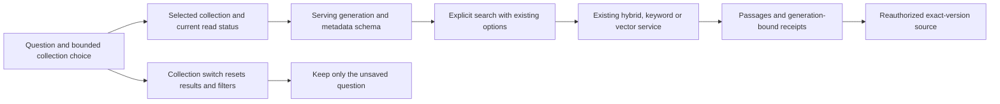

# Search from the dashboard home

The dashboard home puts collection search first: a large query bar, collection selection and compact options, followed by matching passages and their sources. This is a passage-search interface; it does not generate an answer with a chat model.

Implementation, offline verification and the functional production-browser journey pass. A subsequent query-text sizing adjustment awaits a fresh visual smoke check; the completed functional run remains recorded separately.

## Quick search

1. Open the dashboard and type a question or search phrase. The unsaved question stays local to this page.
2. Choose a collection. The dialog supports server-side name filtering and pages of 25 collections. Metadata-visible collections without read access remain visible but cannot be selected.
3. Inspect the options summary. Search defaults to Hybrid with up to 10 results; expand **Search options** to change the strategy, result limit or filters.
4. Press Enter or Search once the selected collection has an active readable index.
5. Inspect the passage, rank information and exact source. A source opens through its returned receipt, preserving the indexed document version.

The query is limited to 4,000 characters and the result limit to 1–50, using the existing contract. Options reuse Hybrid, Keyword and Vector search plus document, language, file-type, tag, creation-date and typed metadata filters. Metadata choices come from the serving generation's configuration rather than an unsaved draft.

Changing collections preserves the question but resets results, open sources, filters and search options. Collection selection does not issue an embedding probe or search request. Only explicit search submission starts search work; keyword-only retrieval does not need query embeddings.

The page keeps compact Collections and Documents shortcuts. Existing account, organization and other navigation remains in the sidebar.

## Readiness and access

No collection is chosen automatically. A user must have the current organization search permissions and the selected collection's explicit read grant. Only the selected collection receives detail queries; status queries additionally require its current read grant. The picker does not probe every collection.

The interface distinguishes permission loading/failure, no selected organization, an empty or unmatched collection list, revoked read access, status loading/failure, and a collection without an active index. An unindexed collection links to its existing workspace. The query bar and options remain available while search is unavailable, but submission is disabled and its handler checks readiness again.

A supported active generation remains searchable while a later draft or rebuild is incomplete or unsupported. A newly active generation updates the form's schema/options; already returned results retain their generation label and exact source receipts until another search or collection switch. Previous-generation results are identified explicitly.

Organization, user and session changes recreate the dashboard query scope and drafts. Current permission/readiness failures recreate the search workspace so earlier results and source dialogs are not kept visible. The server still checks organization membership, operation permissions, collection grants and source receipts on every applicable request.

## Code map

- [dashboard/page.tsx](../apps/web/app/dashboard/page.tsx) renders the search-focused page and compact library shortcuts.
- [home-search.tsx](../apps/web/components/rag/home/home-search.tsx) owns the question/selection and organization-permission states. [collection-picker.tsx](../apps/web/components/rag/home/collection-picker.tsx) uses the existing catalog dialog, server filtering and pagination.
- [selected-collection-search.tsx](../apps/web/components/rag/home/selected-collection-search.tsx) loads only the selected collection and index status, derives readiness and mounts the shared search workspace with an authority-bound key.
- [search-playground.tsx](../apps/web/components/rag/indexing/search-playground.tsx) owns the existing search/result/source journey. Its shared [search-form.tsx](../apps/web/components/rag/indexing/search-form.tsx), [search-filter-fields.tsx](../apps/web/components/rag/indexing/search-filter-fields.tsx), [search-filters.ts](../apps/web/components/rag/indexing/search-filters.ts) and [search-results.tsx](../apps/web/components/rag/indexing/search-results.tsx) support the home and collection presentations.
- [search-source.tsx](../apps/web/components/rag/indexing/search-source.tsx) keeps the existing source preview/original receipt protocol. The [indexing contracts](../packages/api-contracts/src/v1/rag/indexing.ts) and [search service](../packages/routers/rag/src/services/indexing/search.ts) remain authoritative.
- [dashboard-query-scope.tsx](../apps/web/components/dashboard-query-scope.tsx) resets business caches and drafts on authenticated scope changes. The [permission provider](../apps/web/contexts/vectorix-permissions.tsx) supplies current operation visibility.
- The new rag.searchHome messages in [English](../apps/web/messages/en.json), [French](../apps/web/messages/fr.json) and [Belgian Dutch](../apps/web/messages/nl-BE.json) localize the page, picker and options summary.

No API contract, database schema, provider protocol or source-retention behavior changes. Questions are not copied into URLs or browser storage.

## Dashboard acceptance recipe

### Prerequisites

Use production builds, an ordinary synthetic organization and owned disposable stores. Prepare one readable collection with a published document and active generation, plus another readable collection that is not indexed. A second active collection is useful for checking repeated collection changes. Record whether embeddings use a real local/hosted provider or a controlled native-protocol fixture; one must not stand in for the other.

Prepare documents through native HTTP with curl, using authorized least-privilege keys where supported and native sessions for restricted operations. Do not upload or download files through browser automation or broaden permissions for the test.

### Expected journey

1. Open the dashboard, enter a question before selecting a collection and inspect the initial disabled search/readiness message.
2. Open the collection dialog with keyboard and pointer. Search by name, inspect bounded pages and choose the active collection; the question must remain. Metadata-only rows, when present, must be disabled with an explicit read-access explanation.
3. Submit Hybrid using Enter. Inspect results, scores, generation and an exact source. Change the result limit and strategy, verify the collapsed summary and run another explicit search. Inspect relevant filters.
4. While a request is pending, choose another collection. The question stays; old results/source dialogs and filters/options disappear. A late response must not populate the new collection. Selecting an unindexed collection shows its readiness message and workspace link without dispatching search.
5. Return to the active collection and search again. When testing a generation switch, preserve a previous result's source receipt and confirm its generation label while new requests use the serving profile.
6. Check no-match/empty list and request-error states, French/English/Belgian Dutch labels and result plurals, keyboard focus, collapsed-option validation and a narrow viewport. Read denial and organization/session changes must clear the old workspace; record whether these were exercised in the browser or covered through automated/source checks.
7. Check console output, perform normal logout and remove only the owned test resources.

### Actual results

The functional production-browser journey passes at source checkpoint 5d9f66a on October 25, 2026. It used an ordinary synthetic organization, owned disposable stores and real Ollama 0.40.8 with cached embeddinggemma, verified digest 85462619ee721b466c5927d109d4cb765861907d5417b9109caebc4e614679f1, 768 dimensions, DiskANN and document-structure target/overlap 512/64.

| Journey               | Observed result                                                                                                                                                                                                                                                                      |
| --------------------- | ------------------------------------------------------------------------------------------------------------------------------------------------------------------------------------------------------------------------------------------------------------------------------------ |
| Collection choice     | Empty/no-match states and filtering for Garden were checked. A question entered before selection remained when choosing the indexed Garden collection.                                                                                                                               |
| Search options        | Enter submitted Hybrid and returned one result (123 ms). Keyword with topK 1, TXT and a document filter returned one (36 ms); Vector with topK 3 returned one (105 ms). A PDF filter returned zero (23 ms). Invalid topK reopened the collapsed options for native validation.       |
| Collection switch     | Switching to Unindexed cleared results/options/filters, retained the question, disabled Search and showed the collection-workspace action. Keyboard selection back to Garden retained the question and restored Hybrid/10 defaults.                                                  |
| Exact source          | The browser opened the indexed version-1 preview. Separate scoped key/curl reads returned one Vector result, a 2,023-character source preview and the exact 2,048-byte original.                                                                                                     |
| Presentation and exit | Light/Dark, EN/FR live messages and a Belgian Dutch reload were checked. At 390×844 there was no page overflow and the picker measured 357×439 inside the viewport. The console had zero warnings/errors; normal Dutch logout, owned-tab closure and viewport restoration completed. |

Individual timings above describe functional observations, not a performance benchmark. The original was uploaded with native curl and matched SHA-256 ec7e2086bed47651af1bdd76a1f8d22678db13fbda17e7c5b5ead04083cd74cf. The native helper completed 20 calls across setup, upload, scoped-key setup and the three source/search/original reads; no browser file transfer occurred.

Web type generation/type checking and lint pass, with five existing warnings. Three targeted style issues from the first lint pass were corrected. The closed-environment API/backend suite passes 229 cases plus 11 discovery cases; fresh web, API and workers production builds pass. All 25 home keys have matching EN/FR/nl-BE ICU signatures, and independent source review finds no blocking issue.

Final functional-run cleanup confirmed three application processes, five owned containers and four fresh volumes absent. The existing model cache remained unchanged, private captures were retained and helper bytes/modes and disabled gates were restored.

Limits: selection during an in-flight request, permission revocation, multiple picker pages, a G1→G2 transition, provider failure and no-organization recovery remain source-reviewed/recipe scenarios rather than actual results from this browser run. No hosted-provider or retrieval-quality claim is made. The pull request records exact-head CI and delivery.

A separate fresh production-browser smoke at b2d0e25 verifies the subsequent CSS-only desktop sizing correction: the query computes to 24 px in an 80 px field on desktop and 18 px in a 64 px field at 390×844, without horizontal overflow. The empty selector, question retention and Light/Dark presentation pass; the console has zero warnings/errors. Fresh web build/type checking and lint pass again. Normal French logout, owned-tab closure and viewport restoration complete. This seed-only smoke does not repeat the earlier indexing/search journey. Its cleanup confirms three app processes, five containers and four fresh volumes absent, with the model cache/private captures preserved and both helpers restored byte/mode-exact with disabled gates.
