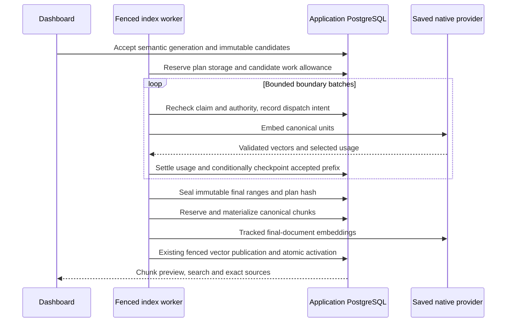

# Semantic chunking: persistence and implementation review

**M6b is implemented and validated through the production dashboard with real Ollama.** This document describes the additive [semantic schema](../packages/db/prisma/models/rag-semantic.prisma), [indexing additions](../packages/db/prisma/models/rag-indexing.prisma) and [quota fields](../packages/db/prisma/models/rag.prisma). After independent schema/protocol review and explicit user approval, `20261028000000_rag_semantic` was generated and tested on disposable databases. Fresh migrations, upgrades, repeat deployment, schema parity, supplementary constraints and two organization-lock races passed. No application database or schema push was used. Parent/child context remains planned M6c work. Actual acceptance and its limits are recorded below and in the [build log](build-task-log.md).

## Dashboard journey

An organization manager saves a semantic profile, its percentile and existing min/target/max/overlap settings, verifies the saved embedding profile, attaches extracted documents and starts indexing. The dashboard shows bounded planning progress and logical embedding work, then exposes actual chunks, search and exact sources. A changed percentile creates a new configuration revision; rebuilding retains the old generation until atomic activation. Provider, permission, capacity and hard-limit failures remain explicit. Retrying a sealed plan reuses its boundaries.

The collection's saved provider/model/dimensions, preparation, preset and credential binding also apply to boundary embeddings. All five existing native providers are in scope. Hosted capability fingerprints cannot attest to immutable weights. Additional semantic calls count toward tracked work and observed usage; these records do not establish a monetary bill or exactly-once provider execution.

## Why a durable plan is needed

The current document-indexing flow plans chunks locally before reservation/materialization. Semantic boundaries require external embeddings first. Recomputing them after a crash could change chunk ordinals, ranges and hashes, especially when a hosted provider changes responses under the same model name.

The implementation therefore checkpoints accepted boundary results, seals a complete canonical plan, and only then enters existing chunk accounting/materialization. It never stores all unit vectors: one last accepted float32 vector is sufficient for the next adjacent comparison. An accepted distance prefix and a sealed plan are immutable during retries.

The [embedding interface](../packages/embeddings/src/types.ts) exposes optional awaited native-batch observers. Five native adapters record a validated prefix before dispatching the next batch; provider and caller errors remain separate. The semantic worker integration uses these events for durable partial observations. Existing structure/token-window flows and query calls remain outside this tracking scope.

## Persisted schema

| Location                          | Fields and purpose                                                                                                                                                                                                                                                                                                                                                                  |
| --------------------------------- | ----------------------------------------------------------------------------------------------------------------------------------------------------------------------------------------------------------------------------------------------------------------------------------------------------------------------------------------------------------------------------------- |
| `SemanticChunkPlan` identity      | `indexedDocumentId` is the primary key. The composite FK `(organizationId, generationId, indexedDocumentId)` proves the exact candidate scope. `configurationRevision`, algorithm versions, `sourceHash`, `profileHash`, `modelIdentity` and `unitManifestHash` bind immutable execution inputs.                                                                                    |
| Plan payload                      | `unitRanges` contains ordered `{ordinal,start,end}` records without duplicated text. `completedUnits`, integer `boundaryScores` and nullable `lastUnitVector` checkpoint a contiguous accepted prefix. `thresholdDistance`, `finalRanges`, `planHash` and `sealedAt` describe the completed plan.                                                                                   |
| Plan lifecycle/capacity           | `state` is `PLANNING`, `READY` or `CLEANED`; `revision` supports compare-and-set updates. `storedBytes` and `reservedBytes` account for actual and outstanding planning storage. `reservedPreparedBytes` and `reservedBatches` hold unassigned candidate work capacity.                                                                                                             |
| `EmbeddingWorkAttempt` identity   | Candidate-scoped composite FK, purpose `BOUNDARY` or `FINAL_DOCUMENT`, `operationKey`, `batchOrdinal` and `attemptNumber`. Their compound unique key prevents duplicate recording. `inputHash`, `inputCount` and `preparedInputBytes` identify bounded prepared work without storing request text or credentials.                                                                   |
| Work fencing/lifecycle            | `taskId` and `leaseEpoch` record the originating claim without a member FK. States are `RESERVED`, `IN_FLIGHT`, `SUCCEEDED`, `FAILED`, `UNCERTAIN`, `CANCELLED`; deadline, dispatch, settlement, usage and uncertainty timestamps distinguish their evidence. `outcomeCode` accepts sanitized constants only.                                                                       |
| Work capacity/usage               | Reserved and dispatched prepared bytes/logical batches support atomic allowance transfer. `successfulRequests`, `estimatedInputTokens`, `providerInputTokens` and `billedInputTokens` are nullable selected observations. Null never means zero. Billed units use a finite floating value because the native interface permits fractional reports; this is not currency arithmetic. |
| `OrganizationEmbeddingAccounting` | One row per organization caches reserved/stored planning bytes, outstanding prepared bytes/batches, cumulative dispatched logical work, known usage subtotals and unknown/uncertain counters. `trackingSince` prevents presenting untracked historical calls as zero. `revision` serializes related accounting updates.                                                             |
| Existing models                   | `IndexedDocument` gains plan/work relations; `Organization` gains its accounting relation. `IndexTask.continuationPending` and `continuations` distinguish successful planning/capacity continuations from failed attempts. No `Chunk` field or public task-kind enum is changed.                                                                                                   |

Work rows cascade only when their candidate is physically deleted, including a valid organization deletion. Normal cleanup marks candidates `CLEANED` and retains non-content usage history. There is no member FK: requester removal cannot prevent late usage settlement or accepted cleanup.

## Technical quotas

| `OrganizationQuota` field            |     Default | Meaning                                                                                                |
| ------------------------------------ | ----------: | ------------------------------------------------------------------------------------------------------ |
| `semanticUnitsPerDocument`           |       8,192 | Maximum useful semantic units in one candidate, subject to the same runtime hard ceiling.              |
| `semanticPlanBytesPerDocument`       |   1,048,576 | Maximum serialized planning payload/checkpoint storage for a candidate; runtime hard ceiling is 1 MiB. |
| `semanticPlanBytesPerOrganization`   |  67,108,864 | Stored plus reserved planning bytes across the organization.                                           |
| `embeddingPreparedBytesPerCandidate` | 134,217,728 | Lifetime dispatched plus outstanding logical prepared-input bytes for one immutable candidate.         |
| `embeddingBatchesPerCandidate`       |       4,096 | Lifetime logical batch allowance; attempt-row growth is independently bounded to 4,096 rows.           |
| `embeddingOutstandingPreparedBytes`  | 536,870,912 | Organization-wide outstanding prepared-byte reservations.                                              |
| `embeddingOutstandingBatches`        |      16,384 | Organization-wide outstanding logical batch reservations.                                              |

These are work/capacity limits, not credits or monthly billing periods. Public values must be safe nonnegative integers within reviewed runtime bounds; unit and per-document plan ceilings cannot be raised through quotas. Validate organization planning capacity at least as large as its per-document allowance, and both outstanding work caps at least as large as their per-candidate allowance. Invalid configured limits fail explicitly.

Reserve a bounded **complete candidate allowance** before boundary calls. The allowance covers both boundary and final-document phases; it is reserved capacity, not a claim to know the exact future semantic plan cost. Defaults permit at most four fully reserved candidate allowances by either outstanding work cap. Temporary organization-capacity exhaustion defers the task without spending failure retries. Existing admitted holders retain their accepted unused allowance when policy caps increase; they do not all wait for larger reservations while holding the old ones. Lower caps constrain further work. A new admission or authorized retry after release may reserve the remaining allowance under current policy. Candidate/plan hard-limit exhaustion is an explicit quota/limit failure.

Before dispatch, transfer that batch's prepared bytes and one logical batch from the plan's unused allowance to its work row. Organization outstanding capacity stays unchanged: it includes unused plan allowance plus reserved/in-flight batches. Record cumulative dispatched intent while retaining the work row's reservation until settlement; settlement releases that outstanding capacity once. A crash between this write-ahead intent and sending may overstate actual transport activity; never relabel it as confirmed provider execution.

A terminal failure releases unused future work and planning-storage allowance but retains actual charged plan payload and all dispatched work. A retry may reserve only the remaining candidate budget, calculated as its cap minus all lifetime dispatched work; it cannot reset the allowance to the full cap. Cancelling/releasing a plan must not erase dispatched work or permit unlimited new attempt rows. Temporary organization contention affects admission, not the candidate's historical work count.

One logical batch is the bounded native operation observed by the embedding adapter. The existing [HTTP transport](../packages/embeddings/src/http.ts) can make up to three transport attempts for each embedding request. Ollama manifest checks add separate requests under the same operation deadline. It does not expose exact wire-attempt counts. Do not invent unused wire-request refunds, equate one work row to one paid request, or claim that a failed batch was free. `successfulRequests` comes only from the validated selected usage; the new single-native-batch boundary expects one successful embedding response.

## Canonical planning and restart protocol

The pure planner uses `semantic-units-utf8-v1` and `semantic-utf8-v1`. Units and final ranges are UTF-16 positions in immutable canonical extraction text, without normalization. Native prepared-input byte limits include saved preparation/title overhead. Each final range receives all intersecting source spans; crossing a PDF page or DOCX section does not invent a single source label.

Adjacent cosine distances are computed from float32 vectors, clamped and quantized to integers in `[0, 2000000]`. The nearest-rank percentile permits positive scores equal to the threshold: ties can all qualify, so the percentile is not an exact top-percentage quota. Min/target/max sizing, bounded overlap and useful final-tail rules still apply. Tests cover unitization, tie handling, plan hashing, strictly advancing overlapping windows and integration with durable worker state.

1. Recheck current organization/collection authority, desired candidate and saved algorithm/model bindings before task-specific credential, source or embedding I/O. Read the saved extraction binding, validate canonical content and derive unit/profile/source hashes.
2. In a short serializable transaction, recheck the live claim and candidate; reserve the full per-document planning allowance and complete candidate work allowance. As payload is persisted, transfer its canonical serialized byte count from reserved to stored planning bytes; their sum stays charged until sealing releases the unused remainder. Persist bounded unit geometry and immutable bindings atomically. Capacity deferral must leave no partial reservation.
3. For each bounded native batch, renew the lease and recheck authority before dispatch. Create a unique work attempt and transfer its allowance. Record dispatch intent before provider I/O; the provider call remains outside database transactions.
4. Persist selected usage idempotently even if the initiating member was removed or the original lease expired. In the same serializable transaction, settle usage and then check the current lease, authority and expected cursor without throwing a domain denial inside the transaction. A stale response commits usage only; return its denial and throw outside the transaction. SQL errors still propagate and retry the complete transaction. A stale response cannot advance planning or publish content.
5. Commit only a contiguous distance prefix and the last accepted vector. Yield after a bounded number of batches/time budget, setting the continuation marker. A continuation increments `continuations`, not the failure-attempt budget; failure retries retain their existing bounded behavior. Each scan prioritizes at most five eligible semantic tasks that actually retain unused work or planning capacity, including interrupted/retry holders. The ordinary slice excludes that entire holder class and retains at least five slots for other eligible tasks. Updating availability rotates holders; capacity waiters without a reservation remain ordinary work.
6. Once all distances exist, compute and atomically seal final ranges/hash. Clear the vector checkpoint and release unused planning-storage reservation. A retry reconstructs exact chunks from this sealed plan and verifies all binding/hash invariants.
7. Apply existing chunk quota reservation, materialization, native final embedding, vector sealing and publication fences. A chunk-quota failure leaves the sealed plan reusable. Final embeddings also consume tracked logical work. Existing active-generation search and signed-source holds remain unchanged.

A sealed vector publication can still be adopted after a crash. A newer lease intentionally discards an unsealed vector stage in the [vector adapter](../packages/vector-store/src/publications.ts). Consequently, a successful historical usage row does not authorize skipping final embedding work after reclaim unless the vectors were independently retained. Repeated external work is recorded; no exactly-once billing claim is made.

## Retention, uncertainty and deletion

Release unused work and planning-storage allowances on completion, terminal failure, retirement or explicit cleanup. Failed candidates may retain a reusable, charged plan payload; the dashboard must expose held storage and existing retry/detach/discard cleanup actions. Reserved/in-flight work remains charged until settlement or its deadline; a deadline reaper settles abandoned attempts through idempotent transitions. An interrupted dispatched batch is `UNCERTAIN`; absence of a recorded response does not prove the provider did no work.

Late validated usage updates only its own attempt/accounting entry and can reduce unresolved uncertainty. `uncertainAttempts` counts currently unresolved attempts, while each row's retained uncertainty/dispatch timestamps preserve its history. It cannot restore a removed membership, extend the claim, rewrite a sealed plan or publish an obsolete candidate. Known token subtotals must be displayed alongside unknown-batch counts; missing provider/billed values remain unknown. Accounting changes use an atomic evidence/CAS transition so duplicate callbacks cannot increment totals twice.

Canonical ranges, scores and the vector checkpoint are content-derived data. Clear them and their storage/work reservations during fenced candidate cleanup, before declaring the candidate/generation cleaned. Preserve only non-content identity/hash/count metadata and settled work history until organization deletion; clear even that history on the existing valid organization cascade. Historical work must not be deleted merely to reset a candidate budget.

The migration extends existing RAG organization key-share admission and cleanup guards to relevant plan/work mutations and outstanding planning/work capacity. Native members-first organization deletion remains inside its existing transaction: a late guard failure rolls member removal back. Settled history with no outstanding/content payload does not permanently block a valid organization deletion. No guard depends on the initiating member still existing.

## Database and runtime invariants

Prisma does not express all of these invariants. The reviewed migration supplies supplementary constraints and guards; runtime validation supplies canonical source/hash, float32 and aggregate-transition checks:

- Nonnegative counters, bounded unit counts (`0..8192` in SQL, nonempty at runtime admission), positive bounded input counts/byte sizes, safe quota ceilings and the cross-field capacity relationships above. Continuation counts and lease epochs remain nonnegative.
- Candidate composite FKs, unique attempt identity and indexes for candidate aggregates, state/deadline scans and originating claims. The application must cap all attempt rows, including cancelled ones, under the same serialized candidate/accounting admission.
- Lowercase 64-character hashes; bounded version/operation/outcome identifiers; explicitly validated JSON arrays and ordered canonical ranges. Enforce absolute JSON/checkpoint byte ceilings, not a database-internal storage-size claim. Runtime validation binds source geometry and prepared-input hashes.
- `0 <= completedUnits <= unitCount`; a distance count matching the accepted prefix; integers in `[0,2000000]`; checkpoint byte length matching saved dimensions when required. Float32 finiteness/nonzero norm is also checked while decoding the checkpoint.
- `READY` requires complete geometry, final plan hash and seal time, no vector checkpoint and no outstanding planning-storage reservation. `CLEANED` requires cleared payload/checkpoint and zero storage/work reservations. Sealed inputs/results cannot change except through explicit cleanup.
- A reserved work row holds at most one logical batch; its reserved/dispatched counters must agree with its lifecycle and prepared-input size. Dispatched intent, immutable attempt identity and selected-usage evidence cannot be rewritten to create fresh allowance.
- Nullable usage values are nonnegative when present; per-attempt floating billed values must be finite and within the native numeric bound; cumulative subtotals must remain finite. Timestamp/state consistency permits late evidence after an uncertainty deadline without pretending it was timely publication.
- Reuse the existing organization cleanup guard rather than bypassing it; extend its protected descendants/capacity checks and preserve safe clean-organization cascades. Cached aggregate counters must be updated with their underlying row transitions in one serializable transaction.

## Compatible API, UI and delivery boundaries

API major 1 exposes compatible revision `1.14.0` with dedicated strict semantic quota DTOs and separate superadmin get/set handlers at `/api/v1/superadmin/organizations/{organizationId}/semantic-quota`. **No keys were added to the existing strict nested `quotaValues`/`limits` contract.** Existing get/set RAG quota operations keep their exact six fields and preserve new stored settings. The outer RAG quota response has an optional top-level semantic sibling containing dedicated limits/usage. Task responses have optional planning/usage metadata; old DTOs strip these outer additions. Cumulative BIGINT counters are public decimal strings.

Keep new runtime logic in focused semantic planning, work-accounting, checkpoint and native-batch modules. Existing public task kinds/failure enums remain usable: hard work limits map to `QUOTA_EXCEEDED`/`CHUNK_LIMIT`, binding drift to `MODEL_CHANGED`, invalid stored plans to a sanitized state failure. Locale dictionaries must cover planning, capacity deferral, retry, unknown usage and source states in English, French and Belgian Dutch.

Automated acceptance covers all five native protocols, crash/retry checkpoints, late/revoked/stale results, transport uncertainty, quota contention, continuation fairness, policy increases, idempotent accounting, foreign identifiers, source cleanup and native organization-delete rollback. The final disposable catalog pass has 182 passing HTTP journeys, 45 direct SQL assertions on each fresh/upgraded database, repeat deployment/parity and two actual PostgreSQL lock races. Workspace type checks and lint (23 tasks each), 44 backend regressions, 45 chunking tests, 138 embedding tests, four production builds and all six production images passed.

[AGENTS.md](../AGENTS.md) requires: “Prepare schema changes for review; migrations are generated manually after review.” That review and explicit user approval preceded generation. The live check below establishes the local Ollama journey. Controlled hosted fixtures establish protocol behavior, not paid-service connectivity or relevance quality.

## Dashboard acceptance recipe

Prerequisites: deploy the approved migration to a disposable test database, run isolated vector PostgreSQL, Redis and private S3, and start production API/workers/web/admin builds. Follow [the Ollama/EmbeddingGemma guide](rag-ollama-embeddinggemma.md) for a real installed model and approved organization endpoint; no paid-provider key is required for this local recipe.

1. As an organization manager, create a collection with Semantic chunking, percentile 90, a saved verified embedding profile and parent/child disabled. Upload a text/Markdown source containing several topics and more than 32 useful sentences, then attach it and start indexing.
2. Inspect task planning progress and successful continuations. Expect the same failure-attempt count across successful planning yields, then a sealed plan followed by chunk materialization and publication. Inspect real chunks and their exact canonical sources.
3. Run hybrid, vector and keyword queries in FR/EN. Capture an exact source before rebuilding. Save a different percentile and review/rebuild the collection; the old generation must remain searchable until activation. After activation, inspect the new chunks and reopen/download the previously captured authorized source.
4. In organization usage, inspect tracking start, outstanding capacity, dispatched intent, confirmed responses and unknown provider/billed usage. Counts cover semantic indexing only. In admin, inspect the separate semantic policy, reject an invalid cross-capacity setting, save a valid change and reload. Existing RAG quota fields must remain unchanged.
5. Inspect EN/FR/nl-BE labels, persisted language, keyboard/dialog behavior and browser consoles. Record actual outcomes and cleanup in the build log and PR. Controlled automated failure/provider fixtures supplement this recipe; they do not establish paid-service availability, relevance quality or load capacity.

## Actual production-dashboard verification

The isolated `2bcb9c865bde` run used production web, admin, API and worker builds, disposable application/vector PostgreSQL, Redis, private RustFS and real CPU-only Ollama `0.40.8`. The installed `embeddinggemma:latest` manifest was `85462619ee721b466c5927d109d4cb765861907d5417b9109caebc4e614679f1`; the saved EmbeddingGemma retrieval profile used 128 dimensions. The complete platform binding was local to this test. No application `.env`, application database or paid-provider key was used.

The browser uploaded a synthetic FR/EN three-topic Markdown file (6,403 bytes; 6,324 UTF-16 units), including decomposed accents, emoji and a final source marker. Its SHA-256 was `38cedabca1ca21e0dc265ba6f93ec9c86a73e96d0e6293923b40c9c13ea1cd41`. With target/overlap/min/max values `128/16/32/192`, percentile 90 produced 20 published chunks. The task completed 75 semantic units with two successful continuations and one failure-budget attempt; its plan was sealed and outstanding reservations were zero. All chunks and their canonical source positions were inspected in the dashboard.

English hybrid search returned five results, with both keyword and vector ranks present for `harbor tide`. An exact source was captured before rebuilding. Saving percentile 55 created revision 2; the profile comparison was inspected and the rebuild activated 22 chunks while retaining the previous 20. Keyword search returned six results from the replacement generation; French vector search returned five relevant harbor passages. Its task again showed 75 units, two continuations, one attempt, a sealed plan and zero outstanding reservations. The 22 new chunks included the useful final marker. The earlier results displayed the previous-generation notice, and their authorized exact source opened and downloaded after cutover. Both original downloads had the identical source SHA-256.

The organization usage page and admin reported eight confirmed logical batches, 32,923 dispatched prepared-input bytes, an 8,296-token estimate and 8,939 known native input tokens. Stored planning payload was 9,486 bytes; unused planning and outstanding work reservations, unknown native-usage batches and unresolved attempts were zero. All eight batches had unknown billed usage, displayed as unknown. Admin rejected a planning capacity of 1,024 bytes because it was below the per-document allowance, saved a valid 8,000-unit limit and preserved it after reload; the legacy six quotas stayed unchanged.

New collection help, task/usage and admin labels were inspected in EN/FR/nl-BE, including locale-aware counters. Belgian Dutch survived reload, English was restored, and all three browser consoles had no warnings or errors. The first and replacement tasks were observed completed; partial `32/75` progress and an old-generation search during the brief live rebuild were not captured. Automated HTTP tests cover these continuation/cutover fences, crash/retry, revocation, controlled provider failures and capacity limits. This run is not a retention soak, relevance benchmark, load claim or live hosted-provider test.

A separate read-only application/vector observation verified both physical publications, canonical geometry/source intersections and stored bindings/hashes, with 22 active plus 20 retained child chunks. All four owned previews, five owned containers, three test tabs and verified downloads were removed; the existing model volume and user tab were preserved.
