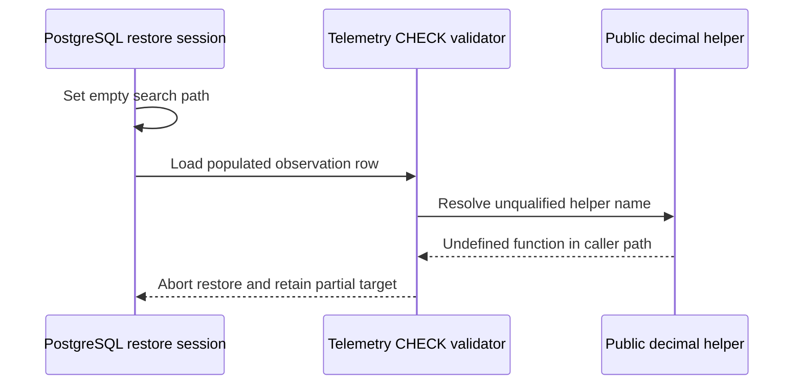

# SQL function lookup during a full restore

Status: the forward migration was independently reviewed, explicitly authorized and generated. Disposable SQL/path/concurrency checks, an ordinary populated application-database archive round trip and the full catalog pass: 11 migrations across fresh/upgrade/repeat/parity checks and 238/238 API journeys. The corrected full-store restore, dashboard sign-in/search/source checks, fresh-Redis replay, rebuild and natural cleanup pass on the owned fixture; exact infrastructure teardown is complete. The earlier failed bundle is retained as failure evidence.

## Observed failure

A source fixture containing real indexed documents, semantic plans and operational observations was quiesced and exported successfully. Restoring its application PostgreSQL archive into a fresh owned `_test` target failed while loading `RagOperationalHour`. The target reported an undefined `vectorix_telemetry_decimal(jsonb)` call from `vectorix_telemetry_phases`. The helper then stopped, leaving an explicitly quarantined partial target. That target was subsequently cleaned without manual repair; the verified private bundle remains failure evidence.

Bounded read-only inspection confirmed that the archive contains `vectorix_telemetry_decimal`, followed by `vectorix_telemetry_phases`, before the table-data entry. The function was not omitted from the dump. PostgreSQL's restore session uses an empty `search_path`; the PL/pgSQL function resolves its unqualified nested helper calls in that caller context.

The relevant existing definitions are:

- [Telemetry validators and merges](../packages/db/prisma/migrations/20261030000000_rag_observability/migration.sql): `vectorix_telemetry_phases` and `vectorix_telemetry_failures` call `vectorix_telemetry_decimal`; the two merge functions call those validators.
- [Semantic payload validation](../packages/db/prisma/migrations/20261028000000_rag_semantic/migration.sql): `vectorix_semantic_plan_payload_valid` calls the unqualified range and score validators from a table CHECK constraint. Static inspection shows the same lookup dependency; the failed restore stopped before proving this second failure independently.
- [Parent context guards](../packages/db/prisma/migrations/20261029000000_rag_parent_context/migration.sql): parent validation and lifecycle triggers call other application helpers or query unqualified application tables. These triggers are restored after table data, so they are not the cause of the observed COPY failure. Their behavior should nevertheless use the intended schema independently of a caller's path.



## Approved bounded change

The forward [migration](../packages/db/prisma/migrations/20261031000000_sql_function_search_path/migration.sql) contains the explicit statements below in one transaction. The ten already applied migrations remain unchanged. Do not alter the restore archive, change target session settings to bypass validation, or disable triggers/constraints.

The migration sets a function-local path of `pg_catalog, public, pg_temp` for the 28 existing application-owned `vectorix_*` functions. Built-ins resolve in `pg_catalog`; application functions, types and relations resolve in `public`; placing `pg_temp` explicitly last prevents a temporary relation/type from taking its implicit earlier position. Functions remain security invokers and continue to enforce the caller's privileges. No new privilege, role, extension or schema is created. `public` must remain a trusted application schema; this migration does not revoke any existing CREATE grants or change the deployment's schema ownership policy.

Pinning only the three CHECK entry points would address the identified table-data restore graph. The approved migration applies the same setting to the explicit current set of 28 functions because the remaining trigger and merge bodies also assume application objects live in `public`. It gives those existing guards one consistent lookup rule without rewriting their reviewed bodies or dynamically changing unrelated/native functions. Future functions are not automatically included.

```sql
ALTER FUNCTION public.vectorix_chunk_lexical()
    SET search_path = pg_catalog, public, pg_temp;
ALTER FUNCTION public.vectorix_rag_organization_lock()
    SET search_path = pg_catalog, public, pg_temp;
ALTER FUNCTION public.vectorix_rag_organization_delete()
    SET search_path = pg_catalog, public, pg_temp;

ALTER FUNCTION public.vectorix_semantic_ranges_valid(jsonb, integer, boolean)
    SET search_path = pg_catalog, public, pg_temp;
ALTER FUNCTION public.vectorix_semantic_scores_valid(jsonb)
    SET search_path = pg_catalog, public, pg_temp;
ALTER FUNCTION public.vectorix_semantic_plan_payload_valid(public."SemanticChunkPlan")
    SET search_path = pg_catalog, public, pg_temp;
ALTER FUNCTION public.vectorix_semantic_plan_update()
    SET search_path = pg_catalog, public, pg_temp;
ALTER FUNCTION public.vectorix_embedding_work_update()
    SET search_path = pg_catalog, public, pg_temp;
ALTER FUNCTION public.vectorix_semantic_history_delete()
    SET search_path = pg_catalog, public, pg_temp;

ALTER FUNCTION public.vectorix_parent_generation_identity()
    SET search_path = pg_catalog, public, pg_temp;
ALTER FUNCTION public.vectorix_parent_revision_identity()
    SET search_path = pg_catalog, public, pg_temp;
ALTER FUNCTION public.vectorix_parent_offset_valid(jsonb)
    SET search_path = pg_catalog, public, pg_temp;
ALTER FUNCTION public.vectorix_parent_spans_valid(jsonb, integer, integer)
    SET search_path = pg_catalog, public, pg_temp;
ALTER FUNCTION public.vectorix_parent_chunk_row()
    SET search_path = pg_catalog, public, pg_temp;
ALTER FUNCTION public.vectorix_parent_chunk_link()
    SET search_path = pg_catalog, public, pg_temp;
ALTER FUNCTION public.vectorix_parent_chunk_touch()
    SET search_path = pg_catalog, public, pg_temp;
ALTER FUNCTION public.vectorix_parent_chunk_insert_touch()
    SET search_path = pg_catalog, public, pg_temp;
ALTER FUNCTION public.vectorix_parent_chunk_delete_touch()
    SET search_path = pg_catalog, public, pg_temp;
ALTER FUNCTION public.vectorix_parent_candidate_layout(public."IndexedDocument")
    SET search_path = pg_catalog, public, pg_temp;
ALTER FUNCTION public.vectorix_parent_candidate_state()
    SET search_path = pg_catalog, public, pg_temp;
ALTER FUNCTION public.vectorix_parent_candidate_delete()
    SET search_path = pg_catalog, public, pg_temp;
ALTER FUNCTION public.vectorix_parent_generation_delete()
    SET search_path = pg_catalog, public, pg_temp;

ALTER FUNCTION public.vectorix_telemetry_decimal(jsonb)
    SET search_path = pg_catalog, public, pg_temp;
ALTER FUNCTION public.vectorix_telemetry_phases(jsonb, public."RagOperationalWorkload")
    SET search_path = pg_catalog, public, pg_temp;
ALTER FUNCTION public.vectorix_telemetry_failures(jsonb)
    SET search_path = pg_catalog, public, pg_temp;
ALTER FUNCTION public.vectorix_telemetry_merge_phases(jsonb, jsonb, public."RagOperationalWorkload")
    SET search_path = pg_catalog, public, pg_temp;
ALTER FUNCTION public.vectorix_telemetry_merge_failures(jsonb, jsonb)
    SET search_path = pg_catalog, public, pg_temp;
ALTER FUNCTION public.vectorix_telemetry_identity()
    SET search_path = pg_catalog, public, pg_temp;
```

Only function configuration changes. Preserve function signatures and bodies, owners and EXECUTE grants, volatility/parallel flags, invoker mode, table/check/trigger definitions, existing data, publication pointers, vector identity/fingerprints, credential bindings and encryption configuration. No Prisma model or generated client change is required. API contracts and their revision remain unchanged.

Schema/function hashes will intentionally change after migration because `pg_get_functiondef` and subsequent dumps include the fixed setting. Restored source/target metadata must agree with the new approved baseline. Never rewrite a captured bundle's hashes or migration pins to pretend it was exported under the newer chain.

## Exact schema-comparison normalization

The ordinary populated restore preserves all table counts, complete row bytes and row SHA-256. PostgreSQL 18 nevertheless deparses three CHECK expressions with one redundant pair of parentheses flattened after dump/reparse. The shared [archive comparison helper](../tests/acceptance/restore/m7c_restore_archive.py) accepts only these reviewed literal differences in their exact `public` table/constraint DDL contexts:

| Constraint                                | Redundant AND grouping                                                                                                    |
| ----------------------------------------- | ------------------------------------------------------------------------------------------------------------------------- |
| `EmbeddingWorkAttempt_bounds_check`       | `length(operationKey) >= 1 AND length(operationKey) <= 128`                                                               |
| `OrganizationQuota_semantic_limits_check` | `semanticUnitsPerDocument >= 1 AND semanticUnitsPerDocument <= 8192`                                                      |
| `SemanticChunkPlan_bounds_check`          | `octet_length(lastUnitVector) >= 4 AND octet_length(lastUnitVector) <= 64000`, inside its existing nullable-vector branch |

One known parenthesis pair per expression may be removed for **comparison only**. The observed populated source loses exactly six ASCII parentheses; the restored target loses none. This does not rewrite an archive, constraint, database or application data. Bounds, operators, null branches and the remaining SQL stay significant. An unknown table, schema, constraint or expression remains byte-for-byte significant. Function bodies, quoted literals and comments are tracked so lookalike DDL inside them is never normalized; duplicate known CHECK contexts fail closed.

The only other omitted schema-dump bytes are PostgreSQL's random `\restrict`/`\unrestrict` lines. Their bounded alphanumeric keys must form balanced, matching pairs, including the two pairs around a `--create` reconnect; `\connect` and all other bytes remain. This is not generic whitespace, SQL or version normalization. The source and target use the same immutable PostgreSQL image. [Six focused canonicalizer tests](../tests/acceptance/restore/m7c_restore_static_test.py) cover the accepted grouping differences, idempotence and refusal to hide changed bounds/operators, foreign DDL, literals, function bodies or malformed restriction pairs.

## Required isolated regression

The user authorized migration generation and tests after independent review. Use only disposable owned `_test` databases and the repository's approved migration chain.

1. Preserve a controlled negative case on the previous chain: populated phase/failure JSON must execute a nested decimal call, and a non-cleaned semantic plan must execute the range/score helpers. An empty `{}` observation or a `CLEANED` plan can skip those paths and is not a sufficient regression. Capture only sanitized failure classes; do not log source text, authentication data or SQL row payloads.
2. Apply the forward migration normally. Assert exactly the 28 listed signatures have the intended function-local setting, with bodies, owners, privileges and execution attributes otherwise unchanged. Verify fresh deployment, upgrade, repeat deployment and Prisma schema parity; do not regenerate clients merely for function settings.
3. From a caller with an empty path, call the schema-qualified telemetry validators and both merges with valid populated data and invalid cases. Exercise the semantic payload CHECK on an actual valid non-cleaned plan. Existing semantic accounting, late-usage, permission and cleanup invariants remain required.
4. Exercise parent insertion, statement transition-table touches, sealing and legal cleanup while the caller's path is empty. Use actual two-transaction mixed-isolation sealing races already covered by the catalog suite. A function-local path must not break PostgreSQL's transition-table bindings or relax immutable layout/deletion guards. Keep `changed_new`/`changed_old` as the existing unqualified executor bindings, and test same-name `pg_temp.changed_new`/`pg_temp.changed_old` shadows as well as a temporary relation with an application-table name. Neither kind of shadow may redirect the intended guard.
5. Create a populated source with nonempty operational observations, a semantic plan and parent/child chunks. Run an ordinary `pg_dump -Fc --create`, then an ordinary `pg_restore --create --exit-on-error` into a fresh owned bootstrap target, without disabling data validation or adding repair SQL. Compare table counts/row hashes, function configuration and definitions, CHECKs, triggers, indexes, ACL/default privileges and relevant lifecycle/accounting state. This populated dump/restore is a permanent regression, separate from the larger browser acceptance.
6. After those checks pass, repeat the actual M7c full-store journey using a newly approved baseline. Keep the failed old bundle intact. Verify pre-replay source/target database and private-object parity, empty Redis, durable worker replay, real dashboard/source/search behavior, normal rebuild and actual retention cleanup. A successful database regression alone does not complete those product acceptance steps.

## Validation recorded so far

The permanent catalog entry points are [the before/after function check](../tests/catalog/sql-function-upgrade-check.sql), [empty-path and shadow probes](../tests/catalog/sql-function-path-check.sql) with their [fixture](../tests/catalog/sql-function-path-fixture.sql), [populated source seed](../tests/catalog/sql-function-restore-seed.sql), and [the separate-target restore check](../tests/catalog/sql-function-restore-check.py). [The catalog script](../scripts/test-catalog.sh) wires them into the existing disposable fresh/upgrade/repeat/parity and API sequence. The restore check requires **Python 3.10+**, its standard library and Docker, uses the source's immutable PostgreSQL image, creates a network-isolated target and compares every public table's rows plus the full narrowly normalized schema. Its [five ownership/refusal unit checks](../tests/catalog/sql-function-restore-unit-test.py), 23 shared Python guard tests and 14 pure object-manifest tests run through `pnpm test:restore:guards` without Docker or a database: **42 pure checks pass**.

Completed: independent review, explicit migration authorization and generation; both controlled old-chain nested-helper lookup failures reproduced; preservation of all 28 function identities/bodies/owners/grants/execution attributes with only the local path changed; 16 empty-path/shadow proofs on each fresh and upgraded chain; the existing two semantic, seven parent and five telemetry concurrency races. The ordinary populated application-database archive restored 63 tables and 70 rows, with all 36,018 row bytes, row SHA-256 and narrowly normalized full schema identical; its archive was 290,097 bytes. The complete catalog passed all 11 migrations across fresh/upgrade/repeat/parity checks and 238/238 API journeys. Schema validation, 23 workspace type checks, 23 lint tasks, 51 backend tests, four production builds and all six Docker image checks also pass.

The separately executed [full-store dashboard journey](rag-restore-acceptance.md) also passes after the fix: private objects, restored grants/sources/search, fresh-Redis worker replay, normal rebuild and natural retention cleanup. Its final read-only proof follows 1,045 real seconds after deletion, with four absent Markdown objects and six unchanged private survivors. All exact owned infrastructure is cleaned. The failed old bundle remains intact as failure evidence; relevance, full capacity and interrupted-process acceptance remain separate pending M7c work.
