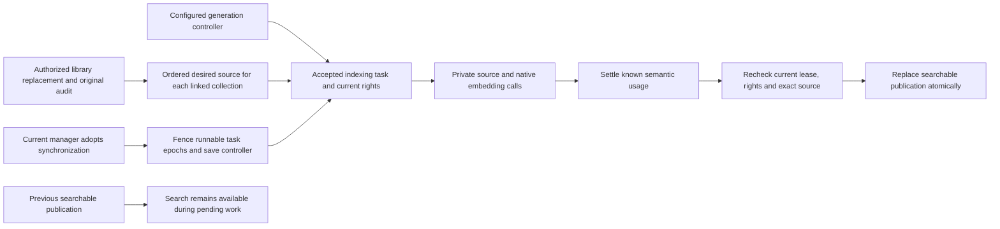

# Collection freshness and synchronization recovery

**M7a implementation, automated validation and real Ollama dashboard acceptance are complete.** Delivered in [PR #41](https://github.com/SimonLoir/vectorix/pull/41), squash-merged as ca6dd80 after both required checks passed on d78eeb7. This slice makes updates from the shared document library converge under an explicitly configured collection-generation controller and makes blocked work recoverable from the dashboard. It reuses existing fields and lease fencing; no new schema definition or migration is required. Operational telemetry, worker health, backup/restore, relevance and load acceptance remain separate M7 work.

## Actors and current authority

A library manager may replace a document without managing every linked collection. The library version, ingestion and mutation audit retain that initiating user. New automatic indexing tasks use the generation's saved `authorityUserId` independently. Index acceptance now configures that controller for first indexes and rebuilds. Every task still checks its accepted executor's current membership, active organization, organization document-management permission and exact member/group collection grant before private I/O, provider cost and publication.

A pending replacement generation additionally requires the controller's current profile-administration permission and collection administration grant. Those stronger requirements stop applying after activation. A controller string is never a cached grant. Global catalog administration does not imply content reading or collection management, and this workflow adds no reading rights.

Historical null-controller initial/active generations remain explicitly **unadopted**. Their previously accepted event-actor behavior is retained until a current manager adopts synchronization (or accepts initial activation through a compatible provisioning/indexing retry); the system does not elect another owner or infer a controller from the creator. Existing non-null rebuild controllers remain configured, with current rights rechecked. The original-requester fallback for historical pending rebuilds remains compatible with the earlier rebuild protocol.

## Adoption and retry are separate actions

The new session-only `indexing.adoptSynchronization` operation captures the collection, exact live generation and nullable stored controller for a compare-and-set check. It always adopts as the current user; callers cannot nominate someone else. Concurrent controller/state changes produce a conflict requiring refreshed review. API keys cannot adopt synchronization.

Under the collection mutation fence, adoption increments every current runnable `PROVISION`/`INDEX_DOCUMENT` task's lease epoch, clears its old lease and binds pending work to the adopting user. The same happens on self-adoption: identity returning from A to B to A cannot revive an old A callback. The bounded current source snapshot must match before transfer. Completed, cancelled and failed history, destructive removals and cleanup tasks are untouched. Plans, canonical chunks, reservations, attempts, continuations and lifetime usage retain their existing values; adoption does not grant a fresh budget.

Failed tasks keep their existing explicit retry. An ordinary ACTIVE task retry transfers only that task and does not change the controller for later automatic events. It remains usable even when another controller has lost access. Initial-generation provisioning/document-indexing retries and pending-rebuild non-cleanup retries preserve their established activation-authority transfer: the retrying manager becomes the saved controller, with all other runnable cost tasks fenced when control changes. Initial removal retries do not transfer control. Initial recovery needs ordinary document management; a pending rebuild retains its stronger administration guard. Activation checks the current generation controller independently from whichever accepted task finished last. Adoption alone does not clear a failed activation anchor; its normal explicit retry remains required.

Late native success can settle its already admitted semantic usage once, even after the old epoch loses authority. It cannot renew a claim, advance a checkpoint or publish using the invalidated task. Old searchable publications and their exact-version source lifecycle remain intact while replacement work is pending or blocked.

## Dashboard and compatible API

Compatible major-1 revision `1.16.0` adds optional synchronization metadata for live generations, an explicit adoption endpoint and optional per-document freshness fields. Existing required fields, child results, scores and source receipts remain compatible. Metadata shows controller readiness, pending documents, current blocked work and actual publication/pending dates. It does not return document text, provider responses, credentials or member emails. The opaque nullable controller used for adoption is omitted unless the current session can manage that collection; an omitted value is never treated as null.

The document list distinguishes the desired and searchable versions, current/pending/blocked work and an exact current task's authorized retry. Current rights and the stronger pending-rebuild guard also determine whether that retry action is returned. Chunk preview and search keep their independent content-reading requirements. Dialogs explain that adoption affects future automatic and current runnable work, while existing failures still need retry. All new UI uses EN/FR/nl-BE dictionaries, bounded dialogs and current permission/error/loading states.

## Integration entry points

- [Authority policy](../packages/routers/rag/src/services/indexing/sync-authority.ts) separates automatic controller selection from current task execution and activation.
- [Adoption service](../packages/routers/rag/src/services/indexing/synchronization.ts) and [task fencing](../packages/routers/rag/src/services/indexing/synchronization-fence.ts) keep controller changes, lease invalidation and audit in one transaction.
- `generation-acceptance.ts`, `changes.ts`, `task-state.ts`, `activation.ts` and `retry.ts` connect the existing source/publication pipeline; semantic work settlement remains in `semantic-work-ledger.ts`.
- `synchronization-views.ts` and `views.ts` own bounded generation/document metadata; explicit public DTOs remain in `packages/api-contracts/src/v1/rag/`.
- Web synchronization controls, confirmation and document freshness live in `apps/web/components/rag/indexing/`.

## Reproducible dashboard acceptance

On isolated application/vector PostgreSQL, Redis, private S3 and production API/web/workers with real Ollama, attach one FR/EN document to two active collections, including parent-enabled indexing. A user with library-write rights and no collection management replaces it through the dashboard. Both collections should converge without granting that writer collection rights. Revoke one controller, replace again, inspect its blocked/pending desired version while old search remains available, then adopt and explicitly retry as a current manager. A later replacement must synchronize under the adopted controller. Inspect exact old/new originals, source links, locales, reload and browser console.

Automated coverage separately proves first-build catch-up, current member/group rights, stronger pending rebuilds, ACTIVE task-only and initial/rebuild transfer compatibility, actual live-claim A-to-B-to-A fencing and late semantic usage, audit rollback, concurrent adoption/source changes, foreign identifiers, scoped keys and detach/delete cleanup. Tests use disposable `_test` databases only. Hosted fixtures establish native protocol behavior, not paid connectivity. Operational telemetry, worker health, backup/restore, relevance and load acceptance remain planned M7 work; this slice does not complete V1 operational readiness.

## Actual validation

The final disposable catalog passed all 220 HTTP/core/RAG tests, fresh and upgraded migrations, repeat deployment, schema parity and the existing semantic/parent SQL and concurrency checks. Fourteen added journeys exercise independent controllers, library-only changes, initial catch-up and compatible retries, legacy null authority, stronger pending rebuilds, current member/group rights, scoped keys and foreign identifiers, deletion, actual PostgreSQL overlap/CAS, native in-flight A-to-B-to-A fencing and late usage settlement. Two ledger-focused cases inject explicitly selected successful usage into real live claims; they are not native-provider or browser connectivity tests. The source/adoption race proves the accepted ordering observed during execution, rather than claiming both orderings were separately forced.

A real first-build native-response/collection-row-lock test observes a published document while the generation still cannot serve search, verifies PENDING instead of CURRENT, revokes its current controller before activation, then recovers the same publication through an authorized initial retry. Existing major-1 activation-retry behavior remains covered unchanged. Workspace validation passed 23 type-check tasks, 23 lint tasks with existing warnings, 44 backend regressions, four production builds and all six image/infrastructure checks. Prisma validation passed; schema changes are comments only and no migration was generated.

The initial catalog exposed stale revision assertions and an initial-retry compatibility regression, which were fixed without weakening the existing worker test. The next pass reached all new tests but their fixed six-scan success waits were shorter than the global activation scan's ten-generation pages. Success waits now use a bounded real scan budget and inspect actual ACTIVE state; partial processing, lease, continuation and concurrency assertions remain exact. The final full rerun passed. Independent production and test reviews found no outstanding actionable P1/P2.

### Actual production-dashboard run

Run 526637db886b used two synthetic accounts, three production previews and five owned isolated containers. Native Ollama 0.40.8 verified embeddinggemma:latest with digest 85462619ee721b466c5927d109d4cb765861907d5417b9109caebc4e614679f1, retrieval preset, 128 dimensions and a 2,048-token context. Both semantic and token-window collections used parent context, target/overlap/minimum/maximum 128/16/32/192, parent maximum 512 and semantic percentile 90. Controlled FR/EN originals included decomposed accents, emoji and explicit version markers.

1. The owner uploaded and attached version 1 to both collections. Both became active. Initial semantic hybrid search returned two parent contexts in 827 ms.
2. A second account with library write/readAll and no collection permission or member/group grant replaced the source with version 2. Both collections published it under the original controller. An actual read-only checkpoint recorded library initiator B, task executor/controller A, both current version 2 and zero reservations.
3. The owner removed only its explicit management grant on the semantic collection, retaining reading/administration and the token collection's management grant. The library-only account uploaded version 3. The semantic document row showed desired 3/searchable 2 and ACCESS_REVOKED; the token collection showed current 3. A second actual checkpoint retained this state before later role changes. Known semantic work totals did not increase for the denied source.
4. The owner gave the second account a limited organization document-management role and explicit read/manage access only to the semantic collection. Under that account, a keyword search still returned version 2. The exact source was opened and downloaded before adoption. Keyboard confirmation adopted synchronization with zero pending/running tasks reassigned; the FAILED task stayed failed. Its document-row retry then published version 3.
5. The captured version-2 source reopened after publication of version 3; both 2,833-byte downloads matched SHA-256 4efa9e530f7f28d1c80c4e986e5b512be02083e7ec7124e9a7b1c9e7f312c969. The ordinary seven-day file delay and existing source grace remained unchanged; no clock advance or retention soak was performed.
6. The second account replaced the source again with version 4. Both collections showed current 4 in the dashboard. Read-only final observation confirmed controller B/executor B for semantic and controller A/executor A for token. This verifies future automatic synchronization independently from the preceding one-task retry.
7. A French hybrid query in Belgian Dutch returned two version-4 parent contexts in 120 ms. Expanding the first showed 504 estimated tokens at canonical range 0–1490. New state, date, count, retry help and confirmation messages were inspected in EN/FR/nl-BE; translated dialogs were cancelled without repeating adoption. Dutch persisted after reload, English was restored, and both warning/error consoles were empty.

The final observer checked eight retained canonical layouts, exact source/child/parent geometry and prepared hashes, all physical child-only vectors/manifests, original mutation actors, one adoption audit and counters. Semantic held nine active plus 24 retained children; token held nine active plus 27 retained children. Their physical tables contained exactly 33 and 36 child rows across four publications each. Twelve successful semantic batches recorded 30,517 prepared-input bytes, 7,713 estimated input tokens and 9,095 known native input tokens; billed units remained unknown. All unused/in-flight reservations and unresolved attempts were zero. The observer used read-only application/vector transactions and made no provider, S3 or API mutation calls; original-byte checks came from the actual browser downloads.

All three owned previews, five owned containers, two created browser tabs and two exact-path/hash-verified downloads were removed. The existing user tab and named Ollama model volume were preserved. No application database, application .env or paid provider was used. Timing observations are individual requests, not relevance or capacity benchmarks.
