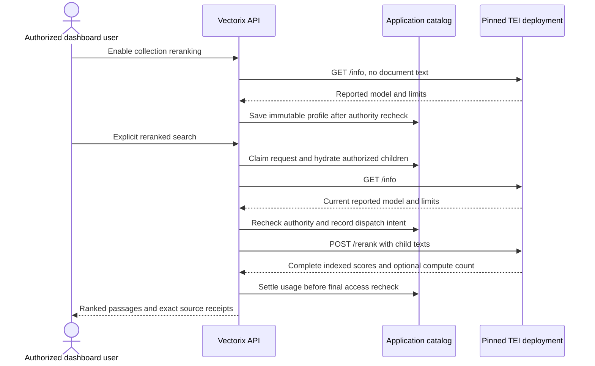

# Optional self-hosted TEI reranking

The optional `docker-compose.reranking.yml` runs an upstream Hugging Face Text
Embeddings Inference (TEI) CPU service alongside the existing infrastructure. It
is a separate reranking runtime. Document storage, query embeddings, collection
vectors and ordinary search continue using their existing services. Reranking
must be explicitly enabled for a collection and explicitly requested during a
search; configuring a destination does not enable it automatically.

This file does not change the default Compose services or the six Vectorix images
validated and published by CI. The TEI image is pulled from the upstream registry;
Vectorix does not build or publish it.

## Pinned runtime and model

| Setting                     | Value                                                                     |
| --------------------------- | ------------------------------------------------------------------------- |
| Official image              | `ghcr.io/huggingface/text-embeddings-inference:cpu-1.9`                   |
| Linux AMD64 manifest digest | `sha256:8419f533857b503ebf6ec292a95d4f1cf9c0464ac8b8abeef39518cf110e5726` |
| Model                       | `Alibaba-NLP/gte-multilingual-reranker-base`                              |
| Model revision              | `8215cf04918ba6f7b6a62bb44238ce2953d8831c`                                |
| Numeric type                | `float32`                                                                 |
| Host root URL               | `http://127.0.0.1:8081`                                                   |
| Compose-network root URL    | `http://tei:8080`                                                         |
| CPU / memory limits         | 4 CPUs / 8 GiB                                                            |
| Client batch limit          | 32 candidate pairs                                                        |
| Live inference permits      | 32 pairs across requests                                                  |
| Physical inference batch    | Up to 4 pairs, at most 8,192 tokens                                       |

The pinned image reports runtime version `1.9.4`; the `cpu-1.9` tag is not a patch-version identity. The CPU backend reports a maximum physical batch of four pairs.

The public [GTE model card](https://huggingface.co/Alibaba-NLP/gte-multilingual-reranker-base)
declares Apache-2.0, 306 million parameters, multilingual support and an 8,192-token
context. The pinned public repository is not gated: downloading it does not
require a Hugging Face account or token. Its safetensors file is approximately
612 MB, with a further 17 MB tokenizer. Float32 weight storage in memory is
approximately 1.22 GB before loader, activation, tokenizer and runtime overhead;
this is an estimate, not a measured resident-memory requirement.

For comparison, the public Apache-2.0
[BGE v2-m3 reranker](https://huggingface.co/BAAI/bge-reranker-v2-m3) has approximately
568 million parameters and a 2.27 GB safetensors download. GTE is the smaller
initial CPU target. Switching models requires a separate deployment and a new
saved collection reranking revision; editing a model label cannot change the
model already served by TEI.

The supplied image targets Linux AMD64. The CPU configuration requests AVX2
through `MKL_ENABLE_INSTRUCTIONS=AVX2`, rather than the upstream image's stronger
default. The host must expose compatible CPU instructions to the container;
virtual machines may require CPU passthrough. An image manifest or CPU flag check
alone does not prove that model loading and inference will work.

## Start and inspect

Run from the repository root, with the normal application infrastructure already
configured:

```sh
docker compose -f docker-compose.yml -f docker-compose.reranking.yml \
  --profile reranking up -d tei
docker compose -f docker-compose.yml -f docker-compose.reranking.yml \
  --profile reranking ps -a tei-cache-init tei
docker compose -f docker-compose.yml -f docker-compose.reranking.yml \
  --profile reranking logs --tail 50 tei
curl --fail --silent --show-error http://127.0.0.1:8081/info
```

The first start pulls the pinned image and downloads the pinned public model into
the private `tei-data` named volume. Allow time for download and the initial CPU
warmup. The health check allows five minutes before counting startup failures;
this is a bounded operational allowance, not a startup-time guarantee. The
initializer must exit successfully before TEI starts.

`VECTORIX_TEI_PORT` changes only the published loopback port; its default is 8081.
If it changes, update the application destination and its allowlist to the exact
same root URL. A containerized API uses `http://tei:8080` on the shared Compose
network instead of the host's loopback address. The browser never calls TEI
directly.

The one-off initializer uses the already-pinned PostgreSQL Alpine image only as
a shell utility. It has no network, a read-only root filesystem and only the
`CHOWN` capability; it changes ownership and mode of the named volume's root,
without recursively rewriting model files. The TEI process runs as UID/GID 1000,
with all capabilities removed, a read-only root filesystem, a bounded private
`/tmp`, and a private writable model cache. No host home directory, application
secrets or Hugging Face token cache is mounted.

This development service has no API key and publishes only to loopback. Other
containers on its Compose network can also reach it. For a shared or remote
deployment, supply operator-controlled TLS and access control before exposing
the runtime; configure its optional Bearer key in the organization endpoint or
the server's secret environment. Do not paste secrets into documentation, issue
comments or chat.

## Bind Vectorix to the destination

Choose either an organization endpoint or a complete platform fallback. For a
host-run API, the public server configuration is:

```dotenv
VECTORIX_DEFAULT_TEI_ENDPOINT=http://127.0.0.1:8081
VECTORIX_DEFAULT_TEI_API_KEY=
```

An empty platform API key intentionally sends no Authorization header. An
organization's configured endpoint takes precedence; an invalid configured
endpoint does not silently fall back to the platform. Existing enabled revisions
retain their saved credential binding and destination. If using an organization
endpoint without a platform default, add the exact root URL to
`VECTORIX_RERANKING_ALLOWED_ENDPOINTS` on the API server. This allowlist is
independent of the embedding allowlist. A complete platform fallback endpoint is
also an approved destination for its provider.

From the dashboard, save the organization's self-hosted reranking endpoint when
needed, open the collection's reranking settings, choose TEI and the exact model
ID above, choose a bounded candidate pool, and enable it. Enabling performs only
a metadata probe. It saves the reported model, revision, type, numeric type,
runtime version and execution limits; it does not send document text for model
inference.

The collection operator needs configuration rights; searching additionally needs
the explicit `ragRerank.use` permission and current collection-content access.
Existing API keys do not gain reranking access automatically. Ordinary search
remains available independently of this optional profile.



## Limits, identity and CPU tradeoffs

TEI serves one model per endpoint. The saved model ID must equal `/info.model_id`;
the inference POST contains no model selector. Every reranked search checks live
metadata against the saved snapshot and rechecks current grants, sources,
credentials, destination policy and configuration immediately before sending
candidate text. A metadata mismatch requires a new profile revision. A revision
label such as a commit SHA is endpoint-reported information, not a verified digest
of loaded weights. Pinning image and model revisions improves reproducibility but
does not turn metadata equality into weight attestation.

The native request sends `truncate: false`, `raw_scores: false` and
`return_text: false`. No candidate is silently truncated, dropped or split into
additional requests. Model-token limits are separate from Vectorix's input-byte
limits. This Compose profile disables global automatic truncation and keeps its
batch-token limit at 8,192; reducing that limit below the model's maximum while
truncation is disabled prevents TEI startup.

The CPU deployment allows 32 simultaneous inference permits. TEI 1.9 uses one
permit per candidate pair, so this limit must be at least the collection's
candidate pool as well as fitting the reported client-batch limit. Vectorix
checks both live limits before enabling or dispatching a profile. Other concurrent
requests can still exhaust available permits and cause an explicit overload
refusal. The CPU backend imposes a physical batch limit of four pairs, and CPU use
remains bounded to four CPUs. TEI's inference-permit limit is distinct from Vectorix's organization
request concurrency quota.

Start acceptance with short French and English passages and a small candidate
pool. The live metadata GET, final admission, inference POST and response share
Vectorix's existing 15-second native deadline. A CPU timeout is an explicit
failure, not a reason to retry automatically, substitute embedding similarity,
or extend the request deadline. Larger pools, longer contexts and simultaneous
searches require their own measurements. A GPU deployment is an operator option
for later capacity testing; it is not provided or verified by this CPU profile.

Scores are normalized cross-encoder scores in `[0,1]`, not calibrated confidence
values or directly comparable scores across models. The optional native
`x-compute-tokens` header records observed provider input tokens. A missing count
stays unknown; it is never replaced by zero or estimated from byte counts. Billed
tokens and billed search units remain unknown for this adapter.

## Actual validation and repeat acceptance

Owned run `781ec6094ad2`, from source checkpoint `f13923bf`, used the exact pinned
image and model above with four CPUs, an 8 GiB limit, UID/GID 1000, a read-only
root filesystem and the reviewed private cache/tmpfs restrictions.

| Check                                                                      | Actual result                                                                                                                                                      |
| -------------------------------------------------------------------------- | ------------------------------------------------------------------------------------------------------------------------------------------------------------------ |
| Public metadata and official CLI/source review                             | Passed                                                                                                                                                             |
| Merged Compose configuration without reading `.env`                        | Passed in a closed environment                                                                                                                                     |
| Official image pull, public model download, non-root loading and health    | Passed; cold startup recorded 81.288 seconds                                                                                                                       |
| Organization endpoint and collection enablement                            | Endpoint created through native curl without a key, verified in the UI; dashboard enablement saved the real metadata snapshot                                      |
| Real reranked search with four candidates                                  | Native curl reported 542.198 ms reranking and 754 ms total search; dashboard observations were 536 ms in the Dutch playground and 513 ms on the French search home |
| Usage                                                                      | Native input tokens: 409; billed input tokens and search units: null                                                                                               |
| Exact source                                                               | Preview and native HTTP download passed; original size 2,048 bytes and SHA-256 `ec7e2086bed47651af1bdd76a1f8d22678db13fbda17e7c5b5ead04083cd74cf`                  |
| Dashboard presentation                                                     | Playground/home comparisons, source states, English/French/Belgian Dutch controls, light/dark themes and a 390×844 mobile viewport checked                         |
| Representative throughput, concurrency, GPU and ranking-quality benchmarks | NOT RUN                                                                                                                                                            |

The container's cgroup memory peak was exactly `8,589,934,592` bytes (8 GiB),
equal to its configured limit. At the end, cgroup memory was `1,812,332,544` bytes
(about 1.69 GiB), and `OOMKilled` was false. These are cgroup observations, including
warmup and cache effects, not process RSS measurements. Reaching the limit means
8 GiB is not a capacity guarantee for other inputs or concurrent requests. The
individual latency observations above establish a working small-corpus CPU
journey, not a CPU/GPU comparison or a ranking-quality improvement.

An earlier owned attempt reached real runtime readiness but the helper incorrectly
expected patch version `1.9.0`; the pinned image actually reports `1.9.4`. The CPU
backend also imposes a physical batch of four despite an earlier CLI value of
one. The helper, Compose configuration and guide were corrected to the observed
version/batch, and that attempt was fully cleaned before the successful fresh
run. No automatic-truncation workaround was used.

To repeat acceptance, configure the organization endpoint through authorized
native HTTP/curl for automation, then verify it in the dashboard. Human operators
can also use the dashboard endpoint form. Index a small FR/EN corpus with the
existing embedding service, explicitly enable reranking from the collection UI,
and compare results over the same captured candidate pool. Check scores,
exact-version source receipts, failure states and known/unknown usage. Automate
document uploads and downloads through native HTTP with authorized least-privilege
API keys where supported, using native sessions for session-restricted operations;
no files were uploaded or downloaded through browser automation. Record actual
image/model identities, startup time, inference latency and memory observations.

To stop only the optional runtime while preserving its model cache:

```sh
docker compose -f docker-compose.yml -f docker-compose.reranking.yml \
  --profile reranking stop tei
```

Do not add `--volumes` to a merged Compose `down` command unless intentionally
deleting all selected infrastructure data, including application databases and
stored documents. The model cache can be reused on later starts.

## Official references

- [TEI 1.9.4 CPU Dockerfile](https://github.com/huggingface/text-embeddings-inference/blob/v1.9.4/Dockerfile)
- [TEI 1.9.4 runtime options](https://github.com/huggingface/text-embeddings-inference/blob/v1.9.4/router/src/main.rs)
- [TEI model loading and startup limits](https://github.com/huggingface/text-embeddings-inference/blob/v1.9.4/router/src/lib.rs)
- [TEI native reranking and candidate permits](https://github.com/huggingface/text-embeddings-inference/blob/v1.9.4/router/src/http/server.rs)
- [TEI Candle CPU batch policy](https://github.com/huggingface/text-embeddings-inference/blob/v1.9.4/backends/candle/src/lib.rs)
- [Intel MKL instruction-set dispatch controls](https://www.intel.com/content/www/us/en/docs/onemkl/developer-guide-linux/2024-1/instruction-set-specific-dispatch-on-intel-archs.html)
- [Native adapter contract and validation](../packages/reranking/README.md)
- [Optional reranking workflow](rag-reranking.md)
