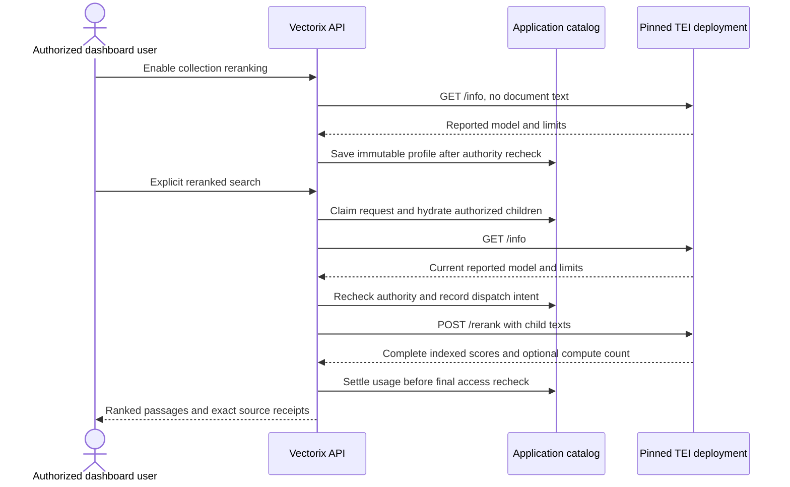

# Optional self-hosted TEI reranking

The optional `docker-compose.reranking.yml` runs an upstream Hugging Face Text
Embeddings Inference (TEI) CPU service alongside the existing infrastructure. It
is a separate reranking runtime. Document storage, query embeddings, collection
vectors and ordinary search continue using their existing services. Reranking
must be explicitly enabled for a collection and explicitly requested during a
search; configuring a destination does not enable it automatically.

This file does not change the default Compose services or the six Vectorix images
validated and published by CI. The TEI image is pulled from the upstream registry;
Vectorix does not build or publish it.

## Pinned runtime and model

| Setting                     | Value                                                                     |
| --------------------------- | ------------------------------------------------------------------------- |
| Official image              | `ghcr.io/huggingface/text-embeddings-inference:cpu-1.9`                   |
| Linux AMD64 manifest digest | `sha256:8419f533857b503ebf6ec292a95d4f1cf9c0464ac8b8abeef39518cf110e5726` |
| Model                       | `Alibaba-NLP/gte-multilingual-reranker-base`                              |
| Model revision              | `8215cf04918ba6f7b6a62bb44238ce2953d8831c`                                |
| Numeric type                | `float32`                                                                 |
| Host root URL               | `http://127.0.0.1:8081`                                                   |
| Compose-network root URL    | `http://tei:8080`                                                         |
| CPU / memory limits         | 4 CPUs / 8 GiB                                                            |
| Client batch limit          | 32 candidate pairs                                                        |
| Live inference permits      | 32 pairs across requests                                                  |
| Physical inference batch    | 1 pair, at most 8,192 tokens                                              |

The public [GTE model card](https://huggingface.co/Alibaba-NLP/gte-multilingual-reranker-base)
declares Apache-2.0, 306 million parameters, multilingual support and an 8,192-token
context. The pinned public repository is not gated: downloading it does not
require a Hugging Face account or token. Its safetensors file is approximately
612 MB, with a further 17 MB tokenizer. Float32 weight storage in memory is
approximately 1.22 GB before loader, activation, tokenizer and runtime overhead;
this is an estimate, not a measured resident-memory requirement.

For comparison, the public Apache-2.0
[BGE v2-m3 reranker](https://huggingface.co/BAAI/bge-reranker-v2-m3) has approximately
568 million parameters and a 2.27 GB safetensors download. GTE is the smaller
initial CPU target. Switching models requires a separate deployment and a new
saved collection reranking revision; editing a model label cannot change the
model already served by TEI.

The supplied image targets Linux AMD64. The CPU configuration requests AVX2
through `MKL_ENABLE_INSTRUCTIONS=AVX2`, rather than the upstream image's stronger
default. The host must expose compatible CPU instructions to the container;
virtual machines may require CPU passthrough. An image manifest or CPU flag check
alone does not prove that model loading and inference will work.

## Start and inspect

Run from the repository root, with the normal application infrastructure already
configured:

```sh
docker compose -f docker-compose.yml -f docker-compose.reranking.yml \
  --profile reranking up -d tei
docker compose -f docker-compose.yml -f docker-compose.reranking.yml \
  --profile reranking ps -a tei-cache-init tei
docker compose -f docker-compose.yml -f docker-compose.reranking.yml \
  --profile reranking logs --tail 50 tei
curl --fail --silent --show-error http://127.0.0.1:8081/info
```

The first start pulls the pinned image and downloads the pinned public model into
the private `tei-data` named volume. Allow time for download and the initial CPU
warmup. The health check allows five minutes before counting startup failures;
this is a bounded operational allowance, not a startup-time guarantee. The
initializer must exit successfully before TEI starts.

`VECTORIX_TEI_PORT` changes only the published loopback port; its default is 8081.
If it changes, update the application destination and its allowlist to the exact
same root URL. A containerized API uses `http://tei:8080` on the shared Compose
network instead of the host's loopback address. The browser never calls TEI
directly.

The one-off initializer uses the already-pinned PostgreSQL Alpine image only as
a shell utility. It has no network, a read-only root filesystem and only the
`CHOWN` capability; it changes ownership and mode of the named volume's root,
without recursively rewriting model files. The TEI process runs as UID/GID 1000,
with all capabilities removed, a read-only root filesystem, a bounded private
`/tmp`, and a private writable model cache. No host home directory, application
secrets or Hugging Face token cache is mounted.

This development service has no API key and publishes only to loopback. Other
containers on its Compose network can also reach it. For a shared or remote
deployment, supply operator-controlled TLS and access control before exposing
the runtime; configure its optional Bearer key in the organization endpoint or
the server's secret environment. Do not paste secrets into documentation, issue
comments or chat.

## Bind Vectorix to the destination

Choose either an organization endpoint or a complete platform fallback. For a
host-run API, the public server configuration is:

```dotenv
VECTORIX_DEFAULT_TEI_ENDPOINT=http://127.0.0.1:8081
VECTORIX_DEFAULT_TEI_API_KEY=
```

An empty platform API key intentionally sends no Authorization header. An
organization's configured endpoint takes precedence; an invalid configured
endpoint does not silently fall back to the platform. Existing enabled revisions
retain their saved credential binding and destination. If using an organization
endpoint without a platform default, add the exact root URL to
`VECTORIX_RERANKING_ALLOWED_ENDPOINTS` on the API server. This allowlist is
independent of the embedding allowlist. A complete platform fallback endpoint is
also an approved destination for its provider.

From the dashboard, save the organization's self-hosted reranking endpoint when
needed, open the collection's reranking settings, choose TEI and the exact model
ID above, choose a bounded candidate pool, and enable it. Enabling performs only
a metadata probe. It saves the reported model, revision, type, numeric type,
runtime version and execution limits; it does not send document text for model
inference.

The collection operator needs configuration rights; searching additionally needs
the explicit `ragRerank.use` permission and current collection-content access.
Existing API keys do not gain reranking access automatically. Ordinary search
remains available independently of this optional profile.



## Limits, identity and CPU tradeoffs

TEI serves one model per endpoint. The saved model ID must equal `/info.model_id`;
the inference POST contains no model selector. Every reranked search checks live
metadata against the saved snapshot and rechecks current grants, sources,
credentials, destination policy and configuration immediately before sending
candidate text. A metadata mismatch requires a new profile revision. A revision
label such as a commit SHA is endpoint-reported information, not a verified digest
of loaded weights. Pinning image and model revisions improves reproducibility but
does not turn metadata equality into weight attestation.

The native request sends `truncate: false`, `raw_scores: false` and
`return_text: false`. No candidate is silently truncated, dropped or split into
additional requests. Model-token limits are separate from Vectorix's input-byte
limits. This Compose profile disables global automatic truncation and keeps its
batch-token limit at 8,192; reducing that limit below the model's maximum while
truncation is disabled prevents TEI startup.

The CPU deployment allows 32 simultaneous inference permits. TEI 1.9 uses one
permit per candidate pair, so this limit must be at least the collection's
candidate pool as well as fitting the reported client-batch limit. Vectorix
checks both live limits before enabling or dispatching a profile. Other concurrent
requests can still exhaust available permits and cause an explicit overload
refusal. Physical batches remain limited to one, and CPU use remains bounded to
four CPUs. TEI's inference-permit limit is distinct from Vectorix's organization
request concurrency quota.

Start acceptance with short French and English passages and a small candidate
pool. The live metadata GET, final admission, inference POST and response share
Vectorix's existing 15-second native deadline. A CPU timeout is an explicit
failure, not a reason to retry automatically, substitute embedding similarity,
or extend the request deadline. Larger pools, longer contexts and simultaneous
searches require their own measurements. A GPU deployment is an operator option
for later capacity testing; it is not provided or verified by this CPU profile.

Scores are normalized cross-encoder scores in `[0,1]`, not calibrated confidence
values or directly comparable scores across models. The optional native
`x-compute-tokens` header records observed provider input tokens. A missing count
stays unknown; it is never replaced by zero or estimated from byte counts. Billed
tokens and billed search units remain unknown for this adapter.

## Planned acceptance and actual validation

The deployment recipe is ready for a real CPU acceptance run. At this stage:

| Check                                                                       | Status                     |
| --------------------------------------------------------------------------- | -------------------------- |
| Public image manifest, pinned model metadata and official CLI/source review | Complete, read-only checks |
| Merged Compose configuration validation without reading `.env`              | Passed, closed environment |
| Official image pull and public model download                               | NOT RUN                    |
| Non-root model loading, health and real inference on this VM                | NOT RUN                    |
| Dashboard configuration and search against this real runtime                | NOT RUN                    |
| CPU latency, peak memory and ranking-quality evaluation                     | NOT RUN                    |

The acceptance journey should configure the real endpoint from the dashboard,
index a small FR/EN corpus with the existing embedding service, explicitly enable
reranking, and compare results over the same captured candidate pool. Check
scores, exact-version source receipts, failure states and known/unknown usage.
Automate any document upload or download through native HTTP with an authorized
least-privilege API key; use the browser only for dashboard states. Record actual
image/model identities, startup time, inference latency and memory observations.
A successful smoke test alone does not establish a relevance or capacity gain.

To stop only the optional runtime while preserving its model cache:

```sh
docker compose -f docker-compose.yml -f docker-compose.reranking.yml \
  --profile reranking stop tei
```

Do not add `--volumes` to a merged Compose `down` command unless intentionally
deleting all selected infrastructure data, including application databases and
stored documents. The model cache can be reused on later starts.

## Official references

- [TEI 1.9 CPU Dockerfile](https://github.com/huggingface/text-embeddings-inference/blob/v1.9.0/Dockerfile)
- [TEI 1.9 runtime options](https://github.com/huggingface/text-embeddings-inference/blob/v1.9.0/router/src/main.rs)
- [TEI model loading and startup limits](https://github.com/huggingface/text-embeddings-inference/blob/v1.9.0/router/src/lib.rs)
- [TEI native reranking and candidate permits](https://github.com/huggingface/text-embeddings-inference/blob/v1.9.0/router/src/http/server.rs)
- [Intel MKL instruction-set dispatch controls](https://www.intel.com/content/www/us/en/docs/onemkl/developer-guide-linux/2024-1/instruction-set-specific-dispatch-on-intel-archs.html)
- [Native adapter contract and validation](../packages/reranking/README.md)
- [Optional reranking workflow](rag-reranking.md)
