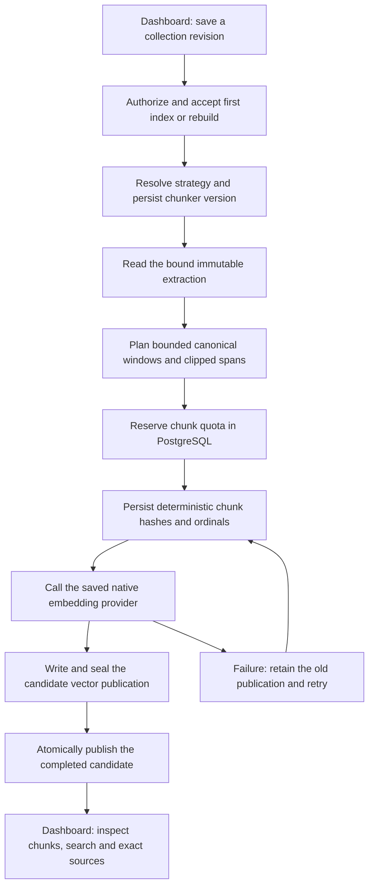

# Token-window indexing and rebuilds

M6a introduced token windows as a second executable chunking strategy in the collection dashboard. Document structure and token windows support Ollama, Cohere, Voyage, OpenAI and Mistral without parent/child expansion. The current dashboard also executes [M6b semantic profiles](rag-semantic-planning.md), whose automated validation and real Ollama production-dashboard acceptance are complete. Parent/child context remains planned for M6c. The M6a slice required no new database migration: collection revisions already retained the strategy/settings and generations their chunker version. M6b has its own approved additive migration, documented in its guide.

## Window semantics

`token-window-utf8-v1` uses a conservative **UTF-8 bytes / 3 estimate**, not the selected model's tokenizer. Target, minimum, maximum and overlap are estimated-token settings. The planner works on the extraction's canonical text without normalization or rewriting. Safe UTF-16 offsets avoid splitting surrogate pairs; this does not promise grapheme-cluster boundaries.

The ordinary window targets `targetTokens × 3` bytes. `maxTokens × 3` and the independently verified model input-byte allowance are hard caps; the smaller cap wins after embedding preparation/title overhead. A short final tail may extend the preceding window when the configured minimum and hard caps permit it. A useful short tail is never silently discarded. Overlap uses a bounded suffix and must always advance the next window. Pure whitespace/punctuation/emoji-only windows are omitted consistently with the structure planner; every attempted window still counts against the work limit.

Unlike document structure, token windows can cross PDF pages, DOCX sections/story parts or Markdown headings. Each chunk retains all intersecting immutable extraction source spans clipped to its exact range. Crossing a boundary does not invent a single page or heading for the entire passage. Public chunk/search responses continue to expose at most 64 spans with `sourceSpansTruncated`; the retained extraction and authorized source selector remain available for precise inspection.

The generator bounds attempted work independently of emitted chunks. Indexing finishes the bounded plan before quota reservation or chunk materialization, with existing aggregate text/span memory caps. An over-limit plan fails explicitly and does not publish a partial document. Native embedding requests retain their no-silent-truncation policy; a provider can still reject an input because the estimate is not exact tokenization.

## Saved versions and publication

New admissions select the version associated with the saved strategy. Existing `DOCUMENT_STRUCTURE` / `structure-utf8-v1` generations keep their original planner. `TOKEN_WINDOW` / `token-window-utf8-v1` generations replay deterministic windows on retries and later document replacements. Unknown or mismatched saved versions fail with `MODEL_CHANGED` before task-specific credential, source, embedding or vector-adapter I/O. Shared worker destination bootstrap remains independent of an individual task. Cleanup must still be able to retire unsupported historical generations.

Editing a draft does not alter the active generation. A rebuild creates a separate table and retains search on the previous publication until the existing activation checks succeed. Retry compares existing chunk ordinals, hashes and source spans before writing missing chunks. Existing active/retained/reserved accounting, authority rechecks, ordered document changes and exact-version source holds apply to both strategies. An old search receipt continues to identify its captured authorized source during the retention period.

API major 1 retains the same explicit DTOs and URLs. Compatible revision `1.13.0` announces executable token-window profiles. Registry-derived RPC/REST headers and OpenAPI documents remain the source of release metadata.

## Dashboard acceptance recipe

Prerequisites: the [local infrastructure](rag-infrastructure.md), API/web/workers, an organization manager, a private S3 binding, and a verified native embedding credential. For a local model, follow [Ollama and EmbeddingGemma](rag-ollama-embeddinggemma.md). Organization credentials precede environment defaults; invalid configured organization credentials do not fall back.

1. Upload a mixed French/English Markdown document containing multiple headings, accents and emoji. Wait for extraction to become ready.
2. Create a collection with **Token windows**, a small target/overlap and a compatible model/dimension. Verify the estimate, independent cap and cross-boundary source explanation. Attach the document and start indexing.
3. Wait for the active generation, inspect bounded chunk pages and estimated counts, then run lexical/vector/hybrid searches and open the authorized source preview/original. Reload the page and repeat a search.
4. On an already indexed structure collection, edit the saved draft to token windows. Confirm the old generation still serves searches. Start the rebuild and inspect the new chunks after activation. Previously captured source receipts must still read the exact old source while retained.
5. Replace a document and inspect the new version after processing. On a provider failure, the previous publication stays searchable; retry completes the candidate without duplicated accounting.
6. Switch English, French and Belgian Dutch and inspect labels/help. A reader with a current collection grant can search and inspect sources but cannot rebuild; revoking that grant blocks content access. Foreign organization identifiers do not grant access.
7. Semantic is now a separate executable strategy; follow the [M6b recipe](rag-semantic-planning.md) for boundary progress, usage and threshold rebuild checks. Parent/child settings remain a draft with an explicit execution gate and must not advertise a completed parent-context journey.

### Actual M6a verification

Automated validation passed: 23 workspace type checks, 23 lint tasks, 44 backend regressions, 23 chunking tests, 123 embedding-adapter tests, 162 disposable core/RAG HTTP tests, four production builds and all six image/runtime/infrastructure checks. The catalog pass includes fresh migrations, upgrades, repeat deployments and schema parity. Twelve added HTTP journeys cover token-window admission, exact Unicode/provenance, idempotency/accounting, current/foreign access, saved-version failure before embedding, provisioning recovery, quotas, replacement/rebuild retries, old receipts, future-mode gates and all four controlled hosted native protocols. Independent source, planner, UI and test reviews found no remaining actionable P1/P2.

An initial catalog pass found two stale revision assertions and a new test querying a nonexistent task field; these were corrected in the test harness. The final complete 162-test rerun passed, with scoped API type/lint checks after the corrections. Production behavior was unchanged by those test repairs.

Actual browser acceptance used production web/API/workers, private disposable application/vector PostgreSQL, Redis and RustFS, and a separate Ollama 0.40.8 container reusing the existing test model volume. EmbeddingGemma retrieval, 128 dimensions and context 2048 were verified against weight digest `85462619ee721b466c5927d109d4cb765861907d5417b9109caebc4e614679f1`.

- A 1,223-byte mixed FR/EN Markdown original, with NFD accents and emoji, was uploaded and extracted through the dashboard. Its token-window collection (target 64, overlap 8, minimum 16, maximum 96) published seven passages. Chunk preview showed overlap, a passage crossing the language heading and the intact final marker. A separate observation confirmed all 14 token-window chunks across the two final active generations had exact canonical UTF-16 ranges, text hashes, estimates and byte bounds.
- English hybrid retrieval returned seven results, French vector retrieval returned seven, and French keyword retrieval after reload returned three. Exact source preview showed all 1,167 canonical characters. The first downloaded original matched SHA-256 `776e5a41d8754e65cb5144ac3381afab1286cf911fb179df47268d2a35fe4e0a`.
- A second collection reused the same library document and first published two structure chunks. Saving token-window revision 2 left generation A searchable. The review dialog compared both strategies/settings; a keyword request after rebuild admission still returned A. Generation B then activated with seven chunks, two retained old chunks and zero reservations. A new French hybrid request returned B; earlier results displayed the previous-generation notice.
- A source dialog captured from A before rebuilding downloaded the same original after A retired, with the same SHA-256. No source-retention clock was advanced. The ordinary retention period was not soaked to completion in the browser.
- New help and profile summaries were inspected in English, French and Belgian Dutch. Belgian Dutch persisted after reload, and initial English was restored. Selecting semantic or parent/child settings displayed the planned-mode explanation; these unsaved selections were cancelled and revision 2 stayed active.
- Both browser consoles had no warnings/errors. The three owned previews, five owned containers, two tabs and two verified synthetic downloads were removed; the existing named model volume was preserved.

Replacement/failure/retry, quota and permission-negative paths in this slice were verified by automated real-transport tests, not separately repeated in the browser. Controlled HTTP-provider vectors do not establish hosted model connectivity or relevance quality; live paid-provider checks remain deferred until organization credentials are configured. This local corpus is acceptance evidence, not a general retrieval-quality benchmark.

## Entry points

- `packages/chunking/src/`: versioned strategy dispatch, unchanged structure planner and bounded token-window planning.
- `packages/routers/rag/src/services/indexing/{generation-profile,generation-acceptance,index-document,process,search}.ts`: saved-version preflight, acceptance, planning, background execution and active-profile search.
- `apps/web/components/rag/collections/{profile-fields,profile-summary}.tsx`: editable settings, execution gates and strategy explanation.
- `apps/web/components/rag/indexing/`: task status, rebuild actions, bounded chunk preview, search and source inspection.
- `apps/api/src/rag-tests/{token-window,token-window-providers}.ts`: real disposable catalog/vector/object state with explicitly synthetic native-protocol vectors.

[M6b](rag-semantic-planning.md) now implements semantic boundary planning and durable technical work reservations/usage, with current validation recorded separately from the historical M6a results above. Parent/child containment/deduplication and operational recovery/load acceptance remain planned for M6c/M7. See the [implementation plan](rag-implementation-plan.md).
