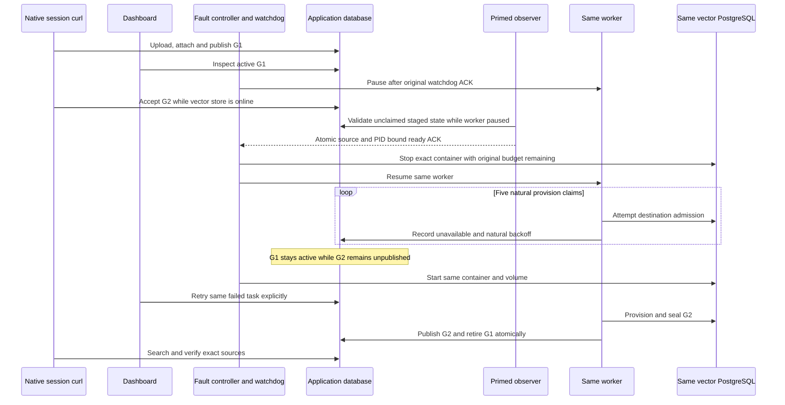

# Vector PostgreSQL provisioning outage acceptance

**Status: the composed `VECTOR_PROVISION_V1` outage/recovery trial is verified at helper commit `5f71fed71c3da4d269af7c7e27d37a044042d3ab` and production/build base `77ac06bd99c113b8cf32e2f48bcaec79038dd94a`.** Fresh run `9ab83712ad3f` completes all six observations and five native session-curl workflows, five natural failed claims, same-store restoration, one admitted dashboard Retry and normal Logout. Exact cleanup restores all 42 source byte/mode pairs and all 16 gates disabled. This acceptance change adds no production behavior, schema, migration, permission, public DTO or API revision.

Historical run `5ffbaa5ed44c` remains verified only at its original `9cef` helpers/`dc314` production builds and 31-pair/13-gate restoration. The failed `2aed`, `24d`, `8aa` and later composed `778` trials remain INCOMPLETE with their original evidence; `778`'s nested guard cause stays UNKNOWN. No later commit is retrospectively assigned to either successful trial.

The dependency is the reviewed disabled protocol-2 S3/cleanup harness at `79bd189`, integrated as a local ancestor with actual main `c93e30c7`. Its historical source inventories and native results remain unchanged. The original vector delta adds a third explicit scenario in namespace `vectorix-m7c-vector-provision-<12hex>`. States, databases and receipts from another scenario are refused; this is not a replay of ingestion, cleanup, capacity or Redis evidence. The cleanup and Redis delivery dependencies have reached actual main. The completed native result retains its tested `dc314fcfe02bbc30877bb1a4a1720d1bb3abccde` product/build attribution. The current source composes actual main `77ac06bd99c113b8cf32e2f48bcaec79038dd94a`; its separate composed validation and fresh `9ab` trial are recorded below, never reassigned to the old trial.

## Exact journey and evidence boundaries

1. Create four new owned PostgreSQL/vector/Redis/RustFS stores and volumes with exact `_test` databases. Launch API, web, workers, bounded SMTP and one synthetic embedding process, all on recorded loopback bindings. Admin is build-pinned but not launched. Source/build/helper/migration/runtime/curl pins precede preparation; no `.env`, application database, hosted key, model volume or GPU is used.
2. An ordinary native HTTP account/organization seed signs out. Session curl creates one collection from the fixed platform-fallback profile, uploads the pinned TXT bytes, waits for native extraction READY, attaches it and starts G1. Native read-only polling requires G1 ACTIVE before the setup receipt is published. No organization credential, API key, role, group or explicit grant is created by the recipe. The collection's normal creator grants remain native behavior.
3. Inspect the existing dashboard index/search controls using normal login. Curl verifies G1 LEXICAL/VECTOR/HYBRID results, the observed publication, exact child/parent ranges, source preview and original bytes. **All upload/download transfers use curl; the browser never transfers files or deletes content.** The positive read path uses the existing owner session, not an API-key authorization claim.
4. Emit the one-shot `vector-g1-ready` proof immediately before enrolling the independent watchdog. After its ACK, pause only the exact worker through pidfd. Session curl accepts G2 using the unchanged saved revision and expected G1 ID while the vector destination is still online. `vector-g2-staged` requires G1 ACTIVE, G2 PROVISIONING, an unclaimed PENDING/attempt-0 PROVISION task, zero live claims, and no G2 physical generation/table.
5. Start the outage observer while the worker is still paused. It initializes the production planner and both readers, validates the unclaimed staged application/physical state and closes its vector reader before atomically publishing `vector-observer-ready.json`. Only this immutable, fresh, source/proof/PID-bound ACK permits the fault command. Require at least 625 seconds remain in the original 900-second window immediately before stopping the exact owned vector container, then resume the same worker. Only that container is stopped; the application database, Redis, RustFS, API, fixture and web remain available. DB-only polling observes five failed provision claims and all natural **10/20/40/80-second** indexing backoffs, totaling at least 150 seconds plus actual I/O/scans. This differs from S3 cleanup's 20/40/80/160-second schedule. Attempts and monotone lease epochs are recorded, never changed. Terminal task state is FAILED/VECTOR_UNAVAILABLE with cleared lease; the generation can remain PROVISIONING.
6. During the outage, G1 remains the active catalog pointer. LEXICAL search and S3 source reads can still work. A real HYBRID request must return the typed VECTOR_UNAVAILABLE refusal; it must not silently degrade to lexical results. No vector physical query or vector-readability claim is made while the store is stopped.
7. Restore the same vector container and volume, preserving the database identity and saved destination fingerprint. `vector-restored-before-retry` confirms G1's sealed physical manifest and G2's continued absence. Use the actual dashboard **Retry task** control once. Native retry resets the same accepted task and fences its epoch; the worker provisions, embeds and activates G2 automatically.
8. Require G2 ACTIVE, G1 RETIRED, exact sealed physical manifests and canonical app layouts, correct source holds and active/retained/reserved accounting. Curl verifies all three search modes against G2 and exact original/preview bytes. The exact inventory is two cost tasks for G1, four before G2 activation, then those four plus one unclaimed PENDING/ACCEPTED G1 CLEAN_GENERATION task. Its schedule equals G1.cleanupAfter and the retained hold deadline; G1.retiredAt equals G2.activatedAt and the deadline uses the pinned production source-retirement constant (currently 17 minutes). No clock advance, row rewrite or forced cleanup is allowed. Normal logout precedes the final signed-out proof and exact owned-resource cleanup.



This scenario targets an unavailable destination during the **PROVISION task**, which can fail in destination initialization before provisioning DDL is attempted. It does not establish interruption inside DDL, a partial vector batch, sealing, or the interval between vector seal and catalog commit. Existing [native adapter tests](../packages/vector-store/tests/adapter.test.ts) cover epoch fencing, partial manifests, immutable sealing and physical index shape. The [post-seal worker regression](../apps/api/src/rag-tests/index-worker.ts) reconstructs catalog state in CI; it is not native outage evidence. A write-boundary scenario would need a separately reviewed bounded embedding-response barrier and is outside this slice.

## Components and limits

`lifecycle.py`, `private.mjs`, `seed.mjs`, `bucket.mjs`, `smtp.mjs` and `fault.py` reuse the existing protocol-2 ownership, pinning, private files, pidfd and cleanup primitives. Seed close-before-success and the guard-timeout hook reuse the reviewed Redis changes. The new focused files are:

- `vector-embedding.mjs`: synthetic Ollama `/api/tags`, `/api/show` and `/api/embed` only; fixed model, three deterministic nonzero dimensions, 16 inputs/16 KiB request, four active requests, 16 concurrent sockets, 128 total connections, 128 admitted requests and a 45-minute process lifetime. It has no outbound I/O and receives no database/SMTP/provider secret environment. Five-second HTTP bounds remain subject to fail-closed guard work. Numeric counters contain no input text or raw mail.
- `vector-curl.mjs`: the reviewed private-file curl transport with a closed route set. Binary pin, no `.curlrc`, proxy, redirect or automatic retry; two-second connect, at most 15 seconds/call, 16 KiB request and 64 KiB response body. Secret headers/bodies stay in exclusive 0600 files and are removed after each child. Its binary hash does not attest all shared OS libraries.
- `vector-workflow.mjs`: one-shot `prepare-g1`, `rebuild-g2`, `search-g1`, `search-outage` and `search-g2` modes. At most 80 ordinary HTTP calls within 180 seconds; sign-out retains one separate ten-second cleanup attempt. Source and index readiness each have at most 30 read-only polls. Unknown mutation acceptance is not retried. Completed receipts require confirmed sign-out and final guard checks.
- `vector-observation.mjs`: pure fixed-profile, G1/G2 pointer, layout, source-hold, accounting and natural-backoff validation.
- `vector-snapshot.mjs`: bounded READ ONLY application/physical readers. Two generations, two candidates, at most five tasks, 32 app rows and eight child vectors per generation; JSON spans are sliced to 64 inside SQL. Physical manifests expose IDs/hashes/counts, never raw vectors. Vector identity is hashed in evidence.
- `vector-observe.mjs`: six exclusive phase proofs, at most 360 two-second outage snapshots/11 changed task states, sharing the original watchdog deadline and a 720-second maximum. Online phases have a 120-second acceptance deadline. Each physical query requires positive remaining budget immediately before dispatch and a client query timeout bounded by that budget; rollback and reader closure are still drained after refusal. App metadata is reread after physical I/O; this is not an atomic cross-store snapshot. Both readers must close successfully and the resource/watchdog/ACK/reference guard must pass before an OBSERVED proof or completed stdout is written.

Every later phase binds G1's publication, ordered child manifest and destination fingerprint to the initial READY proof; online phases also compare its sealed physical receipt and database identity. Coherently changed application and physical metadata cannot replace that baseline. G2 retains the same PROVISION task ID from its staged proof through final sign-out. Its epoch must advance across failed claims and explicit retry, remain unchanged between failure and restoration, and remain unchanged from completion through sign-out.

The vector-only `vector-outage-watch` guard admits only UP/paused before an exact fault intent, then the monotone UP/paused → DOWN/paused → DOWN/running transition; skipped intermediate samples are allowed, backwards transitions and UP/running are refused. Existing normal staged/outage guards are unchanged. The guard samples the worker before its final store read to avoid combining an earlier UP sample with a later resumed worker. Before the first await, an atomic intent records the observer identity for cleanup. Its ready ACK binds run/scenario/phase, selected source commit and helper hashes, staged-proof hash, original watchdog hash/deadline, exact worker/store and observer PID/start ticks/boot/cwd/command hash. Fault admission requires that same live, non-stopped observer and a maximum 90-second ACK age before intent, immediately before stop and immediately before resume. After admission, the immutable ACK remains pinned without expiring during the natural backoffs. No rearming is possible.

The already initialized application reader polls before, during and after the source-bound fault intent; there is no cold import or new database connection after worker resume. Pre-fault waiting is bounded by 90 seconds, the existing 360-snapshot/720-second limit includes waiting and the original 900-second watchdog remains authoritative. The new guard child is capped at 15 seconds and the application READ ONLY transaction at 15 seconds. Cleanup identity-checks and drains the observer with pidfd/SIGTERM before removing stores, with a 55-second refusal timeout and no SIGKILL. Cancellation, intervention, failed close or final guard refusal prevents a success proof.

On failure, evidence retains only eleven validated eight-field durable schedule rows plus a separate validated twelfth overflow event if present, never a full task, raw lease token, source text or native error. `COLLECT_BOUND` identifies collector overflow; `INCOMPLETE_TRACE` identifies fewer than five schedules at validation. Both retain the original requirements for five claims and four natural delays.

The original watchdog window includes pause, native G2 admission, outage, natural retries and restoration. It is never refreshed. A late refusal restores only enrolled identities and remains INCOMPLETE; any watchdog intervention permanently prevents PASS. Cleanup resumes a paused identity-matching worker before graceful shutdown and removes only recorded stores/volumes/processes, without SIGKILL. SMTP retains its existing bounded synthetic capture; zero mail is not assumed.

The model name/digest and vectors are **synthetic protocol fixtures**. A saved native Ollama-shaped capability snapshot is not an attestation of actual model weights. This exercise measures neither Gemma, hosted-provider quality, usage billing, latency, fairness nor capacity. Existing frozen reference/capacity corpora and evidence remain untouched.

## Disabled commands for a separately reviewed future run

All 13 current I/O gates are restored to true. A future vector run requires a reviewed activation of exactly nine: lifecycle, fault, seed, bucket, SMTP and the four new entry/transport gates. The unrelated ingestion/object and cleanup entries stay disabled. Do not enable anything from this guide alone. The operator must select a fresh 12-hex run and review current source/build/helper pins first; no future run is selected by this guide.

After that separate approval, these are the closed command shapes from the repository root (foreground apps and watchdog use separate owned terminals):

```sh
python3 tests/acceptance/s3-outage/lifecycle.py --run "$RUN" --scenario VECTOR_PROVISION_V1 --mode prepare
python3 tests/acceptance/s3-outage/lifecycle.py --run "$RUN" --scenario VECTOR_PROVISION_V1 --mode deploy-existing-migrations
# Deployment already initializes the private bucket: do not invoke bucket again.
python3 tests/acceptance/s3-outage/lifecycle.py --run "$RUN" --scenario VECTOR_PROVISION_V1 --mode app-smtp
python3 tests/acceptance/s3-outage/lifecycle.py --run "$RUN" --scenario VECTOR_PROVISION_V1 --mode app-embedding
python3 tests/acceptance/s3-outage/lifecycle.py --run "$RUN" --scenario VECTOR_PROVISION_V1 --mode app-api
python3 tests/acceptance/s3-outage/lifecycle.py --run "$RUN" --scenario VECTOR_PROVISION_V1 --mode seed
python3 tests/acceptance/s3-outage/lifecycle.py --run "$RUN" --scenario VECTOR_PROVISION_V1 --mode app-workers
python3 tests/acceptance/s3-outage/lifecycle.py --run "$RUN" --scenario VECTOR_PROVISION_V1 --mode app-web
node tests/acceptance/s3-outage/vector-workflow.mjs --run "$RUN" --scenario VECTOR_PROVISION_V1 --mode prepare-g1
# Pause for normal dashboard login/read-only G1 inspection before the following checks.
node tests/acceptance/s3-outage/vector-workflow.mjs --run "$RUN" --scenario VECTOR_PROVISION_V1 --mode search-g1
node tests/acceptance/s3-outage/vector-observe.mjs --run "$RUN" --scenario VECTOR_PROVISION_V1 --phase vector-g1-ready
python3 tests/acceptance/s3-outage/fault.py --run "$RUN" --scenario VECTOR_PROVISION_V1 --mode watchdog
python3 tests/acceptance/s3-outage/fault.py --run "$RUN" --scenario VECTOR_PROVISION_V1 --mode pause-worker --fixture-ready
node tests/acceptance/s3-outage/vector-workflow.mjs --run "$RUN" --scenario VECTOR_PROVISION_V1 --mode rebuild-g2
node tests/acceptance/s3-outage/vector-observe.mjs --run "$RUN" --scenario VECTOR_PROVISION_V1 --phase vector-g2-staged
# Start the primed observer in a separate owned terminal while the worker is still paused.
node tests/acceptance/s3-outage/vector-observe.mjs --run "$RUN" --scenario VECTOR_PROVISION_V1 --phase vector-outage-failed
# Wait for its complete atomic vector-observer-ready.json ACK; never replay or refresh it.
python3 tests/acceptance/s3-outage/fault.py --run "$RUN" --scenario VECTOR_PROVISION_V1 --mode storage-outage
# While it is polling, run the outage curl checks; wait for both to finish.
node tests/acceptance/s3-outage/vector-workflow.mjs --run "$RUN" --scenario VECTOR_PROVISION_V1 --mode search-outage
python3 tests/acceptance/s3-outage/fault.py --run "$RUN" --scenario VECTOR_PROVISION_V1 --mode restore
# Wait for the independent watchdog to exit normally and publish its nonintervention receipt.
node tests/acceptance/s3-outage/vector-observe.mjs --run "$RUN" --scenario VECTOR_PROVISION_V1 --phase vector-restored-before-retry
# Dashboard: click Retry task once, then wait for the target G2 to become ACTIVE.
node tests/acceptance/s3-outage/vector-observe.mjs --run "$RUN" --scenario VECTOR_PROVISION_V1 --phase vector-g2-ready
node tests/acceptance/s3-outage/vector-workflow.mjs --run "$RUN" --scenario VECTOR_PROVISION_V1 --mode search-g2
# Dashboard: sign out normally before the final observation.
node tests/acceptance/s3-outage/vector-observe.mjs --run "$RUN" --scenario VECTOR_PROVISION_V1 --phase vector-signed-out
python3 tests/acceptance/s3-outage/lifecycle.py --run "$RUN" --scenario VECTOR_PROVISION_V1 --mode cleanup
```

Run G1 source checks before the one-shot READY proof so watchdog enrollment does not consume its 90-second freshness budget on transfers. Before the outage, start and prime the observer, wait for its ACK, then invoke the fault; run curl checks while the same reader polls. Starting a cold observer only after worker resume cannot guarantee the first ten-second schedule is observed. After its terminal proof, restore immediately; do not spend the recovery proof's 90-second freshness window on browser work.

Use the existing `abort-incomplete` fault command if control fails; never rerun a partial mutation or refresh a proof/watchdog. The same scoped cleanup is required for any failed setup.

## Validation record

The initial focused pass reports 37 mocked Python tests, 40 pure/injected Node tests and 14 Node syntax checks. The pre-review focused pass after source-proof/epoch refinements passes 37 Python tests, 43 Node tests, 14 Node syntax checks and four Python AST checks. The three changed documents pass formatting, one Mermaid diagram and 79 local Markdown links; `git diff --check` is clean. These cases exercise real helper functions with injected HTTP/PG/process boundaries, not native resources. At that initial checkpoint, production planner execution, current app builds, native transfers/indexing/search, actual container outage/reconnect, dashboard retry, browser locales and owned teardown were **NOT_RUN**. Later validation and the completed native result below remain separate records.

The subsequent independent-review correction adds per-query remaining-budget checks and immutable G1/task/epoch continuity. Four new injected cases cover positive completion, exhaustion before later queries/COMMIT, coherent application-plus-physical G1 replacement and task/epoch substitution. The first revision pass rejects one new positive fixture because it omitted the organization binding that the real CLI supplies; the guard is preserved and only that fixture is corrected. The repeated cohesive pass succeeds with 37 Python tests, 47 Node tests, 14 syntax checks and four AST checks. The original disabled inventory remains archived and its provenance is not rewritten. No native trial is implied by this correction.

The actual-main checkpoint subsequently passes scoped API/workers/web/admin type checks and lint, followed by four serialized production builds. These builds use closed synthetic configuration and do not connect to a database or embedding service. Generated Next declarations are restored exactly. Before any run selection, a further source review finds two acceptance-only gaps: the synthetic Ollama fixture omits the dimensioned embedding request used by production, and curl metadata/hash checks reopen its pathname. The fixture now accepts exactly the native probe DTO without dimensions or the native embedding DTO with dimensions equal to three; other fields and dimensions are refused. Curl checks root ownership, file type, non-writable group/world mode, size and pinned SHA on one descriptor opened with `O_RDONLY | O_NOFOLLOW`, then closes it in `finally`.

Five added pure/injected regressions cover both native request bodies and refusals, descriptor continuity despite pathname replacement, metadata/hash drift and descriptor cleanup on failure. The repeated coherent offline pass succeeds with 37 Python tests, 52 Node tests, 14 syntax checks and four AST checks. Earlier source inventories and validation results remain historical, and the separate review revision records the new helper bytes. The product/package/lock tree is unchanged, so production builds are not repeated for these helper-only changes. At that checkpoint no native run had been selected or activated; native outage/retry and browser verification were still **NOT_RUN**.

### First native setup trial and sign-out correction

Run `2aedbacc86f9` at helper commit `e6d4c3d4dc887bb356238532ed9d853362d681f0` prepares four owned stores/volumes, deploys existing migrations and starts the five recorded processes. The one-shot `prepare-g1` command exits with `S3_OUTAGE_VECTOR_HTTP_UNKNOWN_NO_REPLAY`; its exact failing HTTP status and ordinal were not recorded and remain **UNKNOWN**. A subsequent bounded read-only snapshot separately finds one READY document/version, one ACTIVE generation and two COMPLETE PROVISION/INDEX_DOCUMENT tasks with one attempt each, no task error, zero organization credentials/keys and one session. Those database facts do not complete the failed workflow or authorize an outage. No baseline, watchdog, fault, search receipt or browser action is produced.

The final synthetic fixture counters are seven requests, two embedding calls/two inputs and zero rejected requests. Exact cleanup exits zero: all five processes, four stores and four volumes are absent. Lifecycle is restored first, then every one of the 31 archived source pairs verifies exact disabled bytes/modes; all 13 gates are true and the checkout is clean. This remains an **INCOMPLETE** setup trial, not an outage/recovery result.

Source inspection finds a definite request-shape defect: the workflow sends sign-out without a body or Content-Type, whereas the successful native seed sends JSON `{}`. The installed Hono adapter exposes a POST body stream, and Better Auth's parser requires JSON media type; a 415 refusal is therefore a supported source explanation, not a measured status retroactively assigned to this run. The current correction explicitly sends `{}`, preserves the first workflow failure if sign-out also fails, and records only finite finalization booleans. Existing REST success statuses stay strictly 200; the current oRPC contracts do not declare 201/202 overrides.

Each future workflow call writes exclusive 0600 BEFORE/AFTER receipts containing only closed mode, ordinal, method, status or null, scope and a timestamp. AFTER is written before JSON/status assertions; no route, body, header, token or error message is stored. At most 81 calls and 162 HTTP receipt files are possible per one-shot mode, with the existing private-file cap. The remaining deadline is checked again after durable BEFORE and before dispatch. Unknown acceptance, failed receipt persistence and failed sign-out prevent successful output without replay. Six added injected cases exercise the real workflow/attempt functions; the coherent offline suite passes 37 Python, 58 Node, 14 syntax and four AST checks. Production bytes and the prior four builds are unchanged. No replacement native trial is claimed.

### Second trial: successful setup/source checks, rejected READY observation

The fresh run `24d0469b8d95` uses helper commit `950ee085c78651613ec1c1a977430b91dd4d9b50`. Its separate `prepare-g1` and `search-g1` commands each complete with 13 recorded HTTP 200 responses and confirmed sign-out. Curl checks all three search modes and exact source preview/original bytes. Root performs one normal English dashboard login and observes G1 ACTIVE, one published document/child, zero retained/reserved chunks, two complete tasks and no console errors. There is no browser file transfer or Retry action.

The unique `vector-g1-ready` observation then exits with the generic sanitized failure before any complete application snapshot (`snapshots: 0`). It publishes no READY proof, watchdog ACK, pause, outage or retry result. The full trial remains **INCOMPLETE** despite the separately completed setup/search commands. The root browser tab is closed; no late logout or pre-teardown session-zero claim is made. Exact cleanup removes five processes, four stores and four volumes, then restores all 31 archived source pairs/modes, lifecycle first, with all 13 gates true and Git clean. Synthetic final counters are 13 requests, four embedding calls/four inputs and zero rejected requests.

Read-only source diagnosis finds an invalid application query: `Chunk.generationId` is `TEXT` in the existing migration, but the observer compares it with `ANY($2::uuid[])`. PostgreSQL's text/uuid operator mismatch is inferred from that source/schema; SQLSTATE 42883 was **not captured** in this trial. The exact production planner is separately reproduced without services and returns one child/parent, so that reproduction is not an application database or physical-vector proof.

The current acceptance-only correction binds the parameter as `text[]`, preserving the scoped column, parameterization, row/span bounds and READ ONLY transaction. Unknown failures inside the actual application snapshot transaction report only `S3_OUTAGE_VECTOR_READ_APP_SNAPSHOT`; known guard errors remain unchanged, and raw database payloads are never inspected or logged. A pure regression calls the real reader, captures its query and compares the parameter type with the actual migrated column; it rejects the original UUID cast. Another injected case verifies the closed diagnostic against native-looking errors, accessor traps and revoked proxies. The coherent offline suite passes 37 Python tests, 60 Node tests, 14 syntax checks and four AST checks. At that correction checkpoint, the regression did not compile or execute SQL in PostgreSQL; a fresh migrated `_test` run was required. The third trial below later establishes native READY execution separately. Both earlier trials and their archived hashes remain unchanged.

### Third trial: READY established, outage observation incomplete

Fresh run `8aa5a366fd76` at helper commit `ba755dbdfa13eb39e653b4df3a8d829175b479e4` uses the same selected `dc314` production/build tree. Setup completes with 12 HTTP 200 calls, G1 search/source checks with 13 HTTP 200 calls, and both workflows confirm sign-out. Root logs in once normally and observes English G1 ACTIVE, one document/child, zero retained/reserved chunks, two COMPLETE tasks and no console errors. No browser transfer occurs. The unique G1 READY observation now passes on the real migrated application/vector databases, establishing the corrected application SELECT at this boundary. G2 rebuild (five HTTP 200 calls) and the paused staged observation also pass.

The exact vector store is stopped and the same worker resumed under the original watchdog. The separate curl outage workflow passes seven HTTP 200 responses and one expected typed HTTP 409 VECTOR_UNAVAILABLE refusal, including lexical source reads. The outage observer then exits with `S3_OUTAGE_VECTOR_TRACE_BOUND` after 40 snapshots. The old code uses this label both for a twelfth changed row and for a final trace containing fewer than five rows; its failure receipt stores no rows. The exact branch, five-claim completion and all four backoffs are therefore **UNKNOWN**, not reconstructed from elapsed time. The fault receipt is timestamped 18:10:18.170913 UTC; observer-intent mtime is 18:10:27.562467 UTC, approximately 9.392 seconds later, before planner/Prisma initialization. This proves an ordering gap for a ten-second first backoff, not that it caused this specific refusal.

No restored-before-retry proof or Retry UI action occurs. Controlled abort restores the exact store/worker and marks watchdog intervention; the trial remains **INCOMPLETE**. Root closes the tab and clears fixture memory; no late logout or pre-teardown session-zero claim is made. Cleanup exits zero with five processes, watchdog and four stores/volumes gone. All 31 native source pairs/modes are restored lifecycle first, all 13 gates true and Git clean before the offline revision begins. Synthetic final counters are 20 requests, six embedding calls/six inputs and zero rejects. Historical source pins and failed receipts are retained unchanged.

The subsequent disabled revision primes the observer before fault admission, preserves bounded failure traces and checks the exact native retirement task. Actual hermetic validation is 46 Python tests, 67 Node tests, 14 syntax checks and four AST checks. This includes real collector deduplication with Date/BigInt values, missing-first-schedule and separate overflow failures, atomic ACK/intent visibility, staged/read/close ordering, live identity/source/proof tampering, monotone transitions, cleanup drain refusal and the legitimate fifth cleanup task. No application code/build, schema, migration, budget, native task or clock is changed. At that offline checkpoint the revised protocol was **NOT_RUN** natively, all 13 gates stayed true and a replacement run was not selected.

Independent review also catches and corrects two pre-activation defects in this revision: a later worker metadata variable named `process` would shadow Node process during ACK creation, and rereading a newer OUTAGE phase after an older worker sample could reject a legitimate transition. The actual ACK publisher now owns its Node clock/private-file path outside that lexical scope and is exercised with real private files; the metadata record is named `processIdentity`. The guard passes one phase captured before worker/store sampling into the transition check. A controlled interleaving admits an older DOWN/paused sample when the newer receipt arrives, while a sample taken in OUTAGE still rejects a paused worker. Earlier offline receipts remain separate; the final 46 Python/67 Node pass includes these corrections and is not native recovery evidence.

## Actual completed trial — October 24, 2026

Fresh run `5ffbaa5ed44c` executes the reviewed primed-observer helpers at `9cef0fdf86dda0b03dee545f284d5894479d7d74`, using the existing four serialized application builds pinned to `dc314fcfe02bbc30877bb1a4a1720d1bb3abccde`. The build receipt SHA-256 is `ddd1adf7654c7f9fa35dfcecfebaca730e6dd96209ce71bc6f8abccce7320158`. Those builds are not repeated for acceptance-only helper changes. This is not execution of later main or of the subsequently merged dependency updates.

All six observations pass: G1 READY, paused G2 staged, terminal outage, restored-before-retry, G2 READY and signed-out. Before the fault, the already initialized observer validates the real staged application/physical state, closes its physical reader and publishes the atomic source/proof/PID-bound ACK while the same worker remains paused. The fault consumes that ACK under the original 900-second watchdog and last-moment 625-second guard. Across 44 snapshots it retains exactly five closed durable schedule rows: attempts and lease epochs 1 through 5, with natural 10,000/20,000/40,000/80,000 ms backoffs. The same provision task ends FAILED/VECTOR_UNAVAILABLE and unleased; G1 remains the active publication. These are durable task claims, not a count of wire attempts.

The same vector container and volume are restored. The watchdog exits normally without intervention, and restored-before-retry verifies the unchanged G1 sealed manifest and destination. Root clicks the real dashboard Retry task exactly once. The same G2 provision task completes at lease epoch 7, advancing from 5 after retry, and remains stable through sign-out. G2 becomes ACTIVE, G1 RETIRED, and active/retained/reserved chunks are 1/1/0. The exact fifth task is unclaimed native G1 CLEAN_GENERATION at its saved source-retirement deadline; no clock, task, retention or quota row is changed by the recipe.

The five curl workflows record 51 actual HTTP responses: 50 HTTP 200 and one expected typed HTTP 409 VECTOR_UNAVAILABLE during outage. They cover G1/G2 LEXICAL, VECTOR and HYBRID search and exact source preview/original bytes; lexical/source reads remain available during the vector outage, while HYBRID refuses explicitly. Every workflow confirms its own normal sign-out. Root separately performs one ordinary English dashboard login, inspects G1 and the five-attempt failure, clicks Retry once, inspects active G2 and logs out normally. Four private screenshots and zero console warnings/errors are recorded. There are no browser file transfers or key/role/credential mutations. The post-logout formal observation verifies zero sessions; browser text alone is not used as backend or physical proof. After the login success toast, root uses normal navigation to `/` to establish the dashboard without a second login; no claim is made that the client redirect would never complete.

Cleanup exits zero with `CLEANED_EVIDENCE_RETAINED` and `resources: {}`. All five application/fixture processes, the primed observer and watchdog are terminal; the four owned containers and four volumes are absent. Lifecycle-first restoration verifies all 31 disabled byte/mode pairs, all 13 gates true, protected Next/lock bytes/modes/presence exact and clean Git at `9cef`. Root closes the owned browser tab and clears the private fixture from memory. The synthetic fixture records 29 requests, nine embedding calls/nine inputs and zero rejects. No real model weights, Gemma/hosted quality, billing, latency, capacity, intra-DDL failure, partial write or sealing interruption is established by this slice.

The private terminal summary SHA-256 is `46f3bb6b8f1d75611e0f14f417895bbd11b145b85e9e42de3aed3928627c6654`; root's independent filesystem-only audit is `d4ef5ace75acee394e115a54b08a21b7607e293cda8954988dd578203192e34e`. The browser receipt is `6786d4a2c6356f7e6d7404a1ecf3968840674b009acde6d1da1b52be6ce861e0`. Public `provenance.json` appends this trial separately, preserving all nineteen prior fields and all three failed trials. Current-main reconciliation and new exact-head CI remain separate delivery work; no native replay is implied.

## Later-main source composition

A separate local composition imports exact actual main `77ac06bd99c113b8cf32e2f48bcaec79038dd94a`, including Redis acceptance, the PR97 transaction-conflict classifier, direct ioredis 6 clients and the reviewed resolver update. Four closed scenarios now coexist; Redis keeps its RustFS-plus-Redis watchdog binding and own outage receipt, while vector keeps its exact vector target and primed-observer ACK. Both distinct curl route sets retain descriptor-only binary metadata/hash checks. All sixteen gates remain disabled. The existing original 900-second deadline and per-scenario late minimums are preserved: 120 seconds for ingestion/Redis, 625 seconds for cleanup/vector. No prepared state or old proof can be adopted by the new pin set.

The composed pass succeeds with 66 Python tests, 93 Node tests, 20 Node syntax checks and six Python AST checks. Frozen installation, dummy ignored client generation and schema validation pass, followed by 25 uncached type checks, 25 uncached lint tasks and five unit tasks (11 discovery, 215 API/backend, seven configuration, 56 chunking, 146 embedding and 11 utility tests). Current API, workers, web and admin builds pass in sequence; protected Next declarations and the incoming lockfile are exact afterward. Required standalone public/static files are copied and hash-matched before filesystem-only source/build/runtime pinning, with no service or migration. These are current composed-source checks, not native outage evidence. At that pre-native source checkpoint, a new independently reviewed preparation and fresh vector run were required before claiming native behavior for this product/dependency composition. No native resource, fault, mutation, publication or model-quality result is created by the source merge; the completed `5ff` result remains exactly `9cef`/`dc314`.

### Composed trial `778e85d66c6d` — INCOMPLETE

The fresh composed trial runs helper commit `0ccc1719c65e85bb3a2a249b0e2a166477f5ab73` with the separately built `77ac06bd99c113b8cf32e2f48bcaec79038dd94a` product/dependency tree. G1 READY, paused G2 staged, terminal outage, restored-before-retry and G2 READY each pass independently. The outage observation retains 44 snapshots and five closed claim rows with all four natural 10/20/40/80-second backoffs. After one actual dashboard Retry, the same provision task completes at epoch 7 from failed epoch 5, with the expected G1 retirement task and active/retained/reserved chunks 1/1/0.

The subsequent one-shot `search-g2` exits with `M7C_S3_OUTAGE_INDEPENDENT_GUARD`. Its first six calls record HTTP 200; ordinals seven and eight (the latter the attempted finally sign-out) retain null AFTER status. Null does not establish whether either request reached the wire. The nested guard stage/category was discarded by the old wrapper and remains **UNKNOWN**. Across the entire trial there are 45 confirmed responses: 44 HTTP 200 and one expected typed HTTP 409. Four workflows complete; the final search workflow does not. There is no formal signed-out proof, normal final browser logout or pre-teardown session-zero claim. Separately successful G2/physical observations do not turn the whole trial into a PASS.

Root's English browser observations cover one normal login/G1 inspection and one Retry; the tab is closed after the failed search without extra HTTP or a late logout. There are no browser file transfers. The single controlled abort also refuses with an incomplete diagnostic; it is not replayed. Scoped cleanup subsequently exits zero, all five processes plus the observer/watchdog are terminal, and all four stores/volumes are absent. Lifecycle-first restoration matches all 41 archived byte/mode pairs, all 16 gates are true, protected Next/lock files are exact and Git is clean at `0ccc`. The terminal summary SHA-256 is `87124ea3015d7ab0b12767469f8f8bb4155b487505d638b8f04381dacb639740`; root's filesystem-only audit is `d8ee00510e181f6e3cec0de296d03efcc7964a8d86243a0d535ef5a3e19bf5c6`. Neither a later artifact rehash nor this diagnostic correction retrospectively identifies the guard refusal.

### Offline finite guard diagnostics

The next disabled revision changes only acceptance diagnostics and their tests. Guard-mode failure output is a closed JSON envelope bound to the lifecycle source SHA-256, protocol, scenario, namespace, run and purpose. Code-selected stages distinguish admission, state, source pins, exact store identity, schema, process identity, process run state, SMTP and control/phase checks. Categories are only REFUSED, ERROR or INTERRUPTED. Exception text, causes, stacks, stderr, paths and provider payloads are not inspected or exposed. Normal successful guard proofs retain their existing exact shape.

The actual Node recheck accepts this envelope only on a bounded nonzero child exit and exact binding. Malformed, oversized, unknown or foreign envelopes still refuse with a fixed PROTOCOL stage; timeout, signal, spawn failure and unknown outcomes carry only a finite child outcome and a bounded exit status or null. The generic `M7C_S3_OUTAGE_INDEPENDENT_GUARD` remains compatible. Validated metadata survives the failed CLI and observer-incomplete receipt; workflow finalization separately retains primary and sign-out guard descriptors while preserving the original first error even if sign-out or receipt persistence also fails. A child failure cannot supply arbitrary diagnostic fields.

One cohesive offline pass succeeds with 70 Python tests, 100 Node tests, 21 Node syntax checks and six Python AST checks. Coverage calls the actual Python CLI/guard and actual Node recheck, including a cross-language failure envelope, source/run/scenario/purpose substitution, malformed and oversized output, timeout/signal, hostile accessor/proxy results, normal PASS and primary/secondary finalization retention. Production, schema, permissions, guard predicates, timeouts, backoff/trace caps and the original 900/625-second controls are unchanged. Product builds are not repeated for this helper-only revision. At that offline diagnostic checkpoint no replacement run was selected, activated or executed; `778` remains INCOMPLETE with its historical nested cause UNKNOWN.

## Actual composed trial — run `9ab83712ad3f`

The fresh trial uses committed helpers `5f71fed71c3da4d269af7c7e27d37a044042d3ab` (tree `d1c6ab43cb0b67ccfceb1b61fae6c7d0910bdda0`) and the four existing serialized builds for exact actual main `77ac06bd99c113b8cf32e2f48bcaec79038dd94a`. The unchanged application validation receipt is `2d23c8bb1d3b96815b94a39ac1b753c910b5f22e0fde20bdc8441f44886cc4c5`: 25 type checks, 25 lint tasks, units and four builds. The later acceptance-only diagnostic revision separately passes 70 Python/100 Node tests, 21 syntax checks and six AST checks. Those results retain their own source versions; no application build or test is relabeled as running during this native trial.

All six formal observations and five one-shot workflows pass. The observer is primed while the same worker is paused and its real atomic ACK precedes the one exact vector-store cut. Under the original 900-second watchdog and last-moment 625-second guard, 44 snapshots retain five closed provision claims/lease epochs 1 through 5 and natural 10,000/20,000/40,000/80,000 ms backoffs. G1 remains the active sealed publication while G2 cannot provision. The same vector container/volume and worker are restored, and the watchdog exits normally without intervention. The restored proof precedes root's dashboard action.

Root observes the five-attempt failure and G1 ACTIVE. An initial locator click reports a node-resolution failure; a fresh accessibility observation still shows FAILED/5 and the Retry control. That failed input is preserved separately, with no inference about dispatch. One subsequent successful activation shows the same G2 PENDING/0, removes Retry and produces an immediate Pending screenshot. Native proofs bind the same provision task `79657358-883d-457a-a5be-7cb7e83852ce` from failed epoch 5 to COMPLETE epoch 7/attempt 1, stable through sign-out. This exact chain supports one admitted retry/claim cycle; no helper retry, extra task reset or clock mutation is performed.

G2 becomes ACTIVE and G1 RETIRED, with active/retained/reserved chunks 1/1/0 and the exact fifth unclaimed G1 cleanup task at its native retention deadline. The actual journals contain **52 confirmed responses: 51 HTTP 200 and one expected typed HTTP 409 VECTOR_UNAVAILABLE**, with no null outcomes. Each of the five workflows confirms its own sign-out. Curl verifies G1 and G2 LEXICAL/VECTOR/HYBRID results and exact source preview/original bytes; during the fault, lexical/source reads pass and HYBRID refuses explicitly. The synthetic native-shaped fixture ends with 29 requests, nine embedding calls/nine inputs and zero rejects; these are fixture counters, not model quality, weight attestation, billable usage or capacity.

Browser verification is English only: one ordinary Login redirects automatically to the dashboard, G1/failure/Pending/final G2 views are captured, and one normal Logout reaches `/sign-in` with its toast. Five private screenshots and zero console warnings/errors are recorded. There are no browser file transfers or key/credential/role/grant actions. The final formal observation independently establishes zero sessions and the same task epoch; visual logout alone is not used as backend proof. The tab is closed and private fixture memory cleared.

Cleanup exits zero with `CLEANED_EVIDENCE_RETAINED` and no saved resources. Actual post-cleanup Docker ID/name/label and `/proc` checks verify four containers/volumes absent and all five application/fixture processes plus observer/watchdog terminal. Lifecycle-first restoration matches all 42 archived byte/mode/Git pairs, all 16 gates true, protected Next/lock exact and clean Git at `5f71fed`. Root's later audit rehashes the saved evidence; its resource-terminal claim relies on this recorded actual census rather than a new runtime query. The native terminal summary SHA-256 is `9a3e9c76f2902f3df1dd4d8b64d69e689bab8f7280a32af85c386de778dd74c7`, the 167-file proof inventory is `25b4e572833bc2c301725a5239c55e879204973547a34296eb8ba845c496c7c8`, and root's independent final audit is `0bfb73212beb5fe88de58fd00b8e625b674a02d6135012b1cbc8da9fd1e0c4eb`.

The native success exercises normal guard admission. No guard refusal occurs in this run, so failure-envelope parsing/retention remains supported by the separately recorded hermetic tests. The narrow provisioning-boundary result does not establish intra-DDL, partial vector-write or sealing interruption, live provider quality, broader outage coverage or full capacity. All earlier failed receipts, historical successful pins and previous provenance values remain unchanged; a separate composed native record is appended.
