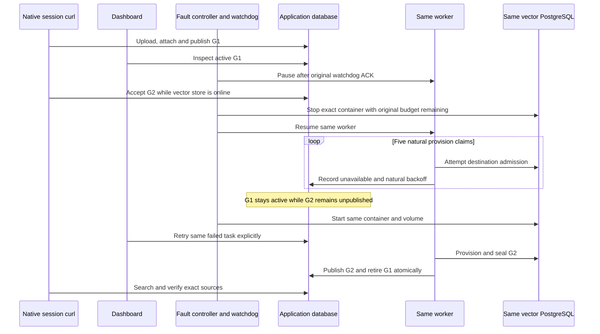

# Vector PostgreSQL provisioning outage — disabled acceptance foundation

**Status: implementation and hermetic validation only; native outage, dashboard retry and teardown NOT_RUN.** `VECTOR_PROVISION_V1` is a small M7c dependency-recovery scenario. It accepts G2 while G1 is active, makes only the owned vector PostgreSQL unavailable during G2's durable PROVISION task, then restores that same store and retries the same task. It changes no production behavior, schema, migration, permission, public DTO or API revision. A future run requires independent source review, actual-main alignment, current builds and separate gate-only activation. No run is selected by this foundation.

The dependency is the reviewed disabled protocol-2 S3/cleanup harness at `79bd189`, integrated as a local ancestor with actual main `c93e30c7`. Its historical source inventories and native results remain unchanged. The vector delta adds a third explicit scenario in namespace `vectorix-m7c-vector-provision-<12hex>`. States, databases and receipts from another scenario are refused; this is not a replay of ingestion, cleanup, capacity or Redis evidence. Publication waits for the cleanup and Redis dependencies to reach actual main.

## Exact journey and evidence boundaries

1. Create four new owned PostgreSQL/vector/Redis/RustFS stores and volumes with exact `_test` databases. Launch API, web, workers, bounded SMTP and one synthetic embedding process, all on recorded loopback bindings. Admin is build-pinned but not launched. Source/build/helper/migration/runtime/curl pins precede preparation; no `.env`, application database, hosted key, model volume or GPU is used.
2. An ordinary native HTTP account/organization seed signs out. Session curl creates one collection from the fixed platform-fallback profile, uploads the pinned TXT bytes, waits for native extraction READY, attaches it and starts G1. Native read-only polling requires G1 ACTIVE before the setup receipt is published. No organization credential, API key, role, group or explicit grant is created by the recipe. The collection's normal creator grants remain native behavior.
3. Inspect the existing dashboard index/search controls using normal login. Curl verifies G1 LEXICAL/VECTOR/HYBRID results, the observed publication, exact child/parent ranges, source preview and original bytes. **All upload/download transfers use curl; the browser never transfers files or deletes content.** The positive read path uses the existing owner session, not an API-key authorization claim.
4. Emit the one-shot `vector-g1-ready` proof immediately before enrolling the independent watchdog. After its ACK, pause only the exact worker through pidfd. Session curl accepts G2 using the unchanged saved revision and expected G1 ID while the vector destination is still online. `vector-g2-staged` requires G1 ACTIVE, G2 PROVISIONING, an unclaimed PENDING/attempt-0 PROVISION task, zero live claims, and no G2 physical generation/table.
5. Require at least 625 seconds remain in the original 900-second window immediately before stopping the exact owned vector container, then resume the same worker. Only that container is stopped; the application database, Redis, RustFS, API, fixture and web remain available. DB-only polling observes five failed provision claims and all natural **10/20/40/80-second** indexing backoffs, totaling at least 150 seconds plus actual I/O/scans. This differs from S3 cleanup's 20/40/80/160-second schedule. Attempts and monotone lease epochs are recorded, never changed. Terminal task state is FAILED/VECTOR_UNAVAILABLE with cleared lease; the generation can remain PROVISIONING.
6. During the outage, G1 remains the active catalog pointer. LEXICAL search and S3 source reads can still work. A real HYBRID request must return the typed VECTOR_UNAVAILABLE refusal; it must not silently degrade to lexical results. No vector physical query or vector-readability claim is made while the store is stopped.
7. Restore the same vector container and volume, preserving the database identity and saved destination fingerprint. `vector-restored-before-retry` confirms G1's sealed physical manifest and G2's continued absence. Use the actual dashboard **Retry task** control once. Native retry resets the same accepted task and fences its epoch; the worker provisions, embeds and activates G2 automatically.
8. Require G2 ACTIVE, G1 RETIRED, exact sealed physical manifests and canonical app layouts, correct source holds and active/retained/reserved accounting. Curl verifies all three search modes against G2 and exact original/preview bytes. G1 retains its natural 17-minute source-retirement grace; no clock advance, row rewrite or forced cleanup is allowed. Normal logout precedes the final signed-out proof and exact owned-resource cleanup.



This scenario targets an unavailable destination during the **PROVISION task**, which can fail in destination initialization before provisioning DDL is attempted. It does not establish interruption inside DDL, a partial vector batch, sealing, or the interval between vector seal and catalog commit. Existing [native adapter tests](../packages/vector-store/tests/adapter.test.ts) cover epoch fencing, partial manifests, immutable sealing and physical index shape. The [post-seal worker regression](../apps/api/src/rag-tests/index-worker.ts) reconstructs catalog state in CI; it is not native outage evidence. A write-boundary scenario would need a separately reviewed bounded embedding-response barrier and is outside this foundation.

## Components and limits

`lifecycle.py`, `private.mjs`, `seed.mjs`, `bucket.mjs`, `smtp.mjs` and `fault.py` reuse the existing protocol-2 ownership, pinning, private files, pidfd and cleanup primitives. Seed close-before-success and the guard-timeout hook reuse the reviewed Redis changes. The new focused files are:

- `vector-embedding.mjs`: synthetic Ollama `/api/tags`, `/api/show` and `/api/embed` only; fixed model, three deterministic nonzero dimensions, 16 inputs/16 KiB request, four active requests, 16 concurrent sockets, 128 total connections, 128 admitted requests and a 45-minute process lifetime. It has no outbound I/O and receives no database/SMTP/provider secret environment. Five-second HTTP bounds remain subject to fail-closed guard work. Numeric counters contain no input text or raw mail.
- `vector-curl.mjs`: the reviewed private-file curl transport with a closed route set. Binary pin, no `.curlrc`, proxy, redirect or automatic retry; two-second connect, at most 15 seconds/call, 16 KiB request and 64 KiB response body. Secret headers/bodies stay in exclusive 0600 files and are removed after each child. Its binary hash does not attest all shared OS libraries.
- `vector-workflow.mjs`: one-shot `prepare-g1`, `rebuild-g2`, `search-g1`, `search-outage` and `search-g2` modes. At most 80 ordinary HTTP calls within 180 seconds; sign-out retains one separate ten-second cleanup attempt. Source and index readiness each have at most 30 read-only polls. Unknown mutation acceptance is not retried. Completed receipts require confirmed sign-out and final guard checks.
- `vector-observation.mjs`: pure fixed-profile, G1/G2 pointer, layout, source-hold, accounting and natural-backoff validation.
- `vector-snapshot.mjs`: bounded READ ONLY application/physical readers. Two generations, two candidates, at most five tasks, 32 app rows and eight child vectors per generation; JSON spans are sliced to 64 inside SQL. Physical manifests expose IDs/hashes/counts, never raw vectors. Vector identity is hashed in evidence.
- `vector-observe.mjs`: six exclusive phase proofs, at most 360 two-second outage snapshots/11 changed task states, sharing the original watchdog deadline and a 720-second maximum. Online phases have a 120-second acceptance deadline. Each physical query requires positive remaining budget immediately before dispatch and a client query timeout bounded by that budget; rollback and reader closure are still drained after refusal. App metadata is reread after physical I/O; this is not an atomic cross-store snapshot. Both readers must close successfully and the resource/watchdog/ACK/reference guard must pass before an OBSERVED proof or completed stdout is written.

Every later phase binds G1's publication, ordered child manifest and destination fingerprint to the initial READY proof; online phases also compare its sealed physical receipt and database identity. Coherently changed application and physical metadata cannot replace that baseline. G2 retains the same PROVISION task ID from its staged proof through final sign-out. Its epoch must advance across failed claims and explicit retry, remain unchanged between failure and restoration, and remain unchanged from completion through sign-out.

The original watchdog window includes pause, native G2 admission, outage, natural retries and restoration. It is never refreshed. A late refusal restores only enrolled identities and remains INCOMPLETE; any watchdog intervention permanently prevents PASS. Cleanup resumes a paused identity-matching worker before graceful shutdown and removes only recorded stores/volumes/processes, without SIGKILL. SMTP retains its existing bounded synthetic capture; zero mail is not assumed.

The model name/digest and vectors are **synthetic protocol fixtures**. A saved native Ollama-shaped capability snapshot is not an attestation of actual model weights. This exercise measures neither Gemma, hosted-provider quality, usage billing, latency, fairness nor capacity. Existing frozen reference/capacity corpora and evidence remain untouched.

## Disabled commands and future native review

All 13 current I/O gates remain true. The vector recipe would require a reviewed activation of exactly nine: lifecycle, fault, seed, bucket, SMTP and the four new entry/transport gates. The unrelated ingestion/object and cleanup entries stay disabled. Do not enable anything from this guide alone. The operator must select a fresh 12-hex run and review current source/build/helper pins first; no run is selected here.

After that separate approval, these are the closed command shapes from the repository root (foreground apps and watchdog use separate owned terminals):

```sh
python3 tests/acceptance/s3-outage/lifecycle.py --run "$RUN" --scenario VECTOR_PROVISION_V1 --mode prepare
python3 tests/acceptance/s3-outage/lifecycle.py --run "$RUN" --scenario VECTOR_PROVISION_V1 --mode deploy-existing-migrations
# Deployment already initializes the private bucket: do not invoke bucket again.
python3 tests/acceptance/s3-outage/lifecycle.py --run "$RUN" --scenario VECTOR_PROVISION_V1 --mode app-smtp
python3 tests/acceptance/s3-outage/lifecycle.py --run "$RUN" --scenario VECTOR_PROVISION_V1 --mode app-embedding
python3 tests/acceptance/s3-outage/lifecycle.py --run "$RUN" --scenario VECTOR_PROVISION_V1 --mode app-api
python3 tests/acceptance/s3-outage/lifecycle.py --run "$RUN" --scenario VECTOR_PROVISION_V1 --mode seed
python3 tests/acceptance/s3-outage/lifecycle.py --run "$RUN" --scenario VECTOR_PROVISION_V1 --mode app-workers
python3 tests/acceptance/s3-outage/lifecycle.py --run "$RUN" --scenario VECTOR_PROVISION_V1 --mode app-web
node tests/acceptance/s3-outage/vector-workflow.mjs --run "$RUN" --scenario VECTOR_PROVISION_V1 --mode prepare-g1
node tests/acceptance/s3-outage/vector-workflow.mjs --run "$RUN" --scenario VECTOR_PROVISION_V1 --mode search-g1
node tests/acceptance/s3-outage/vector-observe.mjs --run "$RUN" --scenario VECTOR_PROVISION_V1 --phase vector-g1-ready
python3 tests/acceptance/s3-outage/fault.py --run "$RUN" --scenario VECTOR_PROVISION_V1 --mode watchdog
python3 tests/acceptance/s3-outage/fault.py --run "$RUN" --scenario VECTOR_PROVISION_V1 --mode pause-worker --fixture-ready
node tests/acceptance/s3-outage/vector-workflow.mjs --run "$RUN" --scenario VECTOR_PROVISION_V1 --mode rebuild-g2
node tests/acceptance/s3-outage/vector-observe.mjs --run "$RUN" --scenario VECTOR_PROVISION_V1 --phase vector-g2-staged
python3 tests/acceptance/s3-outage/fault.py --run "$RUN" --scenario VECTOR_PROVISION_V1 --mode storage-outage
# Start the following observer in a separate owned terminal and let it poll.
node tests/acceptance/s3-outage/vector-observe.mjs --run "$RUN" --scenario VECTOR_PROVISION_V1 --phase vector-outage-failed
# While it is polling, run the outage curl checks; wait for both to finish.
node tests/acceptance/s3-outage/vector-workflow.mjs --run "$RUN" --scenario VECTOR_PROVISION_V1 --mode search-outage
python3 tests/acceptance/s3-outage/fault.py --run "$RUN" --scenario VECTOR_PROVISION_V1 --mode restore
# Wait for the independent watchdog to exit normally and publish its nonintervention receipt.
node tests/acceptance/s3-outage/vector-observe.mjs --run "$RUN" --scenario VECTOR_PROVISION_V1 --phase vector-restored-before-retry
# Dashboard: click Retry task once, then wait for the target G2 to become ACTIVE.
node tests/acceptance/s3-outage/vector-observe.mjs --run "$RUN" --scenario VECTOR_PROVISION_V1 --phase vector-g2-ready
node tests/acceptance/s3-outage/vector-workflow.mjs --run "$RUN" --scenario VECTOR_PROVISION_V1 --mode search-g2
# Dashboard: sign out normally before the final observation.
node tests/acceptance/s3-outage/vector-observe.mjs --run "$RUN" --scenario VECTOR_PROVISION_V1 --phase vector-signed-out
python3 tests/acceptance/s3-outage/lifecycle.py --run "$RUN" --scenario VECTOR_PROVISION_V1 --mode cleanup
```

Run G1 source checks before the one-shot READY proof so watchdog enrollment does not consume its 90-second freshness budget on transfers. During outage, start DB-only polling before the curl checks to retain the first ten-second backoff observation. After its terminal proof, restore immediately; do not spend the recovery proof's 90-second freshness window on browser work.

Use the existing `abort-incomplete` fault command if control fails; never rerun a partial mutation or refresh a proof/watchdog. The same scoped cleanup is required for any failed setup.

## Validation record

The initial focused pass reports 37 mocked Python tests, 40 pure/injected Node tests and 14 Node syntax checks. The pre-review focused pass after source-proof/epoch refinements passes 37 Python tests, 43 Node tests, 14 Node syntax checks and four Python AST checks. The three changed documents pass formatting, one Mermaid diagram and 79 local Markdown links; `git diff --check` is clean. These cases exercise real helper functions with injected HTTP/PG/process boundaries, not native resources. Production planner execution, current app builds, native source transfers/indexing/search, actual container outage/reconnect, dashboard retry, browser locales and owned teardown remain **NOT_RUN** for this foundation.

The subsequent independent-review correction adds per-query remaining-budget checks and immutable G1/task/epoch continuity. Four new injected cases cover positive completion, exhaustion before later queries/COMMIT, coherent application-plus-physical G1 replacement and task/epoch substitution. The first revision pass rejects one new positive fixture because it omitted the organization binding that the real CLI supplies; the guard is preserved and only that fixture is corrected. The repeated cohesive pass succeeds with 37 Python tests, 47 Node tests, 14 syntax checks and four AST checks. The original disabled inventory remains archived and its provenance is not rewritten. No native trial is implied by this correction.
