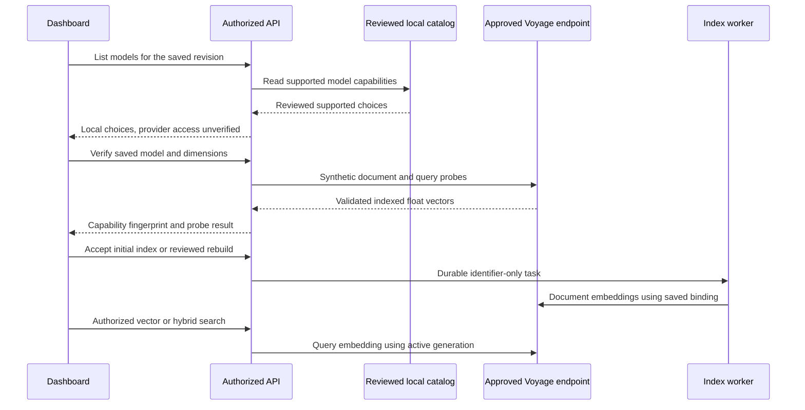

# M5b — Native Voyage embeddings

Implemented on `codex/rag-voyage-provider`, with automated validation, independent review and controlled dashboard acceptance complete. [PR #29](https://github.com/SimonLoir/vectorix/pull/29) passed both CI checks and was squash-merged as `bb32977`. This document describes the native contract, dashboard acceptance recipe and actual results. [M5a Cohere](rag-cohere-embeddings.md) and [real Ollama/EmbeddingGemma](rag-ollama-embeddinggemma.md) remain separate provider records. Live Voyage verification awaits the user's organization credentials.

## Configuration and reviewed capabilities

Use a **Voyage** organization integration with root endpoint `https://api.voyageai.com` and a test API key. The native route is `/v1/embeddings`; do not include `/v1` in the configured root. Approve that exact endpoint through `VECTORIX_EMBEDDING_ALLOWED_ENDPOINTS` on API and workers, unless it is their provider-specific platform default. A complete organization configuration takes precedence; invalid configured credentials never fall back. Saved collection revisions keep their own binding and endpoint.

The optional complete platform fallback is configured at runtime on both services:

```dotenv
VECTORIX_DEFAULT_VOYAGE_ENDPOINT=https://api.voyageai.com
VECTORIX_DEFAULT_VOYAGE_API_KEY=
```

Keep keys in organization credentials or deployment secrets. The browser does not contact Voyage directly. Actual verification, indexing and vector/hybrid search send text to the saved provider and may incur usage.

| Reviewed model   | Context per input | Supported dimensions             | Provider aggregate token limit |
| ---------------- | ----------------- | -------------------------------- | ------------------------------ |
| `voyage-4`       | 32,000 tokens     | 256, 512, 1,024 (default), 2,048 | 320,000                        |
| `voyage-4-lite`  | 32,000 tokens     | 256, 512, 1,024 (default), 2,048 | 1,000,000                      |
| `voyage-4-large` | 32,000 tokens     | 256, 512, 1,024 (default), 2,048 | 120,000                        |

These are explicit reviewed capabilities from the [native embeddings reference](https://docs.voyageai.com/reference/embeddings-api) and [Voyage's embeddings guide](https://docs.voyageai.com/docs/embeddings). Newer, custom, code, multimodal and other model IDs are not enabled automatically. Vectorix applies lower bounded request/response and conservative input-byte limits; these do not promise full model-context utilization. At 2,048 dimensions, choose DiskANN: the implemented HNSW path supports at most 2,000 dimensions.

There is no documented native model-list endpoint in the reviewed [Voyage API index](https://docs.voyageai.com/llms.txt). The model-list action therefore returns Vectorix's local reviewed catalog without contacting Voyage. Its optional `reviewedCatalog:true` metadata and UI label explicitly say that listing does **not** validate credentials or model availability. Existing `discoverySource` metadata is omitted for this case rather than inventing a remote discovery result. Actual verification must successfully embed synthetic document and query inputs with the chosen dimensions.

## Native protocol and identity

Document input uses `input_type: "document"`; queries use `input_type: "query"`. Requests specify `output_dtype: "float"`, the exact supported `output_dimension` and `truncation:false`. The Generic preset avoids invented text prompts; optional preparation is a literal shared prefix. Responses must contain a complete, unique indexed permutation of the requested inputs, exact vector dimensions, finite float32 values and a nonzero norm. Provider-reported input token usage remains separate from the clearly labeled estimate.

The schema-version-3 Voyage snapshot is a versioned capability profile with a deterministic fingerprint, **not an attestation of hosted model weights**. Existing Ollama schema-version-1 and Cohere schema-version-2 snapshots remain readable with their original semantics. Provider, exact model ID, selected dimensions, preset and fingerprint must match throughout indexing and search. Rebuilds use the saved old provider until atomic activation and retain exact old sources during the normal grace period.



## Dashboard acceptance recipe

1. Configure the organization integration and the exact runtime endpoint approval on both API and workers. Upload a small bilingual Markdown or text PDF, wait for extraction, and attach it to an authorized collection.
2. Save **Voyage**, `voyage-4`, **Generic**, 256 dimensions, document-structure chunking and no parent/child expansion. Inspect the local catalog label; listing must not claim to verify the key. Verify the saved model and inspect both-role success, dimensions and capability fingerprint.
3. Start initial indexing. Inspect tasks, active generation and chunks, then run French and English vector/hybrid searches and open/download exact indexed sources. Keyword-only search must make no embedding request.
4. Save a 512-dimensional draft and use **Review and rebuild**. While indexing is paused in the isolated test fixture, inspect the serving 256-dimensional search/source. Resume workers, check activation, query the replacement and reopen a captured old source.
5. Select a new invalid organization credential and create another collection. The local catalog may still list reviewed models; the actual verification must fail explicitly, with no fallback to the platform key. Existing generations retain their original saved binding.
6. Check English, French and Belgian Dutch labels, reactive errors, locale persistence and a fresh console. Remove owned test processes, infrastructure, downloads and browser tabs.

## Validation status

Automated validation passed: 69 controlled native embedding HTTP tests, 107 disposable core/RAG catalog tests, 23 workspace type checks, 23 lint tasks, 23 backend regressions, four production builds and all six image/runtime/infrastructure checks. Independent review found no remaining P1/P2 issue. No Prisma schema change or new migration is required.

Controlled dashboard acceptance passed using production web/API/workers, disposable application/vector PostgreSQL, Redis and RustFS, and a deterministic native Voyage HTTP fixture. This browser run used neither Ollama nor the hosted Voyage service. The actual results were:

- A synthetic organization integration and the three reviewed models were configured in **M5b Voyage Lab**. Listing the local catalog left every provider counter at zero before and after; its label explicitly left provider access unverified. Saved-profile verification then exercised both native roles at 256 dimensions and displayed the capability-profile limitation.
- A 562-byte bilingual Markdown original with three headings produced three chunks in active generation A at 256 dimensions. With only the indexing queue paused, a saved revision-2 draft and accepted 512-dimensional rebuild left A searchable through a fresh English vector request. Resuming indexing activated B with three chunks and retired A on its ordinary 17-minute grace.
- A captured French hybrid result from A remained labeled as the previous generation after activation. Reopening its source and downloading its original succeeded; SHA-256 matched `70829c0856361a6876b0e6b02937d6665657250e00fa2708caa2ba89f144ca3a`. New English vector and French hybrid requests used B; the French result included both keyword and vector ranks. A keyword-only `refund` search returned two passages and left all fixture counters exactly unchanged at 11 organization requests and zero platform requests.
- Selecting a newly created invalid synthetic credential affected new configurations. A new collection still listed three local, explicitly unverified models, but actual verification failed with sanitized `PROVIDER_REJECTED` and created no generation. After that selection, the existing B profile still verified at 512 dimensions through its original saved binding. A valid platform fallback was configured; explicit invalid-key rejection and the integration tests cover the no-fallback behavior. The provider/API had already exited successfully before the final cleanup counter fetch, so no additional post-invalid-key zero-platform-counter proof was collected.
- The English error translated reactively into French and Belgian Dutch; dates, numbers and profile labels were checked. A fresh final tab retained Belgian Dutch, successfully probed the valid saved profile and had no console warnings or errors.

Owned application/provider processes, four infrastructure containers, downloaded originals and temporary browser tabs were removed. Ports 3100, 3101, 3006 and the controlled provider port were verified unbound. No clock advancement or physical-retirement soak was performed: A's three chunks remained retained on the ordinary grace at the last dashboard observation.

Controlled native-wire and dashboard checks do not establish live paid-provider connectivity or retrieval quality. No live Voyage availability, quality, latency, capacity or retention-soak result is claimed. Final documentation checks are recorded in the [build log](build-task-log.md); [PR #29](https://github.com/SimonLoir/vectorix/pull/29) passed both CI checks and was squash-merged as `bb32977`.
