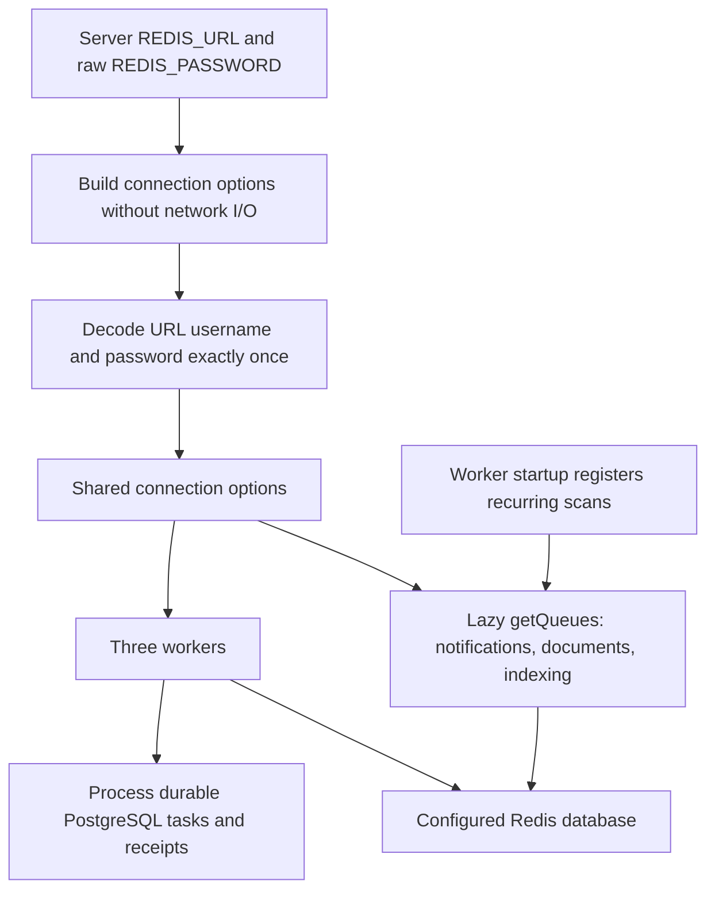

# Redis connections and credentials

This issue #23 change fixes the conversion of Redis URL userinfo into BullMQ connection options. It decodes URL usernames and passwords exactly once while preserving the raw `REDIS_PASSWORD` fallback. No database schema, public API DTO or container policy changes are required.

## Configuration and credential precedence

Configure Redis only on the server. `REDIS_URL` selects the host, port and database and may contain credentials. When it is absent, the existing default is `redis://localhost:6379`. An explicitly empty or malformed URL is an error rather than a request to use that default.

For authentication:

1. A non-empty URL username is percent-decoded once. A missing username remains undefined, including password-only URLs.
2. A non-empty URL password is percent-decoded once and wins over `REDIS_PASSWORD`.
3. A missing or explicitly empty URL password uses `REDIS_PASSWORD` without decoding or trimming it. This includes both `redis://user@host` and `redis://user:@host`. An explicitly empty fallback remains an empty string; an absent fallback remains undefined.

Encode raw username and password components separately with `encodeURIComponent` when building a URL. The examples below contain illustrative credentials only:

| Configuration component                  | Value passed to the Redis client |
| ---------------------------------------- | -------------------------------- |
| URL username `queue%40user`              | `queue@user`                     |
| URL password `secret%2B%25%40`           | `secret+%@`                      |
| URL password `literal+plus`              | `literal+plus`                   |
| URL password `literal%2540`              | `literal%40`                     |
| Raw fallback `REDIS_PASSWORD=raw%40+key` | `raw%40+key`                     |

`+` never becomes a space. Unicode userinfo is decoded back to its authentication value. Decode only once: a literal `%40` in a raw credential must appear as `%2540` in URL userinfo, not `%40`.

Invalid URL syntax, invalid ports rejected by URL parsing, malformed percent escapes and invalid UTF-8 in encoded userinfo fail with the static message `Redis connection configuration is invalid.`. The error carries no raw URL, parser cause or credentials. A configured fallback password does not rescue malformed URL userinfo. Consumers must not log the original URL or credential values themselves.

This is a focused credential fix. Existing connection policies remain unchanged:

- The host comes from the parsed URL; the port defaults to `6379` and the database path defaults to `0`.
- `rediss:` enables the existing `tls: {}` option. This change does not add certificate, proxy or trust-store configuration.
- `maxRetriesPerRequest` remains `null`, as used by the shared BullMQ workers. No new connection timeout, reconnect strategy or delivery guarantee is introduced.
- The helper does not introduce stricter protocol or database-number validation. Deployment configuration still needs to select the intended Redis service and database.

## Runtime entry points and flow

The [pure connection builder](../packages/queues/src/redis-connection.ts) parses options without network I/O. The [queue package entry point](../packages/queues/src/index.ts) resolves those options at module initialization and exports one shared `connection`. Its `getQueues()` lazily creates and caches `notifications`, `documents` and `indexing`; importing the package does not itself connect to Redis. Parsing errors can fail the import before a connection is attempted. Restart consumers after changing connection environment variables.



The [worker entry point](../apps/workers/src/index.ts) constructs all three workers with that same connection object. It registers notification scans every ten seconds and document/indexing scans every five seconds through the shared queues. Scan jobs do not replace the durable task, lease, retry, publication or delivery state in the application database. The [API health endpoint](../apps/api/src/app.ts) also uses the lazily initialized notifications queue. Worker shutdown closes its workers and shared queues; [API shutdown](../apps/api/src/index.ts) closes initialized shared queues. The [package README](../packages/queues/README.md) documents the exported functions and process lifecycle.

## Reproducible tests

Run from the repository root using the pinned Node.js and pnpm versions:

```sh
# Six pure connection-option regressions, also included in pnpm test.
pnpm --filter api exec tsx --test ../../packages/queues/src/redis-connection.test.ts

# Owned Redis integration environment; requires Docker.
pnpm test:queues
```

The [unit tests](../packages/queues/src/redis-connection.test.ts) cover percent-encoded usernames/passwords, literal plus signs and percent sequences, Unicode, password-only URLs, missing and explicitly empty URL passwords, raw fallback preservation, existing default/TLS/retry options and sanitized malformed configuration. Checking `tls: {}` in options is not a live TLS test.

The [integration runner](../scripts/test-redis.sh) creates one disposable `redis:8-alpine` container on a random loopback port, configures synthetic authentication and removes only its own container. It does not read `.env`, connect to application infrastructure or flush another Redis service. Its [test module](../packages/queues/src/redis-auth.integration.ts) refuses direct use without the isolated-test marker, explicit loopback port, database `15` and an accepted test mode.

The runner executes two separate processes:

- Encoded ACL username/password in `REDIS_URL`, with an intentionally incorrect standalone fallback. This proves that the configured URL credential takes precedence.
- A URL without userinfo and the raw default-user password in `REDIS_PASSWORD`, including literal percent and plus characters.

Each process waits for all three queues and workers, completes an ordinary job and a scheduler-produced job on each queue, removes its test schedulers and closes its clients. Operations and the outer process have test-only time bounds. The [catalog workflow](../.github/workflows/catalog.yml) invokes this command; that registration is not a claim that PR CI has completed.

## Dashboard acceptance recipe

Use production web/API/workers, private disposable application/vector `_test` databases, Redis and private object storage. Create a synthetic organization manager. Configure that environment's Redis ACL username/password with reserved characters, encode each component once in `REDIS_URL`, and set a deliberately incorrect `REDIS_PASSWORD` fallback. Restart consumers after changing configuration; do not point this recipe at application data.

Expect API `/ready` to return 200 and all three workers to start. Sign in through the dashboard, upload a small UTF-8 Markdown file from **Documents**, and wait for **Ready**. Confirm its extracted marker, reload, download the original and compare its SHA-256. On the owned Redis only, confirm the connection's `ACL WHOAMI` matches the configured decoded user and inspect completed/failed scan counts. Clean the previews, test infrastructure, temporary tabs and downloads. These observations verify the bounded journey, not prolonged retry, TLS or capacity behavior.

## Validation recorded for this change

The six configuration unit tests and both real Redis modes passed. All three queues, workers and schedulers authenticated and completed their round trips without connection errors. These tests use plaintext loopback Redis, not a TLS deployment. Final local validation also passed 23 workspace type checks, 23 lint tasks, 44 backend regressions, 136 disposable core/RAG HTTP tests, four production builds and all six image/runtime/infrastructure checks. Independent source/test/isolation review found no actionable P1/P2 issue. These are completed local checks; this record does not claim that issue #23 PR CI has completed.

Actual dashboard acceptance used production web/API/workers with disposable infrastructure and encoded Redis ACL credentials. Redis `ACL WHOAMI` matched the configured decoded username, and the connection used database `15`. A UTF-8 Markdown document containing 299 characters and 301 bytes reached **Ready**, remained ready after reload and downloaded with SHA-256 `cc1ff6df6e3042a25e875048e410392c33a3d5d1bc24c5e8dc0bcdcba777e01a`. All three scan queues showed completed jobs and zero failed jobs during this bounded observation.

The initial preview lacked the standalone web server's public assets and returned a service-worker asset 404. Copying public/static assets into the preview as the existing Dockerfile does, then restarting only that owned web preview, corrected the setup. A fresh final tab showed the persisted ready document with no console warnings/errors. No product or container policy change was needed. The three previews, four owned infrastructure containers, two temporary tabs and verified download were removed. No application database, external mail recipient or embedding provider was used. This bounded document/queue journey does not establish TLS acceptance, capacity, prolonged retry behavior or production soak coverage.
