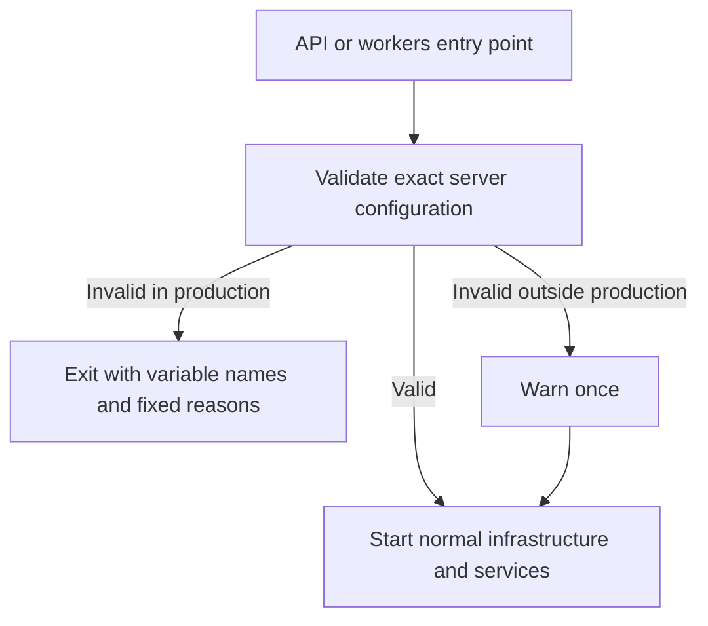

# Startup configuration validation

`@repo/config` checks the server configuration used by the API and workers before their entry points start infrastructure work. This is a runtime foundation, not a new dashboard feature or a completed RAG milestone. Feature-specific providers, quotas and telemetry retain their existing parsers and explicit errors.

| Variable             | API                    | Workers                | Rule                                                                                                                                                                                                                   |
| -------------------- | ---------------------- | ---------------------- | ---------------------------------------------------------------------------------------------------------------------------------------------------------------------------------------------------------------------- |
| `DATABASE_URL`       | Required               | Required               | Nonempty; database connectivity is checked separately.                                                                                                                                                                 |
| `BETTER_AUTH_SECRET` | Required               |                        | At least 32 characters; published placeholders are refused.                                                                                                                                                            |
| `ENCRYPTION_SECRET`  | Required               | Required               | Exactly 64 raw hexadecimal characters, without surrounding whitespace; published placeholders and single-character repetitions are refused. This checks format, not entropy or successful decryption of existing data. |
| `BETTER_AUTH_URL`    | Required in production |                        | Explicit HTTP(S) base; a path prefix is allowed.                                                                                                                                                                       |
| `TRUSTED_ORIGINS`    | Required in production |                        | Nonempty comma-separated serialized HTTP(S) origins. A trailing slash or path is not an origin.                                                                                                                        |
| `API_URL`            | Checked when present   |                        | Explicit HTTP(S) base.                                                                                                                                                                                                 |
| `VECTORIX_WEB_URL`   | Checked when present   | Required in production | Explicit HTTP(S) base, with an optional deployment path prefix.                                                                                                                                                        |

URL bases reject embedded credentials, controls, backslashes, repaired authorities, queries and fragments. Values are not silently trimmed into different encryption keys or bases. Spaces around comma-separated origin entries are allowed; empty entries are ignored only when at least one valid origin remains. The API's existing [origin resolver](../apps/api/src/http/trusted-origins.ts) still supplies the sole CORS/CSRF allowlist. Configuration checks never grant a request or replace current access checks.

With `NODE_ENV=production`, a failure exits with variable names and fixed reasons. Values are never included. Outside production, one warning lists the issues and development may continue. Web/admin public settings remain server-resolved at container startup; no setting is exposed through `NEXT_PUBLIC_*`.

## Setup and integration

Use the server-only variables in [`.env.example`](../.env.example) and the [setup instructions](../README.md); replace its placeholders with independently generated secrets. Preserve the existing encryption key when upgrading: changing a key does not re-encrypt or recover stored provider secrets. Production workers now require `VECTORIX_WEB_URL` instead of silently constructing localhost notification links. Production APIs require explicit `BETTER_AUTH_URL` and `TRUSTED_ORIGINS`. Restart the affected process after changing configuration.

[`findConfigurationIssues` and `assertRuntimeConfiguration`](../packages/config/src/index.ts) are dependency-free. [API startup](../apps/api/src/startup-config.ts) and [worker startup](../apps/workers/src/startup-config.ts) are their entry points. The validator leaves provider, database and object-store I/O to the existing services. It does not prove network reachability or the validity of a hosted API key.

## Verification

[Seven pure cases](../packages/config/tests/runtime-config.test.ts) cover both services, the published example placeholders, exact encryption-key bytes, malformed bases, nonempty serialized origins and development warnings. Catalog CI explicitly runs this package while the original root unit command only targets the API.

[`tests/config/startup-order.mjs`](../tests/config/startup-order.mjs) runs each actual built entry with a closed environment of synthetic values. A proven preload intercepts socket connections, listeners and TLS before I/O. Invalid configurations must exit through the configuration guard without touching this boundary; valid synthetic configuration must reach the same intercepted boundary. These checks do not contact a database, Redis, users or providers. [Six-image checks](../scripts/test-docker.sh) stream the helper into the API/worker images on `--network none`; test tools are not copied into runtime images. The normal image tests separately establish a successful startup against their disposable infrastructure.

The isolated correction checkout passes frozen installation, ignored client generation using a synthetic loopback URL, all 25 type and 25 lint tasks, 159 API/backend and 11 utility tests, and all seven pure configuration cases. API and worker production builds pass. Each actual bundle rejects three invalid configurations before any intercepted socket call; valid synthetic configuration reaches that boundary, and each preload has its own positive control. No network operation is allowed by these probes. Final-main integration and new exact-head catalog/six-image CI remain pending. No local `.env` or application database is read. Existing acceptance-harness source revisions and frozen provenance are not rewritten; a future run must satisfy the current startup requirements using a reviewed setup.
