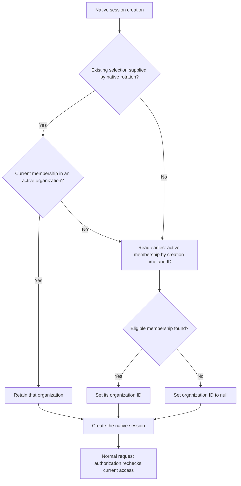

# Initial organization selection

Issue #13 replaces the arbitrary organization selected by the native session-create hook. Implementation, automated validation and the isolated dashboard acceptance below are delivered through [PR #68](https://github.com/SimonLoir/vectorix/pull/68).

## Selection rule

The [focused resolver](../packages/auth/src/initial-organization.ts) receives native session data, not a request body, client organization hint, previous token or last-used history. It performs at most two single-row Prisma reads, selecting only the organization ID:

1. If native session rotation carries an organization ID, retain it only while the user is still a member and the organization is active.
2. Otherwise, select the user's oldest active membership by `createdAt`, then membership `id` as a deterministic tie-breaker.
3. If no eligible membership exists, write `activeOrganizationId: null` explicitly. Database failures remain errors rather than being treated as an empty organization list.

The [Better Auth hook](../packages/auth/src/auth.ts) applies the result before inserting the session. A fresh sign-in uses the deterministic default; the application does not persist a new last-used preference. A valid selection copied during native rotation must survive. Native two-factor challenges still withhold the authenticated session until verification; this resolver does not bypass a challenge.

Selection is a convenience, not an access grant or a membership lock. Suspension or removal after these reads can still make the next organization operation fail closed. Existing API-key admission, current membership, organization suspension, collection rights and CSRF checks remain authoritative. Native manual organization switching has its own existing activity-check limitation; this change must not be described as rejecting every manual selection of a suspended organization.

## Dashboard journey

The [shared organization switcher](../packages/dashboard-core/src/components/team-switcher/team-switcher.tsx) must show an explicit localized state when memberships exist but no active organization resolves. It must preserve loading/error feedback, normal switching, account access and the existing create/join workflow. The native organization list does not supply a verified activity field for filtering, so the UI must not invent an eligibility signal or assert that every listed organization is active.

An account with no eligible organization is still signed in. Account and invitation recovery remain usable. An organization-scoped request without an active organization must remain denied. English, French and Belgian Dutch messages must describe complete states, including accessible labels and retry feedback.

There is no schema, migration, new environment variable or public versioned DTO change. Deploy the rebuilt API and web application together. Reusable authentication and administration services retain their existing boundaries.

## Acceptance recipe

Use production builds against a fresh owned disposable `_test` environment. Arrange only synthetic accounts and organizations before opening the browser. Keep fixture setup separate from browser actions and record any direct fixture writes precisely; never repair an existing application's organization or membership for this test.

1. Prepare a normal member with an older suspended organization and two active organizations. Sign in normally and verify that the earliest active membership is selected and organization settings are usable. Repeat sign-out/sign-in to establish the default, then switch to the other active organization and reload.
2. Use a separate synthetic account whose memberships are all inactive. Sign in and verify the explicit no-active state, account access and create/join recovery controls. Organization-scoped API access remains denied. Exercise the state in EN, FR and nl-BE and distinguish loading/failure from a completed empty selection.
3. Native HTTP integration tests cover equal membership timestamps/ID ties, removed and foreign memberships, no membership, all-inactive membership, valid selection retained through real two-factor session rotation and deterministic selection after completing a fresh two-factor challenge.
4. Do not change credentials, enroll two-factor authentication, promote an administrator or create API keys in the browser. Automated two-factor fixtures belong only to the disposable integration suite. Keep direct-console observations separate from HTTP test evidence.
5. Restore the display locale, sign out and remove only owned processes, stores, volumes and tabs. Record actual paths, outcomes, failures and unrun branches below; a prepared fixture or green unit test alone does not establish browser acceptance.

## Actual validation

Frozen installation, all 24 type-check and lint tasks, 101 API tests, 11 utility tests, 276 disposable catalog/integration tests and all four production builds pass. The catalog command also verifies the unchanged migration chain, repeat deployments, upgrade preservation and schema parity. The [eight native HTTP journeys](../apps/api/src/session-organization-integration.ts) exercise the real hook, authoritative cookie sessions, account-only reads, organization-scoped operations, and actual TOTP session replacement and challenge completion. They do not substitute direct resolver calls for production authentication. Synthetic stale persisted-session writes are explicitly confined to registered disposable integration fixtures.

All 57 team-switcher messages render in EN/FR/nl-BE with key parity and zero ICU errors. An initial nullable-error lint issue is corrected using nullish coalescing and shared readiness predicates; the final checks pass. Independent backend/test and UI/dictionary reviews find no actionable P1/P2. The user's local admin type declaration is restored byte-for-byte after Next generation and remains excluded from implementation commits.

All six Docker images and infrastructure checks pass, including production startup, isolated runtime dependencies and the existing dashboard response-header regression. The full capacity run and live hosted-provider verification remain separately deferred.

### Isolated browser acceptance

Run `c46e193ad257` uses fresh disposable application/vector `_test` databases, Redis and private RustFS, with production API/web builds and a bounded loopback SMTP sink. Setup creates two ordinary synthetic users and four organizations through native HTTP, then signs both users out. One fixture-only serializable ORM transaction reduces activity on exactly the owner's first organization and the recipient's only organization. It changes no user, membership, role, API key or session directly. Two other owner organizations remain active. Workers and the admin application are not launched for this journey.

Actual browser observations:

- Two normal owner sign-ins select the oldest active membership despite the older suspended membership. The members settings page is usable and survives reload. A normal manual switch to the second active organization survives reload within the same session.
- The recipient signs in with no active organization and sees the explicit recovery message. Reload returns to that state; the account page remains usable. Create and join tabs open, including the invitation review form, without submitting either form.
- The no-active state, accessible organization label and account heading render in EN, FR and nl-BE and persist after reload. The display locale is restored to French and both users finish signed out.
- Six separate bounded read-only database checkpoints corroborate default selection, same-session manual switching, three saved locales with a null active organization, and zero final sessions. These receipts do not determine browser acceptance; the observations above do. The browser console contains no warning or error.

The first private harness preflight (`b9d1276e4a03`) refuses its 256 MiB runtime-input hashing bound before creating any run directory or resource. A metadata-only diagnosis measures 393,858,461 bytes across 52 installed packages plus generated code. Independently reviewed revision 2 raises only that private hashing bound to 512 MiB; its remaining limits stay unchanged. This is not a capacity-test limit change or a failed live application run.

Source, build, helper and installed runtime pins match before cleanup. All three owned processes, four containers, four volumes and the sole owned browser tab are removed; the private login fixture and empty mail directory are deleted. Five safe screenshots, read-only receipts and aggregate observations remain in the ignored private evidence directory. No browser credential change, two-factor enrollment, API-key creation, role promotion or invitation acceptance occurs. Native two-factor and negative authorization cases are established by the automated HTTP suite. Forced network-error rendering is not exercised in the browser. The existing native manual-switch activity limitation remains outside this automatic-selection change.

### Pull-request delivery

Exact head `6e83e34713d39ff89e39821df3c9da0a8a72224a` passes [catalog run `40010516543`](https://github.com/SimonLoir/vectorix/actions/runs/40010516543), including all 276 integrations, and [six-image run `40010516472`](https://github.com/SimonLoir/vectorix/actions/runs/40010516472). The first merge gates defer while GitHub still reports the catalog job/check as in progress despite workflow success. Both jobs and PR check-runs report success, and the fresh head/base/main gate reports clean, before the authorized squash/merge.

[PR #68](https://github.com/SimonLoir/vectorix/pull/68) merges as `4b63ac9b74bd9ff7baa99ccf76605886c724da53` at 19:34:46 UTC on October 23, 2026; issue #13 closes at 19:34:47 UTC. No forced merge occurs. Registry publication is not established by these pull-request checks. Subsequent implementation uses a new dedicated branch.
