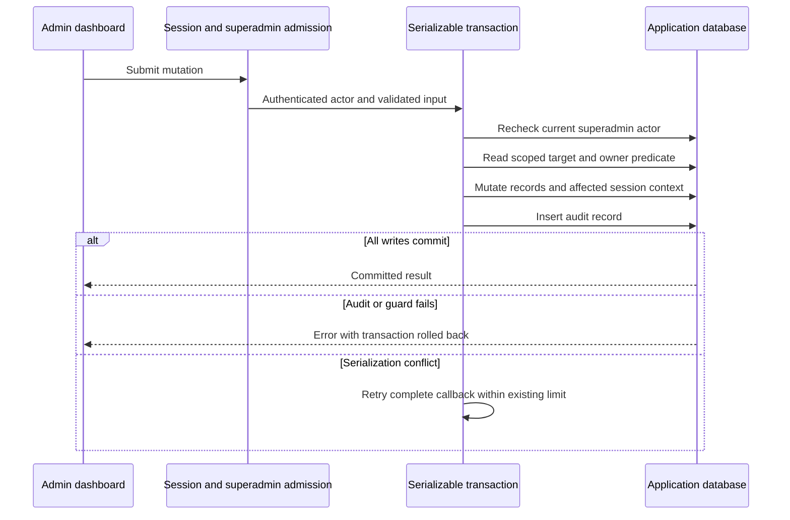

# Superadmin mutation transactions

This follow-up addresses the audit and superadmin transaction defects in issue #20. The implementation, automated checks and bounded dashboard acceptance are complete below. The shared last-owner invariant across native authentication routes remains a separate, reviewed follow-up, so this slice does not close issue #20. No database schema, migration or public DTO changes are included.

## Atomic mutation boundary

The following operations now run their scoped reads, mutation and audit inside one retryable serializable transaction:

- Organization creation and updates.
- Adding an existing member or creating a user, credential account and membership together.
- Removing a member, including clearing that user's sessions that select the removed organization.
- Updating a member's role.
- Creating and updating feature definitions.

The [transaction helper](../packages/routers/superadmin/src/superadmin-transaction.ts) rechecks the actor's current `isSuperAdmin` value inside that transaction. The existing superadmin middleware still requires a real user session and rejects organization API keys. Scoped member lookups match both member and organization identifiers. The owner predicate and its resulting member write share the same transaction, including comma-separated role-token handling.

The [shared retry helper](../packages/routers/utils/src/utils/transactions.ts) retries the complete callback on PostgreSQL serialization conflicts, up to its existing three-attempt limit. Exhaustion through the new superadmin wrapper becomes a sanitized `CONFLICT`, allowing the client to reload and retry. All callback work is database work. Password hashing for a possible new account happens before the callback; new-user prerequisites and current database state are checked again inside it. Every failed attempt rolls its writes and audit back together.

Quota and legacy-access mutations already grouped their audit with their writes; they now also recheck the current actor in their existing transactions. The previously transactional superadmin privilege, feature-override and captured legacy-feature operations retain their existing behavior. The implementation preserves native organization-deletion transactions and RAG cleanup guards.

## Audit address provenance

The [audit helper](../packages/routers/superadmin/src/audit.ts) stores `ipAddress: null` for new records. The request context currently supplies headers without a verified network peer or a configured trusted-proxy boundary. Neither the first nor the last `X-Forwarded-For` entry establishes a trusted address in that context. The existing nullable contract represents this unknown value.

Actor, action, target and details remain recorded. The helper retains its headers input for caller compatibility, and historical rows are unchanged. Future verified peer metadata requires an explicit transport/proxy design before populating this field again; this change adds no proxy trust configuration.

## Current owner-concurrency scope

The serializable predicate protects the changed superadmin removal and role-update operations against each other. Native Better Auth member removal, role updates, leaving an organization and user-deletion cascades require a common persistence guard before claiming that every writer preserves at least one owner.

A proposed follow-up is a reviewed deferred database guard that checks surviving organizations after ownership loss and serializes competing losses. Deferral matters: native organization deletion removes members before the organization within its transaction, and valid deletion must remain possible after RAG cleanup. Native user deletion also needs an atomicity review so a late ownership rejection cannot leave previously removed sessions or credentials behind. An intentionally empty organization created by a superadmin remains a supported initial state. The [owner-guard proposal](organization-owner-guard-proposal.md) records the design, unproven wrapping seam and required matrix. It is planned; no such production guard or migration is added here.

## Entry points

- [Create organization](../packages/routers/superadmin/src/create-organization.ts) and [update organization](../packages/routers/superadmin/src/update-organization.ts).
- [Add member](../packages/routers/superadmin/src/add-organization-member.ts), [remove member](../packages/routers/superadmin/src/remove-organization-member.ts) and [update member role](../packages/routers/superadmin/src/update-organization-member-role.ts).
- [Create feature](../packages/routers/superadmin/src/create-feature-definition.ts) and [update feature](../packages/routers/superadmin/src/update-feature-definition.ts).
- [Quota](../packages/routers/superadmin/src/set-rag-quota.ts), [legacy access](../packages/routers/superadmin/src/set-organization-legacy-access.ts) and the shared transaction/audit helpers linked above.
- Existing admin [organization workspace](../apps/admin/src/components/organization-workspace.tsx), [feature catalog](../apps/admin/src/components/feature-catalog.tsx) and [audit list](../apps/admin/src/components/audit-log-list.tsx).

## Dashboard acceptance recipe

Use production API/admin with private disposable `_test` databases and a synthetic superadmin bootstrapped through the existing operator grant script. Create or select an owned empty organization. Change its name from the organization workspace, reload, and inspect the matching actor/target/before/after audit entry. Create an inert feature definition with no organization grants, disable that same unused definition and inspect both audit records. Expect persisted values and one audit for each successful mutation, with an unknown IP displayed through the existing nullable field.

Audit-failure rollback, membership/session side effects, direct foreign identifiers, privilege revocation and concurrent owner changes belong to the isolated automated suite. Keep those tests scoped to owned fixtures and clean temporary database test helpers. Record actual browser outcomes, existing console limitations and cleanup here after execution.

## Acceptance status

Final local checks passed: 23 workspace type checks, 23 lint tasks, 44 backend regressions, 150 disposable core/RAG HTTP tests, four production builds and all six image/runtime/infrastructure checks. The catalog also verifies seven-migration fresh installation, upgrades, repeat deployment and schema parity. Independent runtime/test review found no actionable P1/P2 in this scoped slice.

The [new integration module](../apps/api/src/superadmin-transaction-integration.ts), awaited by the [core suite](../apps/api/src/integration.test.ts), adds 14 journeys. Actor-specific temporary audit rejection covers all seven handlers and both member-add paths: failure rolls back the organization, feature, new user/account/member, existing membership, issuer-principal cascade and selected-session context as applicable. Successful writes add exactly one audit with a null IP despite forged forwarding headers. Foreign member identifiers fail without changes. Three real HTTP races force both old owner predicates to complete before writes; removal/removal, demotion/demotion and mixed removal/demotion retain one owner and one successful audit. A contract-preserving test HTTP seam revokes the actor after real admission and before the mutation; the transaction rejects the stale context. These tests prove the changed superadmin paths only.

The first catalog attempt stopped during test setup because an admin-role fixture could not issue the scoped key used to test principal rollback. The corrected fixture uses a supported owner and a second owner so membership loss can legally reach the audit fault. Production guards were unchanged. Scoped API types/lint and the complete final catalog rerun passed. Full account/session comparisons use static assertion messages to avoid dumping hashes or tokens. Temporary test DDL is constrained to owned fixtures in the isolated `_test` database and removed in `finally`; it is not a production migration.

Actual browser acceptance used production API/admin and four private disposable infrastructure containers. A synthetic superadmin created an empty organization and renamed it. An actor/target-specific temporary audit rejection then made another name change fail with the translated generic save error. Private database observations retained the original committed name and two audit rows; reload showed that same committed name. The temporary fault was removed immediately. The same browser created an unused feature with no organization grants, disabled it, and inspected all four successful mutations in the audit journal, including the organization before/after values and unknown IP. Reload retained exactly four actions; the rejected mutation added none.

The admin browser and server still report the existing `ENVIRONMENT_FALLBACK` from the missing explicit next-intl timezone. This slice does not claim a clean admin console or correct that separate runtime configuration issue. No new UI copy was introduced. The two previews, four owned containers, temporary fault and browser tab were removed. No application data, mail recipient or embedding provider was used. Native/global ownership, deletion atomicity, prolonged concurrency and production load remain outside this completed bounded acceptance; issue #20 stays open for the reviewed follow-up.
