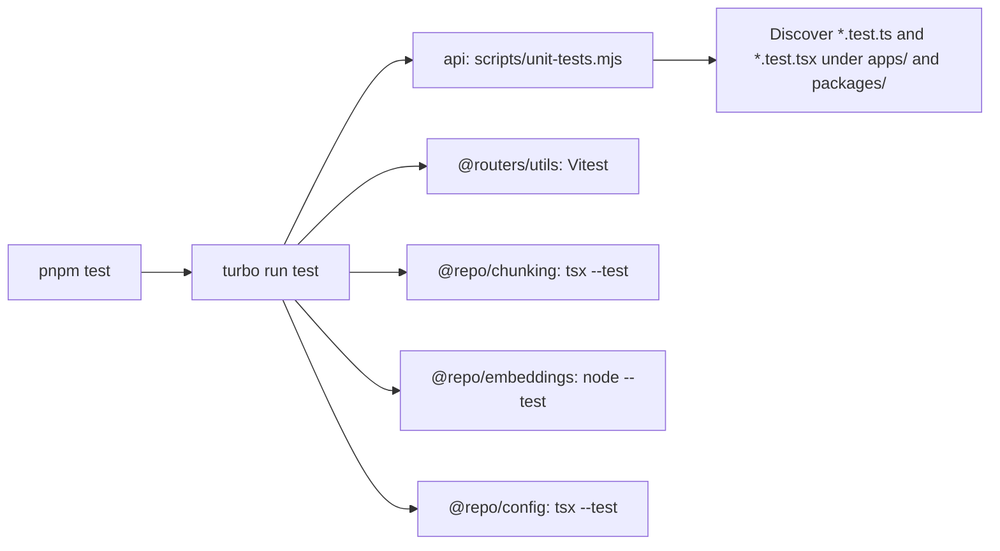

# Unit test discovery

This page covers issue #49. Before this change, root `pnpm test` ran only `api` and `@routers/utils`, and `apps/api` listed its test files by hand, so a new `*.test.ts` file was silently ignored until someone edited that list.

## How tests are found and run

- Root `pnpm test` is `turbo run test`, so every workspace package with a `test` script runs. The task is not cached, because the discovery runner reads files from other packages.
- The API test script first runs eleven hermetic discovery regressions, then [`scripts/unit-tests.mjs`](../scripts/unit-tests.mjs) runs regular `*.test.ts(x)` source files under `apps/` and `packages/` with `tsx --test`. Its focused [discovery helper](../scripts/unit-test-discovery.mjs) skips:
    - integration suites (file names containing `integration`), which `test:integration` and `pnpm test:catalog` run against disposable services;
    - the explicitly registered Vitest test, after checking its package's actual test command;
    - tests covered by the exact `OWN_RUNNERS` patterns and commands (`config`, `chunking`, `embeddings`, `vector-store`), whose own scripts run them;
    - symlinks, generated/build directories, and fixture-data directories named `fixtures` or `__fixtures__`.
- `node scripts/unit-tests.mjs --list` prints the discovered files.
- `pnpm test:coverage` runs the hermetic checks and the same API-owned discovery with Node's built-in coverage report (`--experimental-test-coverage`). It does not measure the separate chunking, embedding or Vitest runners. The report is informational; there is no threshold yet.
- `@repo/vector-store` needs the locally built vector image, so its script is `test:native` (run by the catalog workflow after building the image), not `test`.

To add a Node unit test, create a regular `*.test.ts` or `*.test.tsx` source file outside the reserved data/build directories. Comments and string fixtures containing `from 'vitest'` remain Node tests. Classification parses TypeScript syntax without executing source: a real static import/export or literal `import()`/`require()` dependency on Vitest requires a registered owner. An unknown Vitest test fails discovery clearly instead of silently disappearing. Register its exact package test command before adding it to the ownership map.

A new test inside an alternate-runner package must match that runner's actual pattern. Moving a test outside the pattern or changing the package command fails discovery until ownership is updated. File and directory symlinks are not followed, including aliases to native or integration suites. The eleven [hermetic tests](../scripts/unit-test-discovery.test.mjs) exercise these boundaries using temporary trees; their synthetic source is only parsed, never executed.

## Separate suites

Document parsing (`pnpm test:documents`, native Poppler), Redis (`pnpm test:queues`), the catalog (`pnpm test:catalog`), Docker images (`pnpm test:docker`) and the acceptance guard scripts keep their own commands, because they need native tools, containers or explicit isolation.

## Not included

Browser end-to-end journeys (for example Playwright against the `test:catalog` stack) and coverage thresholds are not implemented. They need a CI browser environment, test fixtures and agreed thresholds; dashboard acceptance remains the manual recipe described in `AGENTS.md`.

## Review correction status

The PR77 correction is prepared in isolated branch `codex/pr77-discovery-review` from `2cec6c0`. The original head passed catalog and six-image CI, but that evidence predates these runner corrections. Frozen installation and dummy client generation pass. The corrected helpers pass strict JavaScript type checks; all 24 workspace type and lint tasks pass. The uncached four-task root unit run passes 10 discovery regressions, 165 API/backend tests, 56 chunking tests, 146 embedding tests and 11 Vitest utility cases. Final-base integration, corrected catalog/build/image validation and exact-head CI remain pending; no native suite or application resource was started by this correction.

The locally integrated PR76 candidate `873fd6a90b4b4d135a959e55ca4838cdec7d9637` passes a new frozen install/generation, strict JavaScript checks for both helpers, all 24 type and 24 lint tasks, and the uncached four-task root test run: 10 discovery regressions, 182 API/backend tests, 56 chunking, 146 embedding and 11 Vitest utility cases. Discovery preserves all 31 previously enumerated Node files and adds the previously omitted Poppler diagnostics file, for 32 regular source files. The inherited S3 guard command, non-blocking audit and native Redis/vector runners remain registered. Both Next declarations are restored to their exact initial bytes and modes. These results validate this candidate integration; actual-main squash alignment and new exact-head catalog/six-image CI remain pending. No new local build or browser result is claimed for the runner-only delta.

The PR81 integration registers the exact `@repo/config` command (`tsx --test tests/*.test.ts`) and its finite source pattern as an alternate runner. Configuration tests execute once through Turbo; the API discovery verifies their owner and excludes them, and CI no longer invokes the same package a second time. Hermetic cases cover its real pattern, out-of-pattern files, script drift and unowned Vitest imports. This integration preserves the distinct Redis, vector, catalog and native parser commands. The combined tree passes frozen installation, dummy client generation, strict JavaScript checks with the API Node type root, all 25 type and 25 lint tasks, and five uncached test tasks: 11 discovery regressions, 189 API/backend cases, seven configuration cases, 56 chunking, 146 embedding and 11 Vitest utility cases. Both worktree Next declarations are restored to their initial bytes and modes. Combined API/worker builds and their closed synthetic startup probes also pass. Four integration-only expected revision headers are updated to match the existing v1.21 metadata; their native catalog execution remains pending in this checkout. New web/admin builds, catalog, final-main alignment and exact-head CI are not claimed for this integration.
