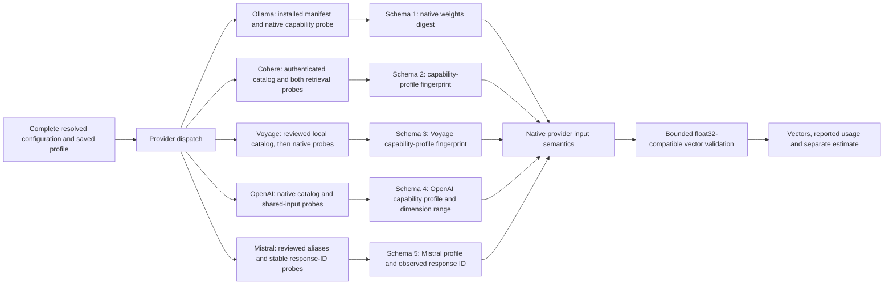

# Native embeddings

`@repo/embeddings` implements native Ollama, Cohere, Voyage, OpenAI and Mistral text embeddings. It accepts a complete resolved `EmbeddingConfiguration`: `{ provider: 'OLLAMA', endpoint, apiKey: string | null }` or `{ provider: 'COHERE' | 'VOYAGE' | 'OPENAI' | 'MISTRAL', endpoint, apiKey: string }`. It never reads environment variables, chooses organization credentials, downloads models, or accesses application databases.

The RAG layer resolves credentials and enforces exact operator-approved endpoints in [`embedding-profile.ts`](../routers/rag/src/services/indexing/embedding-profile.ts). Saved collection revisions retain their credential and destination binding. Invalid configured bindings fail without falling back to platform defaults.

## Entry points

- `discoverModels(config, options?)` calls the resolved native service. Ollama returns installed canonical names, manifest digests and families, bounded to 512 models. Cohere queries its authenticated `/v1/models` catalog, follows at most five pages of 100 entries and intersects results with the reviewed text-model allowlist. Cohere summaries include `discoverySource: 'HOSTED_CATALOG'`, `identityKind: 'CAPABILITY_PROFILE'`, context and dimension choices. Optional catalog metadata may be absent or null: unnamed and unrelated entries are skipped, explicitly non-embedding entries are excluded, and reviewed names can use the endpoint-filtered listing when optional endpoint metadata is absent. Invalid non-null field types fail closed. Listing is not an embedding probe.
- Voyage discovery returns the bounded local `VOYAGE_MODELS` catalog without HTTP. Its summaries set `reviewedCatalog: true` and omit `discoverySource`; they do not assert hosted listing, model availability, valid credentials or embedding readiness. Verification performs actual document/query probes.
- OpenAI discovery calls native `GET models` under the complete saved API base and intersects at most 1,000 entries with its two reviewed text models. Summaries set `discoverySource: 'HOSTED_CATALOG'` and expose range metadata rather than an exhaustive size list. Catalog access and embedding readiness remain separate: verification directly probes the embedding endpoint without requiring discovery first.
- Mistral discovery calls native `GET models`, bounds model cards and aliases, and exposes only explicitly reviewed IDs and aliases on a reviewed model card. Its catalog has no embeddings capability flag. Unknown cards cannot enable a model by asserting a known alias. Listing is not readiness: direct native probes establish a stable observed response ID.
- `verifyEmbeddingModel(config, { model, dimensions, preset, preparation? }, options?)` validates the supported profile and native vectors at the selected dimensions. Ollama checks its installed manifest and model metadata; Cohere probes both retrieval roles using synthetic text without organization content. Unsupported reductions and presets fail explicitly.
- `embedDocuments(config, identity, [{ text, title? }], options?)` and `embedQuery(config, identity, text, options?)` dispatch only when the configuration and saved identity belong to the same provider.
- `canonicalEmbeddingModel(provider, model)` applies provider-specific normalization. Ollama adds its implicit `:latest` tag; hosted model IDs remain exact and case-sensitive. The original `canonicalOllamaModel` export remains available.
- `modelIdentity` parses all five persisted identity formats. `embeddingIdentityKind(identity)` exposes `WEIGHTS_DIGEST` for legacy Ollama snapshots and `CAPABILITY_PROFILE` for Cohere/Voyage/OpenAI/Mistral.
- `embeddingInputByteLimit(identity, { kind?, title?, preparation? })` supplies the conservative content byte budget used by chunking. `prepareEmbeddingInput` applies the same accounting at the provider boundary. `COHERE_MODELS` exposes the reviewed server-side capability catalog; this package contains Node.js integrations and must not be imported into browser components.



## Ollama

The native `/api/embed` request uses `truncate: false`. Verification checks embedding capability, context, architecture, family, default dimensions and actual finite nonzero vectors. The original 300M EmbeddingGemma model supports the documented 768, 512, 256 and 128 dimensions; the selected choice is probed through the native API.

`GENERIC` sends raw text with no inferred model prefix. `EMBEDDING_GEMMA` applies Google's original retrieval prompts to document and query inputs. Document titles are normalized and truncated at a valid UTF-8 boundary to 200 bytes; a missing title becomes `none`.

Every Ollama embedding batch checks the installed manifest digest before and after the native request. A normal replacement fails with `MODEL_CHANGED`. Its embedding response contains a model name and no cryptographic digest, so these observations cannot detect an A→B→A replacement between checks. Deploy trusted, stable Ollama services; this is a consistency guard rather than remote attestation.

## Cohere

Set the endpoint to the service origin, normally `https://api.cohere.com`, and supply a nonempty API key. Versioned or path-prefixed bases such as `/v2` are rejected rather than silently retargeted. Native discovery uses `GET /v1/models`; embedding uses `POST /v2/embed`. These are Cohere's native APIs, not an OpenAI-compatible transport.

| Supported model           | Context tokens | Supported dimensions   | Default dimensions |
| ------------------------- | -------------- | ---------------------- | ------------------ |
| `embed-v4.0`              | 128,000        | 256, 512, 1,024, 1,536 | 1,536              |
| `embed-english-v3.0`      | 512            | 1,024                  | 1,024              |
| `embed-multilingual-v3.0` | 512            | 1,024                  | 1,024              |

The English v3 model is English-only; choose a multilingual model for French/English documents. Newer models, light variants, custom models, images and mixed-media inputs are not included in this reviewed text-only adapter. Model availability is checked against the bound native catalog; there is no automatic model substitution.

Cohere accepts only the `GENERIC` literal-text preset here. Retrieval roles use native `input_type: 'search_document'` and `'search_query'`, with `embedding_types: ['float']` and `truncate: 'NONE'`. V4 requests include the exact `output_dimension`; fixed-dimension v3 requests omit that unsupported parameter. No title prompt or model-name prefix is invented. Each request contains at most 96 texts and also respects the shared request-byte limit.

A Cohere `schemaVersion: 2` identity records the exact model ID, dimensions, documented capability profile and native input/output semantics. Its legacy-named `digest` is a deterministic SHA-256 fingerprint of that profile, explicitly tagged `identityKind: 'CAPABILITY_PROFILE'`. It is **not** a model-weights checksum. The API does not expose a verifiable weights manifest, so this adapter cannot detect an unannounced server-side weights change under the same ID. Saved profile semantics are checked before execution; future capability changes must retain compatible versioned identity parsing.

Ollama `schemaVersion: 1` snapshots retain their original shape and digest meaning. No migration, backfill or invented `identityKind` field is added to those stored objects; the exported helper supplies their public kind.

## Voyage

Use the provider root `https://api.voyageai.com` and a nonempty key. Versioned/path-prefixed endpoints are rejected. The adapter posts only to native `/v1/embeddings`; it does not use an OpenAI-compatible protocol or invent a model-list endpoint. The reviewed general-purpose catalog contains these models:

| Model            | Context tokens | Dimensions (default 1,024) | Native aggregate tokens/request |
| ---------------- | -------------- | -------------------------- | ------------------------------- |
| `voyage-4`       | 32,000         | 256, 512, 1,024, 2,048     | 320,000                         |
| `voyage-4-lite`  | 32,000         | 256, 512, 1,024, 2,048     | 1,000,000                       |
| `voyage-4-large` | 32,000         | 256, 512, 1,024, 2,048     | 120,000                         |

Only the `GENERIC` preset executes. `input_type` is explicitly `document` or `query`, `truncation` is `false`, and `output_dimension`/`output_dtype: 'float'` are explicit. Voyage supplies its own retrieval-role prompts; the adapter does not prepend them. Optional preparation remains a literal prefix. Code/domain/multimodal and other model families remain unsupported. See [Voyage's native API](https://docs.voyageai.com/reference/embeddings-api) and [model guide](https://docs.voyageai.com/docs/embeddings).

A `schemaVersion: 3` immutable capability profile records the model, dimensions, context, native roles, truncation, float output and aggregate request constraints. Its SHA-256 fingerprint is a configuration identity, not a provider-weights checksum. Replay validates the complete saved semantics; Ollama schema 1 and Cohere schema 2 snapshots remain unchanged.

Voyage accepts at most 1,000 inputs natively. Internal batches are smaller: `min(1000, floor(7 MiB / (dimensions * 32)))` allows at most 896/448/224/112 inputs at 256/512/1,024/2,048 dimensions. A separate 1 MiB encoded-input ceiling bounds requests, and prepared UTF-8 bytes plus a conservative 64-token role allowance per input stay within the model's aggregate limit. These are deliberately conservative admission bounds, not tokenizer counts or promised full-context throughput. Native truncation remains disabled. The shared response ceiling is 8 MiB.

Returned rows must form an exact unique integer-index permutation; vectors are restored to original input order across rows and batches. Model, count, dimensions and finite nonzero float32 representation are checked. `usage.total_tokens` supplies aggregate provider input tokens; omitted usage remains `null`, and no separate billing count is invented.

## OpenAI

Set the complete API base, normally `https://api.openai.com/v1`, and supply a nonempty API key. The adapter appends fixed relative `models` and `embeddings` paths. An operator-approved base such as `https://proxy.example/openai/v1` remains under that exact prefix; the adapter never inserts another `/v1` or resets the destination to its origin. A configured root is treated literally as the complete base. Existing collection credential and destination bindings remain authoritative.

| Reviewed model           | Context tokens | Default dimensions | Reviewed integer shortening policy |
| ------------------------ | -------------- | ------------------ | ---------------------------------- |
| `text-embedding-3-small` | 8,192          | 1,536              | 1–1,536, step 1                    |
| `text-embedding-3-large` | 8,192          | 3,072              | 1–3,072, step 1                    |

The API reference documents a minimum of 1 dimension, while the guide describes shortening the natural output sizes above. The maximums in this table are this adapter's reviewed shortening policy, not a separately documented provider maximum. Verification tests the exact selected size, including nonstandard reductions such as 257. Older models, custom/fine-tuned models and other families are not supported; no substitution occurs. The RAG layer's separate float32 HNSW limit remains 2,000 dimensions, so a 3,072-dimensional profile needs DiskANN or a smaller selected size.

Native `POST embeddings` sends only `input: string[]`, the exact `model`, selected `dimensions` and `encoding_format: 'float'`. OpenAI has no native retrieval-role or truncation parameter. Both application paths use the same protocol with the `GENERIC` preset, optional literal preparation, and no inferred document title, role prefix or end-user identifier. Over-budget inputs fail locally; no local slicing or automatic truncation is performed.

A strict immutable `schemaVersion: 4` profile includes the selected size, `dimensionCapability: { kind: 'RANGE', minimum: 1, maximum, step: 1 }`, context, native semantics and request limits. `supportedDimensions: [selectedSize]` remains a compatibility hint for the exact selected/probed size, **not an exhaustive set of allowed dimensions**. Discovery omits that optional legacy list and returns the range instead. Consumers should prefer range metadata when present. Saved execution reconstructs and compares the complete profile and fingerprint before I/O. This configuration fingerprint cannot verify hosted weights or detect an unannounced change under the same model ID. Schemas 1–3 retain their original formats and meaning.

Native limits are 2,048 inputs and 300,000 aggregate input tokens per request. Internal batches use `min(2048, floor(7 MiB / (dimensions * 32)))`, at most 149/74 inputs at natural 1,536/3,072 dimensions, to leave room below the 8 MiB JSON response limit. Prepared UTF-8 bytes plus 32 reserved tokens per input bound aggregate admission conservatively; encoded input JSON has a separate 1 MiB ceiling. The shared per-input context byte bound applies as well. These safety limits are not exact tokenizer counts or guaranteed full-context throughput.

Responses must carry the exact model and a complete unique integer-index permutation. Vectors return in input order across rows and batches; count, dimensions, finite float32 values and nonzero rounded norms are validated without normalizing provider precision. `usage.prompt_tokens` supplies provider input usage, with `null` propagated if any successful batch omits it. `total_tokens` is validated independently and cannot be below a reported prompt count; it is not substituted for input tokens or represented as separately reported billing.

## Mistral

Use a complete saved API base, normally `https://api.mistral.ai/v1`, with a nonempty key. Only fixed relative `models` and `embeddings` paths receive the credential. Approved proxy prefixes and existing `/v1` segments are preserved exactly; no extra version segment or origin reset occurs.

The reviewed text model is `mistral-embed`, with the officially documented `mistral-embed-2312` alias. Both use fixed 1,024-dimensional vectors and the `GENERIC` preset. The model page describes an **8k** context; this adapter deliberately uses an **8,000-token processing budget**, rather than asserting a separately documented 8,192-token maximum. The general API's optional output-dimension/type features do not establish support for reducing this fixed-dimension model. Other model families, custom IDs and arbitrary aliases remain unsupported.

Native requests send only `model`, `input: string[]` and `encoding_format: 'float'`. No `dimensions`, `output_dimension`, `output_dtype`, retrieval role, truncation, metadata or end-user field is invented. Document and query paths use the same native protocol and literal preparation. Titles are not rewritten into model prompts; oversize input is rejected locally rather than sliced.

Native listing reads at most 1,000 cards, each with at most 100 aliases. Documented envelope defaults are supported: an omitted `object` uses `list`, omitted `data` is an empty catalog, and optional/defaulted model-card metadata may be absent. Existing nullish optional catalog metadata remains harmless; invalid present types fail closed, including null/non-array `data`. The reviewed ID/alias intersection does not require a nonexistent `capabilities.embeddings` flag or treat completion flags as embedding readiness. A reviewed card may expose either or both reviewed names. An unrelated card claiming one of those aliases cannot enable it. Discovery fingerprints cover reviewed catalog settings only; no embedding response ID has yet been observed.

A strict immutable `schemaVersion: 5` capability identity records the exact requested `model`, ordered reviewed `equivalentModels` pair, and observed `responseModel`, along with fixed dimensions, processing budget and native semantics. Both synthetic probes must return the same member of that explicit pair; later embedding requests must retain that observed ID. A switch between the reviewed aliases fails with `MODEL_CHANGED`; an unreviewed response ID fails with `INVALID_PROVIDER_RESPONSE`. There is no model substitution or fallback. Saved replay checks the complete profile and fingerprint before I/O; schemas 1–4 retain their original meaning.

This stable response-ID check is consistency evidence, **not weights attestation**. An unchanged hosted name cannot expose a hidden server-side weights change. The fingerprint identifies the saved capability configuration, including its observed alias, rather than a downloadable model manifest.

`batchPolicy` is explicitly a Vectorix safety policy: at most **64 inputs**, with prepared UTF-8 bytes plus **32 reserved units per input** totaling at most **16,000** per request. These are conservative internal admission caps, not documented native batch/token limits or exact tokenizer counts. The shared per-input processing byte budget also applies. Fixed 1,024-dimensional batches remain comfortably below the shared 8 MiB response ceiling; all requests retain the 2 MiB JSON limit and one operation deadline.

Native rows must form a complete unique integer-index permutation and are restored to input order across batches. Cosmetic `object` metadata accepts bounded strings and an omitted row object, matching native SDK optionality. The adapter intentionally requires row `index` and `embedding`, even for one input: although the general SDK permits their omission, vectors cannot be safely associated or published without them. Count, 1,024 dimensions, finite float32 representation and nonzero rounded norms are validated while preserving numeric precision. `usage.prompt_tokens` reports provider input tokens; missing usage in any batch propagates `null` rather than copying SDK zero defaults. `total_tokens` is checked separately, never substituted for input tokens or treated as separately reported billing. Controlled loopback fixtures verify this wire protocol; paid-provider connectivity, availability and relevance remain separate live checks.

## Bounds, preparation and usage

Optional preparation is a literal prefix followed by a newline on both application paths. It is never interpreted as a template. Complete input, including any applicable preparation/title/preset prefix, must fit within the context-token count minus 32 bytes, capped at 64 KiB. This conservative byte bound avoids assuming a tokenizer and may produce smaller chunks than the provider's token maximum. Native truncation is disabled where the provider exposes that control; OpenAI and Mistral have no truncation parameter.

One operation deadline covers discovery, probes, all batches, retries and applicable manifest checks. Request JSON is bounded to 2 MiB, response JSON to 8 MiB and 16 nesting levels. Ollama requests contain at most 128 inputs; Cohere requests contain at most 96; Voyage, OpenAI and Mistral use the respective dimension/byte/aggregate bounds above. Vector counts and exact dimensions must match; components must remain finite as float32 and the rounded vector must be nonzero. Valid provider precision is preserved rather than normalized or silently sliced.

HTTP 429 and 5xx responses receive at most three attempts with bounded backoff. Other error statuses are not retried. Redirects fail closed. Only fixed provider-specific native paths receive the resolved credentials. Errors expose stable domain codes without URLs, credentials, provider bodies or original exceptions. Endpoint approval and organization authorization remain the caller's responsibility.

`EmbeddingUsage` keeps three quantities separate:

- `providerInputTokens`: Ollama's aggregate `prompt_eval_count`, Cohere's `meta.tokens.input_tokens`, Voyage's `usage.total_tokens`, or OpenAI/Mistral's `usage.prompt_tokens`; `null` if any successful batch omits it.
- `billedInputTokens`: optional Cohere aggregate `meta.billed_units.input_tokens`, independently `null` when unavailable. Billed units never replace model input-token counts.
- `estimatedInputTokens`: the explicitly labeled prepared UTF-8 byte estimate, plus `requests` for successful embedding requests. Estimates are neither exact tokenizer counts nor provider billing.

## Awaited native-batch observation

`embedDocuments` and `embedQuery` accept an optional `batchObserver`. Discovery and model-verification probes do not use these hooks. Each event describes one logical native batch, which can contain several inputs and can be split from one application call. The native HTTP transport permits up to three attempts per embedding request; Ollama manifest checks add separate requests under the same deadline. Observer counts and `usage.requests` do **not** attest to exact wire attempts or provider billing.

```ts
await embedDocuments(configuration, identity, documents, {
    preparation,
    batchObserver: {
        async beforeBatch(batch) {
            await reserveLogicalBatch(batch);
        },
        async afterBatch(batch, result) {
            await checkpointValidatedBatch(batch, result);
        },
        async failedBatch(batch, code) {
            await recordUncertainBatch(batch, code);
        },
    },
});
```

The observer methods are optional and awaited in order. `beforeBatch` must resolve before this batch's native I/O, including Ollama's existing manifest checks. Rejection performs no batch I/O and calls neither completion nor failure hooks. `afterBatch` receives input-ordered validated vectors and normalized per-batch usage in a defensive copy. It can atomically record an accepted prefix and its usage before another batch starts. Its error propagates unchanged and stops subsequent batches; a validated success is not reclassified as a provider failure. Persistence can remain uncertain after such a callback error, so the caller needs its own durable recovery protocol.

Native failure invokes `failedBatch` once with a sanitized `EmbeddingErrorCode`, without retaining provider bodies or exceptions. If that hook also fails, the original native error is preserved and no later batch runs. A failure can occur during a manifest check or before an embedding POST is sent, or after an uncertain provider attempt; the event alone does not establish that a charge occurred. Missing provider-token or separately billed usage remains `null`, never a fabricated zero.

The descriptor contains provider/model, the saved identity digest, document/query kind, zero-based batch ordinal and input offset within this embed call, input count, total prepared UTF-8 text bytes and the existing `ceil(bytes / 4)` estimate summed per input. Callers supply their own durable operation/attempt identity; ordinals reset for a new call. This embedding-usage estimate is distinct from the chunk planner's `bytes / 3` estimate. `preparedInputHashVersion: 'sha256-json-strings-v1'` identifies SHA-256 of `JSON.stringify(preparedInputs)` in their input order. JSON framing distinguishes input boundaries. Descriptors contain neither prepared text nor endpoint/credentials/raw provider responses; they are not new identity snapshots or weight attestations.

One existing operation signal covers batch sequencing, retries, manifest checks and time spent awaiting hooks. Hooks receive no fresh native timeout budget, but must bound their own database work: a pending callback is not forcibly interrupted by this package. A completed, validated batch still calls `afterBatch` when cancellation/authority expiry happens after native completion. The caller may record that late usage while refusing any stale checkpoint/publication advancement; the adapter does not implement leases, authorization or database accounting. With no observer, protocols, preparation, identity variants and aggregate result semantics remain unchanged.

## Validation

Run `pnpm --filter @repo/embeddings test` for controlled loopback HTTP fixtures covering native payloads, retrieval semantics, dimension choices/ranges, catalog pagination/no-I/O catalogs, alias observation/drift, immutable identity compatibility, indexed ordering, batching, truthful usage, invalid float32 vectors, retries, cancellation, response limits, redirects and input preparation. These fixtures do not establish live hosted-provider connectivity or product dashboard acceptance.

The [Ollama and EmbeddingGemma reproduction guide](../../docs/rag-ollama-embeddinggemma.md) provides the executed CPU container/version, model digest, installation and native probe commands, credential/network configuration and actual live evidence. For a separate live Ollama check, create a disposable official CPU-only container, install `embeddinggemma`, then run from this directory:

```sh
node --import tsx tests/live.mts http://127.0.0.1:PORT
```

The script accepts only an explicit loopback endpoint and never reads `.env`. It verifies all four dimensions and French query retrieval against French/English documents. Live provider checks and dashboard acceptance must be recorded separately by each product milestone; no live hosted-provider request is claimed by the controlled package tests.

## Primary references

- [Ollama native embedding API](https://docs.ollama.com/api/embed): dimensions, batches, truncation and input-token usage.
- [Ollama installed model API](https://docs.ollama.com/api/tags) and [show API documentation](https://github.com/ollama/ollama/blob/main/docs/api.md#show-model-information): manifests and capability metadata.
- [Google's original EmbeddingGemma 300M model card](https://huggingface.co/google/embeddinggemma-300m): retrieval prompts, context and dimension choices.
- [Official Ollama Docker setup](https://docs.ollama.com/docker): CPU execution.
- [Cohere embedding API](https://docs.cohere.com/reference/embed) and [semantic search guide](https://docs.cohere.com/v2/docs/semantic-search-embed): native roles, float output, truncation, dimensions and the 96-text limit.
- [Cohere model capabilities](https://docs.cohere.com/v2/docs/cohere-embed) and [native model listing](https://docs.cohere.com/reference/list-models): reviewed context/dimension choices and authenticated discovery.
- Cohere's official SDK distinguishes [model input tokens](https://github.com/cohere-ai/cohere-python/blob/main/src/cohere/types/api_meta_tokens.py) from [billed input units](https://github.com/cohere-ai/cohere-python/blob/main/src/cohere/types/api_meta_billed_units.py).
- [Voyage native embedding API](https://docs.voyageai.com/reference/embeddings-api), [text models](https://docs.voyageai.com/docs/embeddings) and [official response schema](https://github.com/voyage-ai/openapi/blob/main/voyage-openapi.yml): retrieval roles, dimensions, current model-specific aggregate limits, indexed responses and token usage. The API/model pages are authoritative for current input/model limits; the older OpenAPI description still names older models and a lower batch limit.
- [OpenAI native embedding API](https://developers.openai.com/api/reference/resources/embeddings/methods/create), [embedding guide](https://developers.openai.com/api/docs/guides/embeddings) and [native model listing](https://developers.openai.com/api/reference/resources/models/methods/list): exact request/response fields, dimensions minimum, default output sizes and shortening, per-input/aggregate limits and authenticated discovery. No paid-provider request is claimed by the controlled fixtures.
- [Mistral native embedding API](https://docs.mistral.ai/api/endpoint/embeddings), [native model listing](https://docs.mistral.ai/api/endpoint/models), [text embedding guide](https://docs.mistral.ai/studio/knowledge-rag/embeddings/text_embeddings) and [model card](https://docs.mistral.ai/models/mistral-embed-23-12): native fields, model-card aliases, fixed dimensions and documented 8k context. The 8,000 processing budget and 64/16,000 batch policy are conservative Vectorix limits, not additional native guarantees.
- Mistral's official SDK schemas for [model lists](https://github.com/mistralai/client-ts/blob/main/src/models/components/modellist.ts), [model cards](https://github.com/mistralai/client-ts/blob/main/src/models/components/basemodelcard.ts), [embedding responses](https://github.com/mistralai/client-ts/blob/main/src/models/components/embeddingresponse.ts) and [embedding rows](https://github.com/mistralai/client-ts/blob/main/src/models/components/embeddingresponsedata.ts): native defaults and optional cosmetic metadata, with the stricter useful-field requirements above retained for safe indexing.
