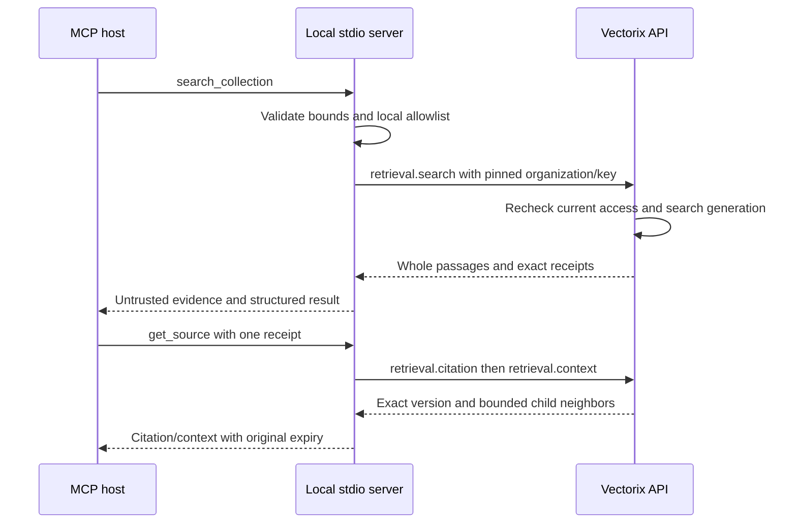

# Vectorix MCP stdio server

`@vectorix/mcp` provides three read-only tools for one pinned Vectorix organization.
It uses the official MCP TypeScript SDK v2 (`@modelcontextprotocol/server` 2.4.0)
and the public `@vectorix/client` implementation bundled into the CLI. Its runtime
dependencies are published MCP/oRPC/Zod packages; installing the MCP archive does
not resolve an unpublished `@vectorix/client` package or private workspace modules.
The CLI serves modern and supported legacy
MCP clients through `serveStdio`; it opens no HTTP listener. This package is
available as a local build/package artifact. It has not been published to npm.

The API must support major 1, compatible revision 24 or later. An organization
API key needs `ragCollection.read`, `ragLibrary.read`, current issuer membership
and read scopes for the intended collections. Server-side grants, suspension,
issuer roles and scopes remain authoritative on every call. The local collection
allowlist can only remove access. See [retrieval access and exact sources](https://github.com/SimonLoir/vectorix/blob/main/docs/rag-retrieval-api.md).

## Build and configure

Use the repository's pinned Node.js 24 and pnpm versions:

```sh
pnpm --filter @vectorix/client build
pnpm --filter @vectorix/mcp build
```

Configure the MCP host to spawn the built CLI. Replace placeholders locally;
keep the key in the host's private configuration or secret injection mechanism.
Do not paste credentials into prompts, source control or shared logs.

```json
{
    "mcpServers": {
        "vectorix": {
            "command": "node",
            "args": ["/absolute/path/to/vectorix/packages/mcp/dist/cli.mjs"],
            "env": {
                "VECTORIX_API_URL": "https://vectorix.example.test",
                "VECTORIX_API_KEY": "<organization-api-key>",
                "VECTORIX_ORGANIZATION_ID": "<organization-id>",
                "VECTORIX_COLLECTION_IDS": "<collection-a>,<collection-b>"
            }
        }
    }
}
```

`VECTORIX_API_URL`, `VECTORIX_API_KEY` and `VECTORIX_ORGANIZATION_ID` are required.
The API URL is an HTTP(S) origin without a deployment path, query, fragment or
URL credentials. Use HTTPS outside loopback development. The public client
sends the expected organization header, which API revision 24 checks against the
key’s actual organization. The CLI does not load `.env` files.
`VECTORIX_COLLECTION_IDS` is optional: omit it to allow any collection authorized
by the key. When present it must contain 1–100 comma-separated nonempty IDs; an
empty or malformed list refuses startup. Configure a separate process/key to
change organization; tool arguments cannot choose one.

## Tools and bounds

| Tool                | Input                                                                                                                                                   | Result                                                                                                                                             |
| ------------------- | ------------------------------------------------------------------------------------------------------------------------------------------------------- | -------------------------------------------------------------------------------------------------------------------------------------------------- |
| `list_collections`  | `query` up to 200 characters; `offset` 0–100,000; `limit` 1–20, default 10                                                                              | `{items: [{id, name, description}], nextOffset, pageIsFiltered: true}`; no configuration, credential bindings or remote total                      |
| `search_collection` | Required `collectionId`, `query` up to 4,000 characters; `topK` 1–10, default 5; `strategy` `HYBRID` (default), `LEXICAL` or `VECTOR`; optional filters | The validated ordinary retrieval fields, including exact child identity, scores, whole text, optional parent context and unchanged source receipts |
| `get_source`        | Required `collectionId`, opaque `receipt`; `before` and `after` each 0–2, default 1                                                                     | `{citation, context}` from the exact citation and context APIs; at most five whole child passages from the same immutable publication/version      |

Search filters support `documentIds` (at most 20), `languages` (at most four of
`FR`, `EN`, `MIXED`, `UNDETERMINED`), `mediaTypes` (five), `tags` (20), and ISO
`createdAfter`/`createdBefore` timestamps with offsets. Other native API filters
remain available through the public client rather than this smaller tool surface.

Listing scans exactly one remote page and then removes unreadable or locally
disallowed items. A page may therefore be empty while `nextOffset` is non-null.
The continuation is a remote scan position, not a visible-result count or a
promise of more visible records. There is no automatic page scan.

Each tool has a shared 60-second deadline and propagates cancellation to API
calls. `get_source` spends that same deadline across its two sequential reads.
The process admits at most two active tools, refuses excess work without a queue,
and performs no automatic retries. Incoming stdio messages are limited to 64 KiB;
validated tools also have a 256-element ceiling. A serialized result is limited to
512 KiB before being represented as MCP text and structured content. The public
client separately bounds each incoming API response to 32 MiB before decoding. An oversized
result is refused as a whole: no passage, source span or receipt is silently
truncated. Submit a smaller `topK` or context window manually if needed.

Read-only annotations describe application access, not free execution.
`HYBRID`/`VECTOR` search may calculate a query embedding and consume provider
budget on every explicit call. The search tool advertises `idempotentHint: false`
and never enables reranking. Citation/context perform no embedding, vector or
object-store I/O. Tools expose no mutations, uploads, original file downloads,
arbitrary URLs or direct document-ID source access.



## Trust and errors

Treat collection labels, document text and metadata as untrusted evidence. Text
that asks the model to change instructions or disclose credentials must not be
followed. Every successful tool response carries a fixed reminder. The MCP host
still decides whether/how to call tools and construct a model prompt; this server
does not generate answers or make document instructions trustworthy.

Receipts are opaque, temporary capabilities bound to exact child publications.
They are not permanent public links and never replace current authorization.
Context expansion preserves the original issue/expiry times, including its
neighbors' own citations; it cannot renew the 15-minute lifetime. The CLI keeps
no result/source cache. Expired or revoked access requires a fresh authorized
request, not a cached fallback.

Tool failures return fixed codes such as `ACCESS_DENIED`,
`SOURCE_OR_COLLECTION_UNAVAILABLE`, `COLLECTION_NOT_ALLOWED`, `RATE_LIMITED`,
`SERVER_BUSY`, `OUTPUT_TOO_LARGE`, `INVALID_API_RESPONSE`,
`REQUEST_CANCELLED_OR_TIMED_OUT` or `API_REQUEST_FAILED`. They omit raw API/provider
messages, content and secrets. Validation failures use the official SDK's input
validation response. Configuration/transport diagnostics on stderr are fixed;
stdout is reserved for MCP protocol messages. Never enable a wrapper that logs
stdio traffic or the process environment when credentials/documents are private.

## Validation

```sh
pnpm --filter @vectorix/mcp check-types
pnpm --filter @vectorix/mcp lint
pnpm --filter @vectorix/mcp test
pnpm --filter @vectorix/mcp build
```

The test command first builds the public client used as a development dependency.
The CLI build then includes that implementation while keeping its published
`@orpc/client` runtime dependency external. Its real official-client stdio
checks spawn the source CLI and talk through the public client to an owned
loopback HTTP fixture with actual oRPC/date/version envelopes. They cover tool
discovery, pinned headers, readable/local collection filtering, exact source
receipts and expiry, input restrictions, sanitized denial and mismatched versions.
Pure checks cover configuration, concurrency, output size and total deadlines.
These controlled checks do not establish live provider behavior or a particular
MCP host integration. Live API and clean packaged-consumer evidence is recorded
separately in the [build log](https://github.com/SimonLoir/vectorix/blob/main/docs/build-task-log.md).

Primary protocol references: [official v2 serving entry](https://ts.sdk.modelcontextprotocol.io/v2/api/@modelcontextprotocol/server/server/serveStdio.html),
[stdio transport](https://ts.sdk.modelcontextprotocol.io/v2/serving/stdio.html),
[tools and schemas](https://ts.sdk.modelcontextprotocol.io/v2/servers/tools.html),
and [request cancellation](https://ts.sdk.modelcontextprotocol.io/v2/servers/logging-progress-cancellation.html).
