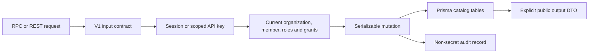

# RAG catalog router

`@routers/rag` implements the V1 catalog contracts in `packages/api-contracts/src/v1/rag/`. `src/index.ts` composes one handler per endpoint. `packages/api/src/index.ts` mounts it below `admin.rag`; `apps/api` provides authenticated HTTP transport at `/rpc/v1` and `/api/v1`.

The public API currently covers credentials, groups, collection configuration and grants, document metadata, platform connection references, quotas, and audit. It does not upload files, call embedding providers, provision vector tables, or perform searches yet.

## Integration entry points

- `@routers/rag/access`: `ragActor` resolves current membership and key issuer permissions. `requireCollection` enforces a scoped collection grant; `documentWhere` expresses library access before pagination. Callers must check the corresponding global operation permission as well as the collection action. An identifier alone never grants access.
- `@routers/rag/credentials`: `resolveCredential` resolves a complete active organization configuration, falling back to the environment only when no organization credential exists for that provider. `resolveCollectionCredential` follows the binding stored in a specific immutable revision; later selection changes do not retarget it. It accepts secret rotation at the same destination and rejects destination changes. These helpers are server-only and return secrets: never serialize or log their results.
- `@routers/rag/api-key-scopes`: validates delegated scopes and binds newly issued keys to the current member. Existing keys without a binding must be replaced. Native key creation remains in the organization router; binding failure removes the newly created key before its secret can be returned.
- `src/services/mutation.ts`: serializable catalog mutation boundary, current access checks, conflict mapping, and transactional audit. Retryable callbacks must not make outbound calls.
- `src/services/quotas.ts`: deployment defaults, organization overrides, and retained object usage. Later ingestion workflows must reserve capacity transactionally before uploads and indexing.

Collections use a platform connection created on first collection creation. Connection listing exposes only the resulting reference, not database URLs or provisioning credentials. Document metadata contains no object keys or storage credentials. Collection deletion retains shared documents and historical revisions; physical retention cleanup belongs to the later ingestion lifecycle.

See [catalog and access](../../../docs/rag-catalog-access.md) for schema, permission rules, and configuration; [implementation plan](../../../docs/rag-implementation-plan.md) for later work; and [the isolated test runner](../../../scripts/test-catalog.sh) for migration and authorization validation. Provider tests use local credential fixtures and make no live provider calls.
