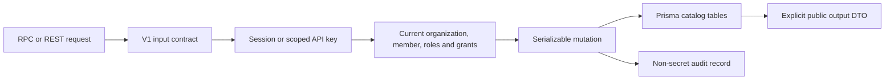

# RAG catalog router

`@routers/rag` implements the V1 catalog contracts in `packages/api-contracts/src/v1/rag/`, currently compatible revision `1.18.0`. `src/index.ts` composes one handler per endpoint. `packages/api/src/index.ts` mounts it below `admin.rag`; `apps/api` provides authenticated HTTP transport at `/rpc/v1` and `/api/v1`.

The public API currently covers credentials, groups, collection configuration and grants, document upload/inspection, associations and lifecycle operations, platform connection references, quotas, and audit. The [catalog dashboard](../../../docs/rag-dashboard.md) exposes configuration, access, quota, and audit workflows. Bounded revision history and principal candidates support these screens; candidates require a session and the corresponding grant/group management permission. The `@routers/rag/quotas` export shares effective quota resolution with superadmin. The [document library](../../../docs/rag-document-library.md) adds private TXT/Markdown upload, extraction, preview, original download and collection links. The [document lifecycle](../../../docs/rag-document-lifecycle.md) adds replacement, deletion, retained version metadata and cleanup/retry in compatible revision `1.5.0`; M2a.2 is implemented and browser-verified. The [M2b rich-document slice](../../../docs/rag-rich-documents.md) adds PDF/DOCX extraction and bounded source previews in compatible revision `1.6.0`; the complete upload/source-preview journey is browser-verified. The [first indexing/search journey](../../../docs/rag-first-search.md), [rebuilds](../../../docs/rag-index-rebuild.md), five native embedding providers and [token windows](../../../docs/rag-token-windows.md) are implemented; semantic execution is implemented with real Ollama dashboard acceptance complete. Parent context is implemented with automated validation and real Ollama dashboard acceptance complete. M7a freshness/recovery, M7b.1 current-work triage and M7b.2 recorded activity are implemented and browser-verified. M7c restore, relevance and capacity acceptance remains planned.

## Integration entry points

- `@routers/rag/access`: `ragActor` resolves current membership and key issuer permissions. `requireCollection` enforces a scoped collection grant; `documentWhere` expresses library access before pagination. Callers must check the corresponding global operation permission as well as the collection action. An identifier alone never grants access.
- `@routers/rag/credentials`: `resolveCredential` resolves a complete active organization configuration, falling back to the environment only when no organization credential exists for that provider. `resolveCollectionCredential` follows the binding stored in a specific immutable revision; later selection changes do not retarget it. It accepts secret rotation at the same destination and rejects destination changes. These helpers are server-only and return secrets: never serialize or log their results.
- `@routers/rag/api-key-scopes`: validates delegated scopes and binds newly issued keys to the current member. Existing keys without a binding must be replaced. Native key creation remains in the organization router; binding failure removes the newly created key before its secret can be returned.
- `@routers/rag/ingestion`: `processDocumentIngestions` is the worker scan entry point. Its optional rich-parser callback is supplied by workers; API services do not import native parser dependencies. PostgreSQL stores task claims, fenced leases, retries and reservations; Redis only schedules scans. `services/documents/` shares scoped upload, storage binding, extraction, preview/download and association logic with the API.
- `@routers/rag/cleanup`: `processDocumentCleanups` claims durable version cleanup, follows saved original/extraction storage bindings, and releases bytes only after successful deletion. The existing document worker schedules ingestion then cleanup every five seconds. Cleanup survives requester removal and organization suspension after authorization.
- `src/services/documents/replace.ts`, `delete.ts`, `lifecycle.ts` and `retention.ts`: current manager authorization, expected-version checks, retained history/deleted listing, retention scheduling and transactional audit. `ingestion-state.ts` preserves the published READY version during replacement and fences publication against newer attempts or tombstones.
- `src/services/mutation.ts`: serializable catalog mutation boundary, current access checks, conflict mapping, and transactional audit. Retryable callbacks must not make outbound calls.
- `src/services/quotas.ts`: deployment defaults, organization overrides, and retained object usage. Upload reservations count originals plus extraction capacity before S3 I/O; retries reuse existing reservations. Indexing accounts active, retained and reserved chunks transactionally before vector writes.

Collections use a platform connection created on first collection creation. Connection listing exposes only the resulting reference, not database URLs or provisioning credentials. Document metadata contains no object keys or storage credentials. Collection deletion retains shared documents and historical revisions; document deletion immediately removes its associations and content access, then durable cleanup honors retention and I/O safety deadlines. Archived version metadata deliberately retains storage and credential references after object purge. Replacement/deletion accept 0–365 days counted from the request, defaulting to seven/zero respectively. There is no restore operation.

See [catalog and access](../../../docs/rag-catalog-access.md) for schema, permission rules, and configuration; [implementation plan](../../../docs/rag-implementation-plan.md) for later work; and [the isolated test runner](../../../scripts/test-catalog.sh) for migration and authorization validation. Embedding-provider tests use synthetic credentials and make no live model calls. Document tests use real disposable RustFS and binary HTTP transports.

## Embedding provider catalog

Credential and collection contracts accept Ollama, Cohere, Voyage, OpenAI, and Mistral. OpenAI/Mistral each store a required encrypted API key and an explicit API base endpoint in their provider-specific child table. Apply `20261023000000_openai_mistral_credentials` before running the updated application. `credential-data.ts` masks and encrypts/decrypts them; `credential-update.ts` preserves omitted keys during updates. The existing resolver uses `VECTORIX_DEFAULT_OPENAI_{ENDPOINT,API_KEY}` or `VECTORIX_DEFAULT_MISTRAL_{ENDPOINT,API_KEY}` only when organization configuration is absent.

The dashboard exposes both in integration and collection-profile selectors. Native execution, saved capability probes and indexing/rebuilds support all five providers. See their linked guides in the root README for exact protocol and actual acceptance evidence; paid-provider connectivity remains pending organization test credentials. `apps/api/src/rag-tests/embedding-providers.ts` covers real database/HTTP persistence, masking, rotation, organization isolation, saved bindings, and failure without fallback using synthetic credentials.

## Semantic planning and work tracking (M6b)

Deploy `20261028000000_rag_semantic` before the updated services. `src/services/indexing/generation-profile.ts` dispatches exact saved algorithms; `semantic-capacity.ts` admits full bounded candidate allowances, and `semantic-planning.ts` orchestrates 32-unit continuations. `semantic-plan-state.ts` binds canonical source/profile geometry and explicit little-endian float32 checkpoints. `semantic-checkpoints.ts` persists only contiguous accepted scores and one last vector; a sealed plan is reused before chunk reservation and materialization.

`semantic-work.ts` provides one native observer per embed call. The ledger writes dispatch intent before I/O, settles selected usage idempotently and checks current claim/authority before advancing a checkpoint. Domain denial is thrown after committing valid usage. SQL errors abort/retry the full transaction. `semantic-work-lifecycle.ts` expires abandoned work, releases unused work/planning-storage allowance and clears content after fenced vector cleanup. Actual stored payload and all dispatched history remain charged/retained. `task-scan.ts` bounds priority to five eligible actual reservation holders, with a separate ordinary slice so fresh backlogs cannot stall every capacity holder. Active holders retain their admitted allowance across policy increases; retry after release may re-admit under the new caps. Settled history survives ordinary cleanup so a retry cannot reset lifetime work limits.

`@routers/rag/semantic-quotas` shares separate technical policy and usage with admin. Existing strict six-field RAG limits remain unchanged; compatible API revision 1.14.0 adds optional semantic siblings and dedicated superadmin policy operations. BIGINT counters cross JSON as decimal strings. Known reported-token subtotals must be read with unknown-batch counts; dispatched intent is not confirmed provider work or a monetary bill. Tracking covers semantic indexing, not historical/structure/token/query calls. The internal `semantic-work`/`semantic-work-ledger` workspace exports support focused worker recovery tests and are not HTTP endpoints.

See [semantic schema, protocol, limits and acceptance](../../../docs/rag-semantic-planning.md). Coordinated automated validation and real Ollama production-dashboard acceptance are complete; hosted native protocols use controlled fixtures.

## Parent context and bounded retrieval (M6c)

Deploy the approved additive `20261029000000_rag_parent_context` migration and update/drain all API and cleanup workers before enabling parent materialization. Old cleanup reconstructs manifests from every candidate row and is incompatible with new parent rows. The separately saved `parent-context-utf8-v1` descriptor supports structure, token-window and semantic children across all five native providers without changing their existing versions or historical semantic hashes.

`chunk-materialization.ts` validates exact replay, inserts parents before linked children, and seals the complete application layout before external child-vector publication. Parent-enabled canonical content is immutable from insertion; statement-level candidate row touches serialize raw chunk writes with a stale Serializable sealer. Only CHILD rows enter vector inputs/manifests, progress counters and searchable-passage accounting. Cleanup deletes both kinds after the existing vector tombstone/work/source fences; parents add bounded application storage and no embedding work.

`search-representatives.ts` groups eligible metadata-only children before final `topK`, keeping the strongest representative's original scores. `chunk-projection.ts` hydrates only selected child/parent pairs with a static parameterized PostgreSQL projection of at most 64 source spans per row. Prisma cannot slice this JSON array; loading full provenance then truncating would not satisfy the bound. Search rechecks exact publications and current access after hydration. Generation preview also rechecks current management capability so a manager downgraded to reader cannot finish an unpublished preview.

`views.ts` keeps preview pagination child-only and adds optional context through the explicit major-1 DTOs. API `1.15.0` preserves child identity/text/scores/receipt and adds optional canonical ranges, `parentContext`, saved layout metadata and `parentUnderfilled`. The latter reports fewer distinct contexts in a bounded candidate window separately from vector underfilling; it does not establish corpus exhaustion. `sources.ts` accepts exact CHILD receipts only, with the existing current-access and saved-storage checks; there is no parent-ID content endpoint.

```mermaid
flowchart LR
    Child["Saved child planner"] --> Parent["Bounded canonical parent layout"]
    Parent --> Seal["Immutable application seal"]
    Seal --> Vector["Child embeddings and vector publication"]
    Vector --> Ranks["Authorized child ranks"]
    Ranks --> Groups["Metadata grouping before topK"]
    Groups --> Context["Selected child and parent text: 64 spans per row"]
    Context --> Access["Current access and exact publication recheck"]
```

Automated validation is complete, including 206 HTTP/catalog tests and all six images. Real Ollama production-dashboard acceptance is complete. Delivered in [PR #40](https://github.com/SimonLoir/vectorix/pull/40), squash-merged after both exact-head checks passed. See [parent layout, rollout, source fences and actual acceptance](../../../docs/rag-parent-context.md); controlled hosted-provider fixtures are separate from pending paid-service verification and load/relevance acceptance.

## Synchronization recovery (M7a)

New automatic tasks use the saved generation controller rather than inheriting a library-only event actor. `sync-authority.ts` keeps current management checks separate from event audits and task-scoped retry overrides. New first indexes save a controller; null historical initial/active generations remain unadopted and preserve prior event-actor behavior until adoption or compatible initial recovery. Pending replacements retain the stronger rebuild guard.

The session-only `adoptSynchronization` endpoint self-adopts an exact live generation using a captured nullable controller CAS. `synchronization-fence.ts` invalidates all runnable cost-task epochs transactionally, preserving plans, progress, admitted work and reservations. It never bulk-retries failures or changes destructive cleanup. Initial/rebuild task retries preserve their established activation-authority transfer through the same fencing when control changes; ACTIVE retries remain task-scoped. `activation.ts` independently checks the current controller; late semantic success can settle known usage without reviving a stale task.

`synchronization-views.ts` compares exact desired/publication fields through static parameterized SQL because Prisma cannot compare those related columns. Generation aggregates transfer no document text or large snapshot lists, and document enrichment is restricted to the authorized page. Compatible API 1.16.0 and localized web controls passed 220 disposable HTTP/core/RAG tests, workspace/backend/build checks and all six images. Real Ollama dashboard acceptance verified library-only replacements, actual access revocation, explicit adoption/retry, future synchronization, exact old sources and all three locales. See [freshness, compatibility and acceptance](../../../docs/rag-sync-freshness.md).

## Current work triage (M7b.1)

The operations services under src/services/operations/ read current organization tasks through a consistent application-database snapshot. Organization session quota-read permission controls technical totals; current library, collection metadata and deleted-cleanup policy separately filter detail rows before paging. Static scoped SQL is reserved for exact related desired/source/generation/receipt comparisons that Prisma cannot express. Recovery links open existing guarded screens; no bulk mutation or retry endpoint is added.

Compatible major-1 revision 1.17.0 is implemented. Pending means a scheduling check is due or deferred; a valid/expired processing lease does not attest to worker liveness. Acceptance age includes queue/backoff/retries and is not phase runtime. No new persistence, migration or Redis observer is introduced. See [current work definitions and acceptance](../../../docs/rag-operations.md); 229 disposable HTTP/core/RAG tests, workspace/backend/build checks, six image checks and the real Ollama dashboard failure/recovery journey passed. Historical usage, phase duration and worker observations are implemented separately in M7b.2 below.

## Recorded activity (M7b.2)

`@routers/rag/telemetry` owns the bounded numeric-only recorder; `@routers/rag/telemetry-read` owns repeatable-read technical summaries. Domain executions update memory synchronously; background persistence never participates in task/accounting transactions or extends native/search deadlines. `@repo/embeddings` emits numeric validated success once after admission/response validation and before mandatory settlement, including late valid usage. The semantic quota ledger remains authoritative.

API/worker startup enables a 5s flush timer; workers additionally observe three real scan lanes, heartbeat initialized lanes every 15s and prune at most 500 expired hour rows per 60s pass. Shared observations describe evidence from some replica, not readiness or complete scan history. Organization reads require a current session and ragQuota.read; superadmin summaries contain no content identifiers and grant no collection access. Apply the approved 20261030000000_rag_observability migration before deploying new recorders. See the [complete observation guide and acceptance record](../../../docs/rag-observability.md) for fixed dimensions, native/phase/unknown semantics, memory/SQL bounds and actual tests.
