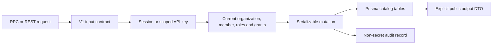

# RAG catalog router

`@routers/rag` implements the V1 catalog contracts in `packages/api-contracts/src/v1/rag/`. `src/index.ts` composes one handler per endpoint. `packages/api/src/index.ts` mounts it below `admin.rag`; `apps/api` provides authenticated HTTP transport at `/rpc/v1` and `/api/v1`.

The public API currently covers credentials, groups, collection configuration and grants, document upload/inspection, associations and lifecycle operations, platform connection references, quotas, and audit. The [catalog dashboard](../../../docs/rag-dashboard.md) exposes configuration, access, quota, and audit workflows. Bounded revision history and principal candidates support these screens; candidates require a session and the corresponding grant/group management permission. The `@routers/rag/quotas` export shares effective quota resolution with superadmin. The [document library](../../../docs/rag-document-library.md) adds private TXT/Markdown upload, extraction, preview, original download and collection links. The [document lifecycle](../../../docs/rag-document-lifecycle.md) adds replacement, deletion, retained version metadata and cleanup/retry in compatible revision `1.5.0`; M2a.2 is implemented and browser-verified. Embedding calls, vector tables and search remain planned.

## Integration entry points

- `@routers/rag/access`: `ragActor` resolves current membership and key issuer permissions. `requireCollection` enforces a scoped collection grant; `documentWhere` expresses library access before pagination. Callers must check the corresponding global operation permission as well as the collection action. An identifier alone never grants access.
- `@routers/rag/credentials`: `resolveCredential` resolves a complete active organization configuration, falling back to the environment only when no organization credential exists for that provider. `resolveCollectionCredential` follows the binding stored in a specific immutable revision; later selection changes do not retarget it. It accepts secret rotation at the same destination and rejects destination changes. These helpers are server-only and return secrets: never serialize or log their results.
- `@routers/rag/api-key-scopes`: validates delegated scopes and binds newly issued keys to the current member. Existing keys without a binding must be replaced. Native key creation remains in the organization router; binding failure removes the newly created key before its secret can be returned.
- `@routers/rag/ingestion`: `processDocumentIngestions` is the worker scan entry point. PostgreSQL stores task claims, fenced leases, retries and reservations; Redis only schedules scans. `services/documents/` shares scoped upload, storage binding, extraction, preview/download and association logic with the API.
- `@routers/rag/cleanup`: `processDocumentCleanups` claims durable version cleanup, follows saved original/extraction storage bindings, and releases bytes only after successful deletion. The existing document worker schedules ingestion then cleanup every five seconds. Cleanup survives requester removal and organization suspension after authorization.
- `src/services/documents/replace.ts`, `delete.ts`, `lifecycle.ts` and `retention.ts`: current manager authorization, expected-version checks, retained history/deleted listing, retention scheduling and transactional audit. `ingestion-state.ts` preserves the published READY version during replacement and fences publication against newer attempts or tombstones.
- `src/services/mutation.ts`: serializable catalog mutation boundary, current access checks, conflict mapping, and transactional audit. Retryable callbacks must not make outbound calls.
- `src/services/quotas.ts`: deployment defaults, organization overrides, and retained object usage. Upload reservations count originals plus extraction capacity before S3 I/O; retries reuse existing reservations. Chunk accounting remains planned.

Collections use a platform connection created on first collection creation. Connection listing exposes only the resulting reference, not database URLs or provisioning credentials. Document metadata contains no object keys or storage credentials. Collection deletion retains shared documents and historical revisions; document deletion immediately removes its associations and content access, then durable cleanup honors retention and I/O safety deadlines. Archived version metadata deliberately retains storage and credential references after object purge. Replacement/deletion accept 0–365 days counted from the request, defaulting to seven/zero respectively. There is no restore operation.

See [catalog and access](../../../docs/rag-catalog-access.md) for schema, permission rules, and configuration; [implementation plan](../../../docs/rag-implementation-plan.md) for later work; and [the isolated test runner](../../../scripts/test-catalog.sh) for migration and authorization validation. Embedding-provider tests use synthetic credentials and make no live model calls. Document tests use real disposable RustFS and binary HTTP transports.

## Embedding provider catalog

Credential and collection contracts accept Ollama, Cohere, Voyage, OpenAI, and Mistral. OpenAI/Mistral each store a required encrypted API key and an explicit API base endpoint in their provider-specific child table. Apply `20261023000000_openai_mistral_credentials` before running the updated application. `credential-data.ts` masks and encrypts/decrypts them; `credential-update.ts` preserves omitted keys during updates. The existing resolver uses `VECTORIX_DEFAULT_OPENAI_{ENDPOINT,API_KEY}` or `VECTORIX_DEFAULT_MISTRAL_{ENDPOINT,API_KEY}` only when organization configuration is absent.

The dashboard exposes both in integration and collection-profile selectors. This is catalog configuration support; native embedding execution, model capability checks, and indexing remain planned. `apps/api/src/rag-tests/embedding-providers.ts` covers real database/HTTP persistence, masking, rotation, organization isolation, saved bindings, and failure without fallback using synthetic credentials.
