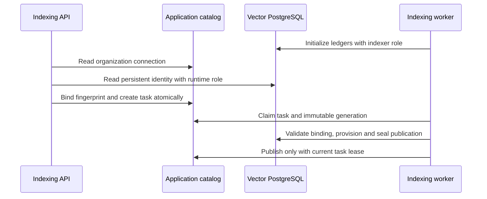

# PostgreSQL vector store adapter

This package owns vector-database SQL, generated collection tables, destination identity and publication fencing. It is a technical part of the M3 implementation; it does not complete the dashboard indexing/search milestone. The adapter stores no authoritative document text. Its integration tests create and remove an isolated vector PostgreSQL container and anonymous volume without reading `.env`.

## Integration boundary

Dependencies: `pg` only. Node 24, PostgreSQL 18.6, pgvector 0.8.7 and pgvectorscale 0.9.1. Current executable profiles are cosine/float32, matching today's public collection contract. HNSW accepts at most 2,000 dimensions; DiskANN accepts at most 16,000 (the pgvector storage limit), with actual 16,000-dimensional provisioning/insertion/query exercised. Other numeric types and metrics fail explicitly; catalog acceptance must not imply execution support.

```ts
import { VectorStore, manifestHash } from './src/index.ts';

// Workers may initialize/provision with the indexer connection.
const workerStore = new VectorStore({ runtimeUrl, provisioningUrl, schema });
const destinationFingerprint = await workerStore.initialize();
// Save this fingerprint in the immutable generation catalog row.
const generation = {
    id,
    organizationId,
    collectionId,
    dimensions: 768,
    metric: 'cosine',
    numericType: 'float32',
    indexType: 'DISKANN',
    destinationFingerprint,
} as const;
await workerStore.provision(generation);
const publication = {
    id: publicationId,
    documentId,
    sourceVersionId,
    expectedCount: rows.length,
    manifestHash: manifestHash(rows),
};
const stage = await workerStore.open(generation, publication, taskEpoch);
if (stage.state === 'OPEN') {
    // Batches of at most 128 vectors, identifiers and hashes only; no source text.
    for (let offset = 0; offset < rows.length; offset += 128) {
        await workerStore.write(
            generation,
            publication,
            taskEpoch,
            rows.slice(offset, offset + 128)
        );
    }
}
const seal = await workerStore.seal(generation, publication, taskEpoch);
// Only now may a current lease-fenced app transaction publish this candidate.
await workerStore.analyze(generation); // after initial bulk load / significant changes

// API runtime needs no provisioning URL and performs no DDL at initialization.
const apiStore = new VectorStore({ runtimeUrl, schema });
await apiStore.initialize();
const { hits, underfilled } = await apiStore.search(generation, {
    vector: queryVector,
    allowedPublicationIds,
    limit: 100,
    mode: 'ann',
});
// Hydrate authoritative chunks and recheck current app authorization/manifests.
```

`rows` contains `{ chunkId, ordinal, chunkHash, vector }`; ordinals must be contiguous `0..count-1`. `manifestHash` hashes the canonical sorted chunk IDs/ordinals/source hashes. The publication fixes its source version, document, count and manifest. Same-epoch batch replay succeeds only for identical immutable values, including the rounded float32 vector hash. A newer task epoch resets an unsealed partial stage; old epochs cannot write. A sealed stage may be adopted after a worker crashes before application publication, but cannot be changed. The application's task epoch **must be monotone per publication** (one durable deduplicated task), and model identity/input preparation remain immutable generation metadata.

## Isolation, publication and cleanup

One generated physical table `g_<uuid without hyphens>` per generation stores only vector rows and provenance identifiers. A small shared `vx_identity`, `vx_generations` and `vx_publications` ledger records immutable shape, database identity, epochs, seals and permanent tombstones. The indexer owns DDL in the dedicated schema; runtime has DML only. Startup explicitly rejects an administrative runtime/provisioner role and a runtime role that can create schema objects. Existing bootstrap/default grants are operator prerequisites; the adapter creates no roles or extensions.

The destination fingerprint includes normalized host/port/database/schema/TLS mode plus a persistent random identity in the vector database. It excludes usernames/passwords so credential rotation does not move a generation. Both connection targets must agree. A fresh database at an old URL has a different identity and fails an existing generation binding. Runtime-only initialization reads the existing identity. Full vector-database loss therefore requires explicit generation rebuild/rebinding in application orchestration; it cannot silently redirect old generations.

Each write holds a generation shared lock then a publication update lock. Generation creation/drop also serializes under a transaction advisory lock so cleanup can create a tombstone **before** delayed provisioning. Publication cleanup takes the same publication lock, tombstones and deletes rows atomically. Generation cleanup tombstones, marks all publications and drops the dynamic table in one transaction. Keep ledger tombstones; deleting them would allow stale workers to recreate resources. Application authorization, active pointers, quotas, task leases, source holds and outbox catch-up are outside this adapter.

## Retrieval and filtering

The app catalog derives authorized publication IDs after document/language/date/media/custom-metadata filtering; pass that same whitelist to both lexical and vector branches. For any truly chunk-level filter, `allowedChunkIds` is an additional bounded whitelist. The adapter first locks matching SEALED publication rows, then applies whitelist predicates **inside SQL before distance ordering and LIMIT**. No post-topK application filter can replace this restriction. Publication shared locks hold sealing/deletion stable until the bounded vector query finishes; hydration still rechecks current app state.

Exact mode materializes the eligible rows before distance ordering, so no ANN index can consume candidates from outside the whitelist. ANN mode allows the optimizer to choose the native index, uses HNSW strict iterative scans or DiskANN search/rescore settings, and retries with bounded candidate budgets (256, 1,024, 4,096). The default SQL query budget is 3 seconds; the hard maximum is 10 seconds. Pool acquisition has a separate 5-second connection/queue bound, so end-to-end latency must include both. `underfilled` means fewer than the requested candidates were returned; it does not prove the corpus has no other matches or establish recall. SQL always filters first, but ANN remains approximate. Small/selective subsets may be faster as exact scans; use production corpus evaluation to choose the policy.

Refresh planner statistics after bulk load: without `ANALYZE`, PostgreSQL estimated a fresh publication filter at only nine rows and chose a B-tree plus sort. The isolated test now verifies actual HNSW and DiskANN ANN plans after analysis. No representative 100,000-chunk or concurrency/recall benchmark is claimed here. Lexical FR/EN/simple FTS, RRF and authoritative chunk text stay in the application database.

## Tests and remaining integration work

```sh
pnpm --filter @repo/vector-store test:native
pnpm --filter @repo/vector-store check-types
```

The test enforces `_test` database naming and uses the project's already built vector image. It covers real password-authenticated roles, runtime-only startup, destination drift, idempotent shape verification, exact/ANN filtered topK with 400 closer obsolete vectors, chunk filters, unsealed invisibility, sealed adoption, epoch fencing, manifest completeness, real publication/generation lock contention, permanent pre-create tombstones, input validation, schema drift and native 16,000-dimensional DiskANN. All containers/anonymous volumes are removed by its trap.

Application schema, durable orchestration, lexical FTS/RRF, access checks and dashboard/Ollama acceptance are integrated separately. `packages/routers/rag/src/services/indexing/generation-adapter.ts` binds this package to organization-scoped catalog connections and immutable generations. The test runner accepts an explicit `VECTOR_POSTGRES_IMAGE` override so the global container suite can supply its already tested image; otherwise it uses the local infrastructure image. It never builds, migrates or connects to an application database. The prototype error boundary returns safe `VectorStoreError` codes and never driver messages/connection strings. Do not log a raw `pg` error outside that boundary.

Primary references: [pgvector 0.8.7 indexing/filtering](https://github.com/pgvector/pgvector/blob/v0.8.7/README.md), [pgvectorscale 0.9.1 filtering/query parameters](https://github.com/timescale/pgvectorscale/blob/0.9.1/README.md). Limits were verified against the pinned local image, not inferred from a public catalog label.

## Catalog integration

`prepareVectorDestination()` and `generationVectorAdapter()` accept the full application client and perform vector-network I/O **outside** application transactions. `bindVectorDestination()` performs only the compare-and-set catalog update inside the caller's short transaction. The shared ledger is initialized lazily by an indexing worker; missing vector settings must not stop notification or extraction processors. Runtime initialization only reads identity and role boundaries. A successful provisioning initialization is reused by that worker pool, while runtime identity is checked again on each adapter binding.



The bridge never reads `.env` itself, accepts no user-provided connection strings and does not log configuration. Its internal pool cache uses a SHA-256 key rather than raw credentials. `closeVectorAdapters()` closes cached pools during graceful shutdown and isolated test teardown. TLS mode is part of destination identity; URL `sslmode` takes precedence over the process `PGSSLMODE`, with `disable` as the local driver's default. Credential rotation does not change physical identity.
